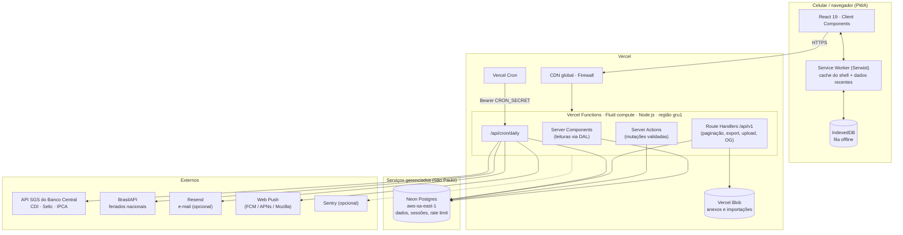
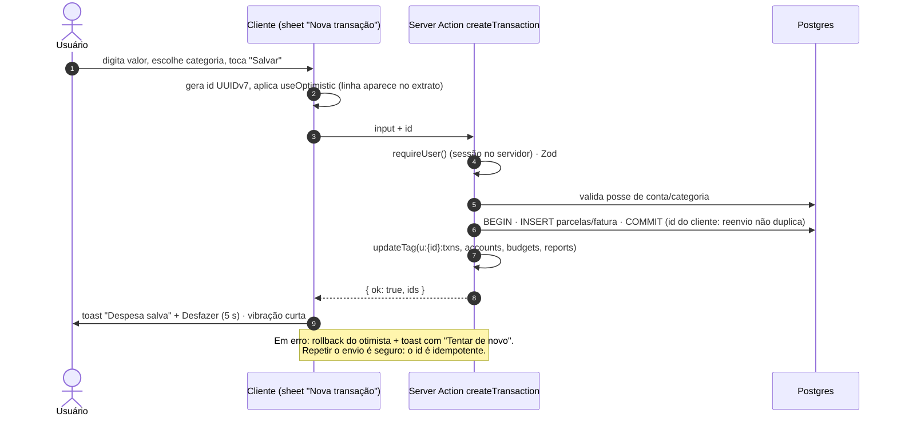
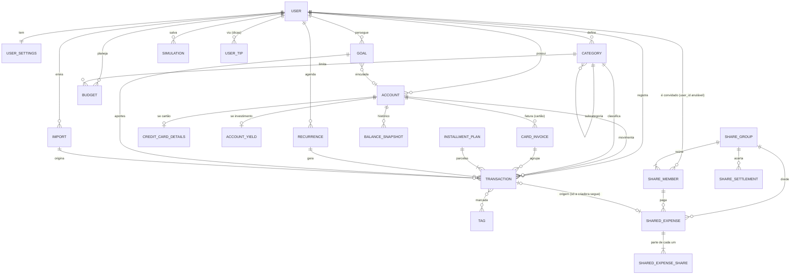

# 01 · System design — Meu Finan

> Controle financeiro pessoal, mobile-first, com projeção de juros compostos, orçamentos, metas e relatórios. Backend e frontend hospedados na Vercel. Uso pessoal ou familiar: **a primeira conta (a do dono) administra e convida as outras**; cada conta tem as próprias finanças, e a autenticação é obrigatória.

**Sumário**

1. [Visão do produto](#1-visão-do-produto)
2. [Requisitos](#2-requisitos)
3. [Arquitetura](#3-arquitetura)
4. [Stack](#4-stack)
5. [Estrutura do projeto](#5-estrutura-do-projeto)
6. [Modelo de dados](#6-modelo-de-dados)
7. [Camada de aplicação e API](#7-camada-de-aplicação-e-api)
8. [Cache e invalidação](#8-cache-e-invalidação)
9. [Jobs agendados (Vercel Cron)](#9-jobs-agendados-vercel-cron)
10. [Integrações externas](#10-integrações-externas)
11. [Autenticação e contas](#11-autenticação-e-contas)
12. [Performance](#12-performance)
13. [Observabilidade](#13-observabilidade)
14. [Ambientes, CI/CD e migrações](#14-ambientes-cicd-e-migrações)
15. [Custos](#15-custos)
16. [Roadmap](#16-roadmap)
17. [Decisões de arquitetura (ADRs)](#17-decisões-de-arquitetura-adrs)
18. [Riscos e mitigações](#18-riscos-e-mitigações)

---

## 1. Visão do produto

**Problema.** Planilhas são trabalhosas no celular e apps de banco mostram só um banco. A pessoa quer saber, em segundos, *quanto tem*, *para onde o dinheiro está indo*, *se vai fechar o mês no azul* e *quanto o dinheiro guardado pode render*.

**Promessa.** Registrar um gasto em menos de 5 segundos, ver o mês inteiro em uma tela e planejar o futuro com projeções honestas (com IR e inflação).

**Público.** O dono do app e, se ele quiser, pessoas que ele convida (família), no Brasil (BRL, `pt-BR`, fuso `America/Sao_Paulo`), uso majoritário no celular, frequentemente com uma mão. Não há cadastro público: a primeira conta é criada uma única vez pelo dono (§11.1) e as outras só entram por convite de um administrador (§11.9). Cada conta tem as próprias finanças, isoladas das demais.

**Objetivos mensuráveis**

| Objetivo | Métrica | Meta |
|---|---|---|
| Registro rápido | Tempo da abertura do "+" até salvar (p50) | ≤ 5 s |
| Hábito | Dias da semana com pelo menos um registro (medido no próprio banco) | ≥ 3 dias/semana |
| Proteção | Páginas, actions e rotas que devolvem dados sem sessão | nenhuma (teste de acesso no CI) |
| Clareza | Tarefas "quanto gastei com X?" resolvidas sem ajuda em teste de usabilidade | ≥ 90% |
| Velocidade | LCP p75 (4G, celular intermediário) | ≤ 2,0 s |
| Responsividade | INP p75 | ≤ 200 ms |

**Fora de escopo na v1**: conexão automática com bancos (Open Finance — fase 4), múltiplas moedas com conversão (o campo existe, só BRL é suportado), finanças compartilhadas entre pessoas (cada conta é individual; não há contas ou orçamentos em conjunto), app nativo (o PWA cobre instalação, push e atalhos).

---

## 2. Requisitos

### 2.1 Funcionais

| ID | Módulo | Requisito |
|---|---|---|
| RF-01 | Acesso | Configuração única da primeira conta, a administradora (`/primeiro-acesso`); demais contas por convite (`/convite/[token]`); login por passkey e por e-mail + senha forte; sessões revogáveis; recuperação de emergência do dono (`/recuperar`); 2FA TOTP na F1. Sem cadastro público (§11) |
| RF-02 | Onboarding | Criar primeira conta com saldo atual, escolher categorias sugeridas, definir dia de início do mês financeiro |
| RF-03 | Contas | CRUD de contas (corrente, poupança, dinheiro, investimento, cartão de crédito, outra); arquivar; ajustar saldo (gera lançamento de ajuste); ordenar |
| RF-04 | Lançamentos | Receita, despesa e transferência; status pago/pendente; data; categoria/subcategoria; tags; notas; anexo (comprovante) |
| RF-05 | Parcelamento | Compra parcelada em 2–72x, com distribuição de centavos e alocação automática nas faturas |
| RF-06 | Recorrência | Lançamentos que se repetem (diário, semanal, mensal, anual, com intervalo); editar "só este", "este e próximos" ou "todos" |
| RF-07 | Cartão de crédito | Limite, dia de fechamento e vencimento, faturas por mês, status (aberta/fechada/paga/vencida), pagamento total/parcial, melhor dia de compra, limite comprometido com parcelas futuras |
| RF-08 | Extrato | Lista agrupada por dia, busca textual tolerante a acentos, filtros (período, conta, categoria, tipo, status, tag), seleção múltipla e ações em lote |
| RF-09 | Orçamentos | Valor mensal por categoria, ritmo de gasto (pace), "pode gastar por dia", copiar do mês anterior, rollover opcional |
| RF-10 | Metas | Valor-alvo, prazo, conta vinculada, aporte planejado, rentabilidade esperada; projeção de data de conclusão e aporte necessário |
| RF-11 | Simulador | Juros compostos com valor inicial, aporte mensal (com reajuste anual), taxa (a.m., a.a., % do CDI, IPCA+), prazo, IR regressivo, inflação; modos "quanto terei", "quanto investir", "em quanto tempo"; comparar até 3 cenários; salvar e compartilhar |
| RF-12 | Relatórios | Visão geral (receitas × despesas, taxa de poupança), por categoria (com drill-down), fluxo de caixa com projeção, patrimônio líquido, calendário de gastos; regime de competência ou caixa; exportar CSV/PDF |
| RF-13 | Importação | Upload de OFX/CSV, pré-visualização, deduplicação, categorização sugerida por regras aprendidas |
| RF-14 | Notificações | Via Web Push, uma vez por dia pelo cron: Resumo do dia, Contas a vencer, Vencimento em dia não útil (flag `alerta_dia_nao_util`, 12/11/2026), Próxima receita, Resumo semanal e Resumo mensal, cada um ligado ou desligado pela pessoa (05/11/2026). Depois: fatura fechando, orçamento a 80%/100%, meta atingida (resumo por e-mail opcional, em fase posterior) |
| RF-15 | Insights | Cartões de observação automáticos (ex.: gasto atípico em uma categoria) |
| RF-16 | Privacidade e dados | Modo discreto (oculta valores), exportar todos os dados (backup), apagar todos os dados (recomeçar do zero) |
| RF-17 | Ajustes | Categorias (criar, editar, mesclar, reordenar), tema, dia de início do mês, notificações, segurança (passkeys, senha, sessões) |
| RF-18 | Administração | Só administradores: convidar pessoas, desativar e reativar, encerrar sessões, mudar o papel, gerar link de redefinição, excluir conta com todos os dados; atividade (auditoria); feature flags globais e por pessoa (§11.9, §11.10). O painel nunca mostra as finanças de outra pessoa (um link de redefinição abre só a conta para a qual foi gerado, §11.9) |

### 2.2 Não funcionais

| Atributo | Requisito |
|---|---|
| Plataforma | Web responsiva mobile-first; PWA instalável (Android/iOS/desktop) |
| Performance | LCP ≤ 2,0 s, INP ≤ 200 ms, CLS ≤ 0,05 (p75); JS inicial da rota `/inicio` ≤ 170 KB gz |
| Disponibilidade | Herdada da Vercel e da Neon; degradação graciosa (offline mostra últimos dados) |
| Consistência | Saldos e totais sempre derivados do ledger (fonte única da verdade); operações multi-linha atômicas, numa transação de banco (`db.transaction`) |
| Durabilidade | Dado apagado ou corrompido por engano tem volta: soft delete com Desfazer, restauração pontual da Neon e backup semanal criptografado fora da Neon (§11.7) |
| Precisão | Valores monetários em centavos inteiros; nenhum `float` persiste dinheiro |
| Segurança | OWASP ASVS nível 2 como referência; sessão verificada no servidor em toda página, action e rota; checagem de posse (`user_id`) em todas as consultas; rate limiting nas rotas de autenticação |
| Privacidade | Minimização (sem CPF), backup exportável, apagar todos os dados, logs sem PII (§11.8) |
| Acessibilidade | WCAG 2.2 AA |
| Localização | `pt-BR` primeiro; textos em catálogo para permitir outros idiomas |
| Custo | R$ 0/mês: tudo dentro dos planos gratuitos (§15) |

---

## 3. Arquitetura

### 3.1 Visão geral

Aplicação **monolítica modular** em Next.js: o mesmo deploy entrega páginas (React Server Components), mutações (Server Actions), endpoints HTTP (Route Handlers), imagens dinâmicas e jobs agendados. Dados em Postgres gerenciado, colocalizado na mesma região das funções.



### 3.2 Por que essa forma

- **Um deploy só**: front e back no mesmo projeto Vercel, tipos compartilhados de ponta a ponta, preview por PR com banco próprio (branch da Neon, sempre protegido — §11.6).
- **RSC para leitura**: as telas chegam renderizadas com dados, sem cascata de requisições no celular; menos JavaScript no cliente.
- **Server Actions para escrita**: validação (Zod) e autorização no servidor, sem API REST interna para manter.
- **Route Handlers só quando há motivo**: paginação incremental chamada pelo cliente, arquivos (CSV/PDF/upload), cron, webhooks, imagens OG.
- **Colocalização**: funções em `gru1` (São Paulo) + Postgres em `aws-sa-east-1` → latência de banco de ~1–3 ms por consulta. Para quem usa o app no Brasil, isso vale mais do que funções na borda.

### 3.3 Fluxo de leitura (ex.: abrir o Início)

1. `proxy.ts` (antigo `middleware.ts`) faz só uma checagem otimista do cookie de sessão e redireciona para `/entrar` se não houver.
2. A página `/inicio` é um Server Component; o **shell** (cabeçalho, navegação) é estático e sai imediatamente; cada card é um componente assíncrono dentro de `<Suspense>` com skeleton próprio — saldo, orçamento e próximas contas fazem streaming independente. Com Cache Components, ler a sessão fora de `<Suspense>` é erro de build, então nem o layout nem a página esperam a sessão no topo.
3. Cada card chama `requireUser()` do **DAL** (`server/dal`) — a checagem real da sessão, no servidor — e as queries com o `userId` no Postgres (com cache por tag, ver §8).

### 3.4 Fluxo de escrita (ex.: nova despesa)



---

## 4. Stack

| Camada | Escolha | Observações |
|---|---|---|
| Framework | **Next.js 16.4** (App Router, Turbopack, React 19.3) | `proxy.ts` no lugar de `middleware.ts`; **Cache Components ligado** (`cacheComponents: true`, como o `create-next-app` 16.4 gera) e `partialPrefetching`: sessão lida só dentro de `<Suspense>`, `'use cache'`, `'use cache: private'`, `cacheTag`, `updateTag`. Confirme as APIs nos guias de `node_modules/next/dist/docs/` |
| Linguagem | TypeScript `strict` | `noUncheckedIndexedAccess` ligado |
| Estilo | **Tailwind CSS v4** via `@tailwindcss/turbopack` (sem PostCSS) | tokens via `@theme` em CSS (ver doc 02) |
| Componentes | **shadcn/ui** (primitivas Radix) | código copiado para o repo e adaptado aos tokens |
| Sheets/drawers | Sheet próprio sobre o Dialog do Radix + Motion | arrastar para fechar no celular, diálogo centralizado a partir de `md`; o voltar do navegador fecha a folha do topo |
| Animação | **Motion** (`motion/react`) | sempre respeitando `prefers-reduced-motion` |
| Gráficos | SVG/HTML próprios (`src/components/charts`) | colunas, linha, área empilhada com scrub, sparkline e anéis; cada gráfico tem visão em tabela |
| Formulários | Estado local do React + **Zod 4** | o schema da Server Action valida no servidor; o cliente só dá retorno imediato |
| Server Actions | **next-safe-action** | middleware de auth (sessão verificada em toda action) e erros padronizados |
| Estado de URL | **nuqs** | filtros e mês ativo na URL (voltar do navegador funciona, links compartilháveis) |
| Dados no cliente | Server Components + Server Actions com `refresh()` | sem cache de dados no cliente; autocomplete por Server Action |
| Estado de UI | **Zustand** (com `persist`) | modo discreto, rascunho do lançamento, preferências locais |
| Datas | motor próprio (`src/lib/finance/dates`) + `@date-fns/tz` | datas locais sem hora; o fuso do usuário só entra para saber que dia é hoje |
| ORM | **Drizzle ORM** + drizzle-kit | dois drivers atrás da mesma API: **Neon WebSocket Pool** (`drizzle-orm/neon-serverless`, com `attachDatabasePool` da Vercel) quando há `DATABASE_URL`, e **PGlite** embutido (`drizzle-orm/pglite`) no desenvolvimento local e nos testes; ambos com transações interativas (`db.transaction`) |
| Banco | **Neon Postgres** (Vercel Marketplace) | `aws-sa-east-1`; extensões `pg_trgm`, `unaccent` |
| Auth | **Better Auth** | plugin de passkey (`@better-auth/passkey`), plugin admin (papéis e desativação, rotas HTTP desligadas, §11.9), `twoFactor` na F1; adapter Drizzle; hooks que fecham o cadastro após o primeiro acesso |
| Rate limit | limitador embutido do **Better Auth** (`storage: 'database'`) | sem Redis; regras estritas em login, primeiro acesso e recuperação |
| Arquivos | **Vercel Blob** | upload direto do cliente (evita limite de 4,5 MB de corpo das funções) |
| E-mail | **Resend** + React Email — opcional, fase posterior | resumo semanal e alertas; o login não depende de e-mail |
| PWA | **Serwist** (`@serwist/next`) + `web-push` | manifest via `app/manifest.ts` |
| Imagens dinâmicas | `next/og` (`ImageResponse`) | cartão de compartilhamento da simulação |
| PDF | `@react-pdf/renderer` | relatórios exportados (runtime Node) |
| Parsers | papaparse (CSV) + parser OFX próprio (SGML 1.x e XML 2.x) | |
| Observabilidade | Vercel Observability, Speed Insights; **Sentry** opcional, em fase posterior | métricas de hábito saem do próprio banco (§13) |
| Qualidade | Biome (lint/format), **Vitest 5** + Testing Library, fast-check, **Playwright** | e2e em viewports de iPhone e Pixel |
| Pacotes | **npm** | Node.js 24 |

---

## 5. Estrutura do projeto

Organização **por feature** (cada domínio tem suas actions, queries, schemas e componentes) e um núcleo financeiro **puro** (sem I/O), testado à exaustão.

```
meu-finan/
├─ src/
│  ├─ app/
│  │  ├─ page.tsx                             # "/" → redireciona para /inicio (sem landing pública)
│  │  ├─ (auth)/                              # as únicas páginas sem sessão
│  │  │  ├─ entrar/page.tsx
│  │  │  ├─ primeiro-acesso/page.tsx          # configuração única do dono (SETUP_TOKEN)
│  │  │  ├─ recuperar/page.tsx                # emergência, só com RECOVERY_TOKEN
│  │  │  └─ convite/[token]/page.tsx          # convite ou link de redefinição (§11.9)
│  │  ├─ (app)/
│  │  │  ├─ layout.tsx                        # AppShell: TopBar, BottomNav/Sidebar, QuickAdd
│  │  │  ├─ @modal/(.)extrato/[id]/page.tsx   # detalhe em sheet (intercepting route)
│  │  │  ├─ inicio/page.tsx
│  │  │  ├─ extrato/page.tsx
│  │  │  ├─ extrato/[id]/page.tsx
│  │  │  ├─ contas/page.tsx · contas/[id]/page.tsx
│  │  │  ├─ cartoes/[id]/page.tsx · cartoes/[id]/faturas/[mes]/page.tsx
│  │  │  ├─ planejar/orcamentos/page.tsx
│  │  │  ├─ planejar/metas/page.tsx · planejar/metas/[id]/page.tsx
│  │  │  ├─ planejar/simulador/page.tsx
│  │  │  ├─ relatorios/[visao]/page.tsx       # visao-geral | categorias | fluxo | patrimonio | calendario
│  │  │  ├─ importar/page.tsx                 # atrás da flag importar_extrato (§11.10)
│  │  │  ├─ ajustes/…                         # inclui ajustes/novidades
│  │  │  └─ admin/{usuarios,flags,atividade}  # só administradores (§11.9)
│  │  ├─ onboarding/page.tsx
│  │  ├─ api/
│  │  │  ├─ auth/[...all]/route.ts            # Better Auth
│  │  │  ├─ v1/transactions/route.ts          # GET paginado (keyset)
│  │  │  ├─ v1/transactions/suggest/route.ts  # autocomplete de descrição
│  │  │  ├─ v1/reports/[visao]/route.ts
│  │  │  ├─ v1/export/route.ts                # CSV | PDF
│  │  │  ├─ v1/blob/upload/route.ts           # token de upload do Vercel Blob
│  │  │  ├─ v1/attachments/[id]/route.ts      # download autorizado
│  │  │  ├─ og/simulacao/route.tsx            # ImageResponse 1200×630
│  │  │  └─ cron/daily/route.ts
│  │  ├─ manifest.ts · icon.tsx · apple-icon.tsx · sw.ts
│  │  └─ globals.css                          # tokens (doc 02)
│  ├─ components/
│  │  ├─ ui/            # shadcn adaptado (button, sheet, dialog, input, …)
│  │  ├─ app/           # AppShell, BottomNav, TopBar, MonthSwitcher, PrivacyToggle
│  │  ├─ money/         # Money, MoneyInput, Keypad
│  │  └─ charts/        # ChartCard, Sparkline, Ring, BarsIncomeExpense, RankedBars, …
│  ├─ features/
│  │  ├─ transactions/  { actions.ts, queries.ts, schema.ts, components/, hooks/ }
│  │  ├─ accounts/ · cards/ · categories/ · budgets/ · goals/
│  │  ├─ simulator/ · reports/ · imports/ · insights/ · notifications/ · settings/
│  ├─ server/
│  │  ├─ auth.ts        # instância Better Auth (passkey, hooks do primeiro acesso, rate limit em banco)
│  │  ├─ dal.ts         # getSession, requireUser, requireAdmin (React cache)
│  │  ├─ safe-action.ts # cliente next-safe-action + middlewares
│  │  ├─ db/            { client.ts, schema/*.ts, seed-defaults.ts }
│  │  ├─ cache-tags.ts
│  │  └─ jobs/          # passos do cron diário (idempotentes)
│  ├─ lib/
│  │  ├─ finance/       # PURO: money, rates, compound, tax, solve, installments,
│  │  │                 #       invoices, recurrence, period, budget-pace, forecast, goals
│  │  ├─ format/        # moeda, datas, percentuais, compacto
│  │  ├─ flags/         # registro das feature flags e a resolução (§11.10)
│  │  ├─ tips/          # registro das dicas e novidades e a seleção por tela (doc 02 §6.16)
│  │  ├─ admin/         # papéis, regras da administração e frases da Atividade
│  │  ├─ theme.ts       # tema (escuro por padrão) e quando o aparelho adota o tema da conta
│  │  ├─ auth-client.ts # cliente Better Auth (React) com plugin de passkey
│  │  └─ utils.ts
│  └─ proxy.ts
├─ drizzle/             # migrações SQL geradas
├─ scripts/seed.ts      # npm run db:seed
├─ tests/e2e/           # Playwright
├─ .github/workflows/   # CI e backup semanal (F1)
├─ vercel.json
└─ drizzle.config.ts
```

Regras de dependência: `app → features → server/lib`; `lib/finance` não importa nada do projeto (só funções puras); componentes de `features` não acessam o banco — só via actions/queries da própria feature.

---

## 6. Modelo de dados

### 6.1 Convenções

| Tema | Decisão |
|---|---|
| IDs | `uuid` v7 (ordenável no tempo → índices mais compactos); gerado na aplicação, inclusive no cliente para idempotência |
| Dinheiro | `bigint` em **centavos** (`amount_cents`). Nunca `numeric`/`float` para valores de lançamento |
| Sinal | **Ledger com sinal por conta**: entrada na conta `> 0`, saída `< 0`. Saldo = saldo inicial + Σ lançamentos efetivados |
| Transferência | Duas linhas (`kind = 'transfer'`) ligadas por `transfer_id`: saída na origem, entrada no destino. Não entram em relatórios de receitas/despesas |
| Cartão de crédito | É uma conta (`type = 'credit_card'`). Compras são despesas negativas na conta-cartão com `invoice_id`. Pagar a fatura = transferência da conta corrente para o cartão |
| Caixinha | É uma conta (`type = 'savings_box'`, ícone `vault`): entra no patrimônio, mas **não é dinheiro para gastar**. A regra é uma só, `isSpendableAccount` (`src/lib/finance/spendable.ts`): tipo fora de `NON_SPENDABLE_ACCOUNT_TYPES` (cartão e caixinha), `include_in_net_worth` e não arquivada. Saldo em contas, variação do mês, previsto, Fluxo de caixa e os avisos Resumo do dia e Próxima receita leem essa regra (`spendableAccountsOf`, uma leitura por requisição); nenhuma consulta repete a lista de tipos em SQL. Guardar e resgatar são transferências (ADR-04) |
| Estorno | Despesa com valor positivo (reduz o total da categoria); `kind` continua `expense` |
| Datas | `occurred_on date` (data local do usuário, sem hora); `created_at/updated_at timestamptz` |
| Exclusão | Soft delete (`deleted_at`) para permitir "Desfazer"; expurgo definitivo após 30 dias pelo cron |
| Dono (`user_id`) | `user_id` em todas as tabelas de domínio: é a fronteira entre as contas (cada pessoa só vê as próprias finanças, §11), com consultas uniformes e checagem de posse barata. Todo índice começa por `user_id` (ou por uma FK já escopada). Não há outra camada de isolamento entre pessoas (sem políticas de banco por usuário): toda consulta filtra pelo `user_id` da sessão e confere a posse de cada id recebido As únicas exceções são as tabelas compartilhadas (`share_*` e `shared_*`, §11.11): pertencem a um grupo e só os membros ativos o leem. |
| Taxas | `numeric` com escala explícita (índices, percentuais), nunca `float` no banco |

### 6.2 Diagrama entidade-relacionamento



### 6.3 DDL de referência (PostgreSQL 16+)

> As tabelas de autenticação seguem os modelos do Better Auth e ficam no schema Drizzle (`src/server/db/schema/auth.ts`): `user`, `session`, `account` (credencial de senha), `verification`, `passkey`, `rateLimit` (contadores do limitador, com storage em banco) e, na F1, a do 2FA (`twoFactor`). Para não colidir com a tabela `account` dele, as contas financeiras se chamam `fin_accounts`.

```sql
create extension if not exists pg_trgm;
create extension if not exists unaccent;

-- unaccent não é IMMUTABLE; wrapper para poder indexar
create or replace function f_unaccent(text) returns text
  language sql immutable parallel safe strict
  as $$ select public.unaccent('public.unaccent'::regdictionary, $1) $$;

create type fin_account_type as enum ('checking','savings','cash','investment','credit_card','other','savings_box');
-- 'savings_box' (Caixinha) entrou na migração 0008_caixinha, só com o ADD VALUE:
-- o valor novo não pode ser usado na mesma transação em que nasce.
create type txn_kind        as enum ('income','expense','transfer','adjustment');
create type txn_status      as enum ('pending','paid');
create type category_kind   as enum ('income','expense');
create type rate_index      as enum ('fixed','cdi','selic','ipca');
create type recurrence_freq as enum ('daily','weekly','monthly','yearly');
create type import_status   as enum ('uploaded','parsed','review','done','failed');

-- Preferências -------------------------------------------------------------
create table user_settings (
  user_id              text primary key references "user"(id) on delete cascade,
  currency             char(3)  not null default 'BRL',
  locale               text     not null default 'pt-BR',
  timezone             text     not null default 'America/Sao_Paulo',
  month_start_day      smallint not null default 1 check (month_start_day between 1 and 28),
  theme                text     not null default 'dark' check (theme in ('system','light','dark')),  -- escuro por padrão; salvo ao trocar o tema
  privacy_mode_default boolean  not null default false,
  report_basis         text     not null default 'accrual' check (report_basis in ('accrual','cash')),
  onboarding_done_at   timestamptz,
  home_layout          jsonb check (home_layout is null or jsonb_typeof(home_layout) = 'array'),
                       -- blocos do Início escolhidos (doc 02 §6.3): [{ id, visible }], sem o Saldo; null = padrão do app
  notification_prefs   jsonb check (notification_prefs is null or jsonb_typeof(notification_prefs) = 'object'),
                       -- avisos do cron (doc 02 §6.14): { events: { daily_summary, bills_due, non_business_due,
                       -- income_countdown, weekly_summary, monthly_summary }, billsLeadDays: 0|1|3, showAmounts }; null = padrão;
                       -- lido campo a campo (campo ausente ou inválido e evento novo ficam no padrão)
  created_at           timestamptz not null default now(),
  updated_at           timestamptz not null default now()
);

-- Contas -------------------------------------------------------------------
create table fin_accounts (
  id                    uuid primary key,
  user_id               text not null references "user"(id) on delete cascade,
  name                  text not null check (char_length(name) between 1 and 60),
  type                  fin_account_type not null,
  color                 text not null,               -- token: 'cat-1'..'cat-8'
  icon                  text not null,               -- nome do ícone Lucide
  initial_balance_cents bigint not null default 0,
  include_in_net_worth  boolean not null default true,
  sort_order            int not null default 0,
  archived_at           timestamptz,
  created_at            timestamptz not null default now(),
  updated_at            timestamptz not null default now()
);
create index fin_accounts_user on fin_accounts (user_id, sort_order) where archived_at is null;

create table credit_card_details (
  account_id          uuid primary key references fin_accounts(id) on delete cascade,
  limit_cents         bigint   not null check (limit_cents >= 0),
  closing_day         smallint not null check (closing_day between 1 and 31),
  due_day             smallint not null check (due_day between 1 and 31),
  payment_account_id  uuid references fin_accounts(id) on delete set null
);

create table account_yield (                          -- para projeções de investimentos
  account_id      uuid primary key references fin_accounts(id) on delete cascade,
  index           rate_index not null,
  pct_of_index    numeric(7,4),                      -- 1.0200 = 102% do CDI
  spread_annual   numeric(7,6),                      -- 0.060000 = IPCA + 6%
  fixed_annual    numeric(7,6),                      -- prefixado
  tax_mode        text not null default 'regressive' check (tax_mode in ('regressive','exempt'))
);

create table card_invoices (
  id               uuid primary key,
  user_id          text not null references "user"(id) on delete cascade,
  account_id       uuid not null references fin_accounts(id) on delete cascade,
  reference_month  date not null check (extract(day from reference_month) = 1), -- mês do vencimento
  closing_date     date not null,
  due_date         date not null,
  unique (account_id, reference_month)
);
-- Total, pago e status da fatura são DERIVADOS dos lançamentos (ver doc 03 §9).

-- Categorias ---------------------------------------------------------------
create table categories (
  id          uuid primary key,
  user_id     text not null references "user"(id) on delete cascade,
  parent_id   uuid references categories(id) on delete cascade,
  kind        category_kind not null,
  name        text not null check (char_length(name) between 1 and 40),
  icon        text not null,
  color       text not null,
  sort_order  int not null default 0,
  archived_at timestamptz,
  unique nulls not distinct (user_id, parent_id, name)
);
-- Subcategorias (doc 02 §6.14): UM nível só. A mãe é sempre uma categoria
-- principal (parent_id nulo), da MESMA pessoa e do MESMO tipo, e ativa ao
-- criar a filha; uma categoria com filhas (ativas ou arquivadas) nunca vira
-- filha, então não há netos nem ciclos. O domínio confere tudo numa transação
-- que trava a categoria e a mãe (FOR UPDATE). Arquivar a mãe arquiva as filhas
-- ativas com o MESMO archived_at; restaurar a mãe restaura as filhas com esse
-- archived_at (o Desfazer é simétrico); restaurar uma filha com a mãe
-- arquivada restaura a mãe. Orçamento só em categoria principal (doc 03 §11).
-- Mover (mesclar, ou arquivar com "Passar para"): `moveCategoryEntries` muda
-- transactions (pagos, agendados, excluídos e cada parcela), recurrences e
-- categorization_rules de TODAS as categorias de origem, e soma os orçamentos
-- da origem, mês a mês, no da categoria principal do destino (ON CONFLICT DO
-- UPDATE) antes de apagá-los. Mesclar ARQUIVA a origem (não apaga): o nome
-- continua ocupado no nível, pela chave única acima. sort_order: dentro de
-- cada grupo de irmãs vale a posição relativa; trocar de mãe manda para o fim (999).

create table tags (
  id       uuid primary key,
  user_id  text not null references "user"(id) on delete cascade,
  name     text not null,
  unique (user_id, name)
);

-- Planos de parcelamento e recorrências -------------------------------------
create table installment_plans (
  id           uuid primary key,
  user_id      text not null references "user"(id) on delete cascade,
  account_id   uuid not null references fin_accounts(id),
  description  text not null,
  total_cents  bigint not null check (total_cents > 0),
  count        smallint not null check (count between 2 and 72),
  first_date   date not null,
  created_at   timestamptz not null default now()
);

create table recurrences (
  id               uuid primary key,
  user_id          text not null references "user"(id) on delete cascade,
  account_id       uuid not null references fin_accounts(id),
  category_id      uuid references categories(id),
  kind             txn_kind not null check (kind in ('income','expense')),
  amount_cents     bigint not null check (amount_cents <> 0),
  description      text not null,
  freq             recurrence_freq not null,
  interval         smallint not null default 1 check (interval between 1 and 12),
  by_month_day     smallint check (by_month_day between 1 and 31),  -- 31 = último dia
  start_on         date not null,
  end_on           date,
  generated_until  date not null,          -- horizonte já materializado
  paused_at        timestamptz,
  created_at       timestamptz not null default now(),
  updated_at       timestamptz not null default now()
);

-- Metas, importações -------------------------------------------------------
create table goals (
  id                  uuid primary key,
  user_id             text not null references "user"(id) on delete cascade,
  name                text not null,
  icon                text not null,
  color               text not null,
  target_cents        bigint not null check (target_cents > 0),
  target_date         date,
  account_id          uuid references fin_accounts(id) on delete set null,
  initial_cents       bigint not null default 0,
  monthly_plan_cents  bigint,
  expected_rate       jsonb,               -- {"index":"cdi","pct":1.02} | {"index":"fixed","annual":0.1}
  achieved_at         timestamptz,
  archived_at         timestamptz,
  created_at          timestamptz not null default now(),
  updated_at          timestamptz not null default now()
);

create table imports (
  id            uuid primary key,
  user_id       text not null references "user"(id) on delete cascade,
  account_id    uuid not null references fin_accounts(id),
  blob_pathname text not null,
  format        text not null check (format in ('ofx','csv')),
  status        import_status not null default 'uploaded',
  stats         jsonb,                     -- {"rows":120,"duplicates":8,"imported":112}
  error         text,
  created_at    timestamptz not null default now()
);

-- Lançamentos (ledger) -----------------------------------------------------
create table transactions (
  id                   uuid primary key,
  user_id              text not null references "user"(id) on delete cascade,
  account_id           uuid not null references fin_accounts(id),
  category_id          uuid references categories(id),
  kind                 txn_kind not null,
  status               txn_status not null default 'paid',
  amount_cents         bigint not null check (amount_cents <> 0),
  description          text not null check (char_length(description) between 1 and 120),
  notes                text,
  occurred_on          date not null,
  paid_at              timestamptz,
  transfer_id          uuid,
  invoice_id           uuid references card_invoices(id),
  installment_plan_id  uuid references installment_plans(id) on delete cascade,
  installment_number   smallint,
  recurrence_id        uuid references recurrences(id) on delete set null,
  goal_id              uuid references goals(id) on delete set null,
  import_id            uuid references imports(id) on delete set null,
  external_id          text,                -- FITID do OFX / hash do CSV
  attachment_pathname  text,
  created_at           timestamptz not null default now(),
  updated_at           timestamptz not null default now(),
  deleted_at           timestamptz,
  constraint transfer_pair      check (kind <> 'transfer' or transfer_id is not null),
  constraint installment_fields check ((installment_plan_id is null) = (installment_number is null))
);

create index txn_user_date     on transactions (user_id, occurred_on desc, id desc) where deleted_at is null;
create index txn_account_date  on transactions (account_id, occurred_on desc)       where deleted_at is null;
create index txn_user_cat_date on transactions (user_id, category_id, occurred_on)  where deleted_at is null;
create index txn_pending       on transactions (user_id, occurred_on)              where status = 'pending' and deleted_at is null;
create index txn_invoice       on transactions (invoice_id)                         where invoice_id is not null;
create index txn_transfer      on transactions (transfer_id)                        where transfer_id is not null;
create unique index txn_external on transactions (account_id, external_id)          where external_id is not null;
-- inclui linhas excluídas de propósito: uma ocorrência apagada não é recriada pelo cron
create unique index txn_recurrence_occ on transactions (recurrence_id, occurred_on) where recurrence_id is not null;
create index txn_search        on transactions using gin (f_unaccent(lower(description)) gin_trgm_ops);

create table transaction_tags (
  transaction_id uuid not null references transactions(id) on delete cascade,
  tag_id         uuid not null references tags(id) on delete cascade,
  primary key (transaction_id, tag_id)
);

-- Orçamentos ---------------------------------------------------------------
create table budgets (
  id            uuid primary key,
  user_id       text not null references "user"(id) on delete cascade,
  category_id   uuid not null references categories(id) on delete cascade,
  month         date not null check (extract(day from month) = 1), -- mês financeiro
  amount_cents  bigint not null check (amount_cents > 0),
  rollover      boolean not null default false,
  unique (user_id, category_id, month)
);

-- Histórico, índices de mercado, simulações, regras, notificações -----------
create table balance_snapshots (
  account_id     uuid not null references fin_accounts(id) on delete cascade,
  on_date        date not null,
  balance_cents  bigint not null,
  source         text not null default 'auto' check (source in ('auto','manual')),
  primary key (account_id, on_date)
);

create table market_rates (            -- global (sem user_id), alimentada pelo cron
  index     rate_index not null,
  ref_date  date not null,
  value     numeric(12,8) not null,    -- CDI/Selic: % a.a.; IPCA: % no mês
  primary key (index, ref_date)
);

create table holidays (                -- global (sem user_id), alimentada pelo cron (passo syncHolidays)
  scope      text not null,            -- 'BR' (nacionais); depois 'BR-SP', 'BR-SP-3550308' (UF, IBGE)
  date       date not null,
  name       text not null check (char_length(name) between 1 and 80),
  source     text not null check (source in ('brasilapi')),
  fetched_at timestamptz not null default now(),   -- quando o ano foi buscado; base dos 30 dias
  primary key (scope, date)
);
-- Cache da BrasilAPI. O calendário que o app usa é o cálculo próprio (src/lib/finance/business-days.ts,
-- doc 03 §10.3) somado a estas linhas, que só acrescentam datas. O cálculo não é gravado.

create table simulations (
  id         uuid primary key,
  user_id    text not null references "user"(id) on delete cascade,
  name       text not null,
  params     jsonb not null,           -- validado por Zod (SimulationInput)
  created_at timestamptz not null default now(),
  updated_at timestamptz not null default now()
);

create table categorization_rules (
  id           uuid primary key,
  user_id      text not null references "user"(id) on delete cascade,
  pattern      text not null,          -- descrição normalizada (sem acento, minúscula)
  category_id  uuid not null references categories(id) on delete cascade,
  account_id   uuid references fin_accounts(id) on delete cascade,
  hits         int not null default 0,
  updated_at   timestamptz not null default now(),
  unique (user_id, pattern)
);

create table push_subscriptions (
  id          uuid primary key,
  user_id     text not null references "user"(id) on delete cascade,
  endpoint    text not null unique,
  p256dh      text not null,
  auth        text not null,
  user_agent  text,
  created_at  timestamptz not null default now()
);

create table notifications (
  id          uuid primary key,
  user_id     text not null references "user"(id) on delete cascade,
  type        text not null,           -- avisos do cron: daily_summary | bills_due | non_business_due | income_countdown
                                       -- | weekly_summary | monthly_summary; reservados: bill_due | invoice_closing | budget_80
                                       -- | budget_100 | goal_reached | insight
  dedupe_key  text not null,           -- '{tipo}:{data local}', ex.: 'weekly_summary:2026-11-09' (um por dia)
  payload     jsonb not null,          -- o texto como foi enviado (título, corpo, link); bills_due e non_business_due
                                       -- guardam itemKeys ('t:{id}:{vencimento}', 'f:{id}:{vencimento}', '…:vencida');
                                       -- amounts (boolean) diz se o corpo leva valores: o sino o esconde no modo discreto
                                       -- (linha antiga, sem o campo, conta como 'pode ter valores')
  read_at     timestamptz,
  dismissed_at timestamptz,            -- dispensada no sino: sai da lista e da contagem, mas a linha fica
                                       -- (os avisos de contas leem itemKeys e dedupe_key; apagar repetiria o aviso)
  created_at  timestamptz not null default now(),
  unique (user_id, dedupe_key)
);
create index notifications_user_id_created_at_idx on notifications (user_id, created_at);

create table user_tips (               -- dicas e novidades vistas (doc 02 §6.16)
  user_id  text not null references "user"(id) on delete cascade,
  tip_id   text not null check (char_length(tip_id) between 1 and 80),
                                       -- id do registro em src/lib/tips; '*' = dicas desligadas
  seen_at  timestamptz not null default now(),
  primary key (user_id, tip_id)
);

create table job_runs (
  id          uuid primary key,
  job         text not null,
  started_at  timestamptz not null default now(),
  finished_at timestamptz,
  status      text not null default 'running',
  report      jsonb
);

-- Administração: papéis, links de acesso, auditoria e flags (§11.9, §11.10) --
-- "user" ganha, pelo plugin admin do Better Auth: role ('admin' | 'user'),
-- banned, ban_reason, ban_expires; "session" ganha impersonated_by (não usado:
-- não há personificação).

create table access_links (            -- convites e links de redefinição
  id            uuid primary key,
  user_id       text not null references "user"(id) on delete cascade,
  purpose       text not null check (purpose in ('invite','reset')),
  selector      text not null unique,  -- parte pública do token (12 bytes)
  verifier_hash text not null,         -- SHA-256 do verificador (32 bytes); o token nunca é guardado
  created_by    text references "user"(id) on delete set null,
  created_at    timestamptz not null default now(),
  expires_at    timestamptz not null,  -- 72 h
  used_at       timestamptz,           -- uso único
  revoked_at    timestamptz            -- substituído por um link novo, invalidado ou conta desativada
);
create unique index access_links_open_per_user on access_links (user_id)
  where used_at is null and revoked_at is null;

create table audit_log (               -- Administração › Atividade
  id             uuid primary key,     -- UUIDv7: a ordem do id é a ordem no tempo
  action         text not null,        -- user.created | user.banned | flag.global_set | …
  actor_id       text references "user"(id) on delete set null,
  actor_name     text not null,        -- retrato: a entrada continua legível depois de uma exclusão
  target_user_id text references "user"(id) on delete set null,
  target_name    text,
  target_email   text,
  metadata       jsonb not null default '{}',  -- nunca token, senha ou dado financeiro
  created_at     timestamptz not null default now()
);

create table feature_flags (           -- valor global; sem linha = padrão do código
  key        text primary key check (key ~ '^[a-z][a-z0-9_]{0,62}$'),
  enabled    boolean not null,
  updated_by text references "user"(id) on delete set null,
  updated_at timestamptz not null default now()
);

create table feature_flag_overrides (  -- valor da pessoa; ganha do global
  user_id    text not null references "user"(id) on delete cascade,
  key        text not null check (key ~ '^[a-z][a-z0-9_]{0,62}$'),
  enabled    boolean not null,
  updated_by text references "user"(id) on delete set null,
  updated_at timestamptz not null default now(),
  primary key (user_id, key)
);

-- Compartilhamento entre contas (ADR-13, §11.11; migração 0011_compartilhado).
-- Únicas tabelas lidas por mais de uma conta: só membros ativos do grupo.
create table share_groups (
  id            uuid primary key,
  name          text not null check (char_length(name) between 1 and 40),
  created_by    text references "user"(id) on delete set null,
  default_split jsonb check (jsonb_typeof(default_split) = 'object'), -- { method, inputs: { [memberId]: n } }
  created_at    timestamptz not null default now(),
  updated_at    timestamptz not null default now()
);

create table share_members (  -- toda pessoa convidada, qualquer que tenha sido o desfecho
  id            uuid primary key,
  group_id      uuid not null references share_groups(id) on delete cascade,
  user_id       text references "user"(id) on delete set null, -- nulo: e-mail sem conta ou conta excluída
  invited_email text not null,  -- normalizado
  display_name  text not null,  -- retrato: o nome da conta (ou o e-mail, sem conta)
  role          text not null default 'member' check (role in ('owner','member')),
  status        text not null check (status in ('invited','active','declined','left','removed')),
  invited_by    text references "user"(id) on delete set null,
  invited_at    timestamptz not null default now(),
  expires_at    timestamptz,    -- o convite vale 14 dias
  responded_at  timestamptz,
  left_at       timestamptz
);
create unique index share_members_group_user_key on share_members (group_id, user_id) where user_id is not null;
create unique index share_members_group_email_open_key on share_members (group_id, invited_email) where status in ('invited','active');
create index share_members_user_status_idx on share_members (user_id, status);

create table shared_expenses (  -- retrato (descrição, valor, data) do que um membro digitou ou copiou
  id                    uuid primary key,  -- id do cliente: reenviar não duplica
  group_id              uuid not null references share_groups(id) on delete cascade,
  created_by_member     uuid not null references share_members(id),
  paid_by_member        uuid not null references share_members(id),
  description           text not null check (char_length(description) between 1 and 80),
  amount_cents          bigint not null check (amount_cents > 0),
  occurred_on           date not null,
  split_method          text not null check (split_method in ('equal','amounts','percent','shares')),
  source_transaction_id uuid references transactions(id) on delete set null,  -- só a criadora segue
  created_at            timestamptz not null default now(),
  updated_at            timestamptz not null default now(),
  deleted_at            timestamptz
);
create unique index shared_expenses_source_key on shared_expenses (source_transaction_id)
  where deleted_at is null and source_transaction_id is not null;  -- um lançamento em um grupo só
create index shared_expenses_group_date_idx on shared_expenses (group_id, occurred_on);

create table shared_expense_shares (  -- a parte de cada um
  expense_id  uuid not null references shared_expenses(id) on delete cascade,
  member_id   uuid not null references share_members(id),
  input       integer not null check (input >= 0),  -- iguais: 1; percentual: pontos-base; cotas: peso; valores: centavos
  share_cents bigint not null check (share_cents >= 0),  -- resultado de split.ts (maior resto)
  primary key (expense_id, member_id)
);

create table share_settlements (  -- "Marcar como acertado": from pagou to, fora do app
  id                uuid primary key,
  group_id          uuid not null references share_groups(id) on delete cascade,
  from_member       uuid not null references share_members(id),
  to_member         uuid not null references share_members(id) check (from_member <> to_member),
  amount_cents      bigint not null check (amount_cents > 0),
  occurred_on       date not null,
  created_by_member uuid not null references share_members(id),
  created_at        timestamptz not null default now(),
  deleted_at        timestamptz
);
create index share_settlements_group_idx on share_settlements (group_id);

-- Caixinha compartilhada (ADR-13, tarefa 9; migração 0012_caixinha_compartilhada).
create table shared_boxes (  -- uma caixinha do grupo; o dinheiro mora nas contas de cada um
  id                uuid primary key,
  group_id          uuid not null references share_groups(id) on delete cascade,
  name              text not null check (char_length(name) between 1 and 40),
  icon              text not null,
  color             text not null,  -- COLOR_TOKENS
  target_cents      bigint check (target_cents > 0),  -- sem objetivo: só acompanham o guardado
  target_date       date,
  expected_rate     jsonb check (jsonb_typeof(expected_rate) = 'object'),  -- reservado: sem campo na tela ainda
  target_split      text not null default 'equal' check (target_split in ('equal', 'percent')),
  created_by_member uuid not null references share_members(id),
  created_at        timestamptz not null default now(),
  updated_at        timestamptz not null default now(),
  archived_at       timestamptz
);
create index shared_boxes_group_idx on shared_boxes (group_id);

create table shared_box_members (  -- o plano de cada um e o peso na parte do objetivo
  box_id             uuid not null references shared_boxes(id) on delete cascade,
  member_id          uuid not null references share_members(id),
  monthly_plan_cents bigint not null default 0 check (monthly_plan_cents >= 0),
  target_weight      integer not null default 0 check (target_weight between 0 and 10000),  -- pontos-base; só vale com target_split = 'percent'
  primary key (box_id, member_id)
);

create table shared_box_entries (  -- + guardar, - resgatar; só o que a pessoa pôs na caixinha do grupo
  id                 uuid primary key,  -- gerado no cliente (idempotência)
  box_id             uuid not null references shared_boxes(id) on delete cascade,
  member_id          uuid not null references share_members(id),
  amount_cents       bigint not null check (amount_cents <> 0),
  occurred_on        date not null,  -- nunca no futuro
  source_transfer_id uuid,  -- a transferência da própria pessoa que acompanhou a entrada (sem FK: transfer_id não é único)
  created_at         timestamptz not null default now(),
  deleted_at         timestamptz
);
create index shared_box_entries_box_date_idx on shared_box_entries (box_id, occurred_on);
```

### 6.4 Exemplo de schema Drizzle (convenção)

```ts
// src/server/db/schema/transactions.ts
export const transactions = pgTable(
  'transactions',
  {
    id: uuid('id').primaryKey(),
    userId: text('user_id').notNull().references(() => user.id, { onDelete: 'cascade' }),
    accountId: uuid('account_id').notNull().references(() => finAccounts.id),
    categoryId: uuid('category_id').references(() => categories.id),
    kind: txnKind('kind').notNull(),
    status: txnStatus('status').notNull().default('paid'),
    amountCents: bigint('amount_cents', { mode: 'number' }).notNull(),
    description: text('description').notNull(),
    occurredOn: date('occurred_on').notNull(),
    // … demais colunas como na DDL
    deletedAt: timestamp('deleted_at', { withTimezone: true }),
  },
  (t) => [
    index('txn_user_date')
      .on(t.userId, t.occurredOn.desc(), t.id.desc())
      .where(sql`${t.deletedAt} is null`),
  ],
);
```

### 6.5 Consultas-chave

**Saldo por conta** (efetivados; pendentes ficam para a previsão):

```sql
select a.id,
       a.initial_balance_cents
         + coalesce(sum(t.amount_cents) filter (where t.status = 'paid'), 0) as balance_cents
from fin_accounts a
left join transactions t on t.account_id = a.id and t.deleted_at is null
where a.user_id = $1 and a.archived_at is null
group by a.id;
```

**Extrato paginado por keyset** (estável mesmo com inserções; nunca `OFFSET`):

```sql
select id, occurred_on, description, amount_cents, kind, status, category_id, account_id,
       installment_number, installment_plan_id
from transactions
where user_id = $1 and deleted_at is null
  and occurred_on between $from and $to
  and (occurred_on, id) < ($cursor_date, $cursor_id)   -- ausente na 1ª página
order by occurred_on desc, id desc
limit 51;                                               -- 50 + 1 para saber se há próxima
```

**Receitas × despesas por mês financeiro** (dia de início `d`): desloca a data em `d − 1` dias antes de truncar.

```sql
select date_trunc('month', occurred_on - ($d - 1))::date as period,
       sum(amount_cents)  filter (where kind = 'income')  as income_cents,
       -sum(amount_cents) filter (where kind = 'expense') as expense_cents
from transactions
where user_id = $1 and deleted_at is null and status = 'paid'
  and occurred_on >= $from and occurred_on < $to
group by 1
order by 1;
```

**Busca tolerante a acento e erro de digitação**:

```sql
select … from transactions
where user_id = $1 and deleted_at is null
  and f_unaccent(lower(description)) % f_unaccent(lower($q))      -- similaridade trigram
order by similarity(f_unaccent(lower(description)), f_unaccent(lower($q))) desc, occurred_on desc
limit 30;
```

### 6.6 Volume e crescimento

Uma pessoa gera ~1.500–5.000 lançamentos/ano. Com os índices acima, agregações de 12 meses leem alguns milhares de linhas — milissegundos. Não há tabelas de resumo na v1. Se um relatório ficar lento (p95 > 150 ms), criar `monthly_category_totals` mantida pela própria Server Action (na mesma transação) — não por trigger, para manter a lógica testável em TypeScript.

---

## 7. Camada de aplicação e API

### 7.1 Princípios

- **Leitura**: Server Components chamam a camada de domínio (`src/server/domain/*`), cujas funções recebem `userId`/`UserContext` explicitamente. Sem chamadas HTTP internas.
- **Escrita**: Server Actions (`src/server/actions/*`) criadas com `authAction` (next-safe-action). Toda action: autentica (sessão verificada no servidor) → valida com Zod → chama o domínio, que **verifica a posse de todo id referenciado** (conta, categoria, meta, fatura) e executa numa transação (`db.transaction`) → atualiza a tela com `refresh()` → retorna DTO.
- **Dentro de uma transação, só o `tx`**: o PGlite tem uma conexão só, então uma consulta pelo `db` global com uma transação aberta trava. Funções auxiliares recebem um `Executor` (`db` ou `tx`).
- **Rotas**: todo Route Handler começa verificando a sessão (`getSession()` do DAL; sem sessão → 401). Exceções: `/api/auth/*` (Better Auth), `/api/cron/daily` (`CRON_SECRET`) e o aviso de upload concluído do Vercel Blob (assinado, §7.3).
- **Nunca** aceitar `userId` vindo do cliente. **Nunca** retornar linhas cruas do banco — sempre DTOs com os campos que a tela usa.
- **Idempotência**: o cliente gera o `id` (UUIDv7) de lançamentos; o insert usa `on conflict (id) do nothing`. Reenvio por rede instável ou fila offline não duplica.

```ts
// src/server/safe-action.ts
export const actionClient = createSafeActionClient({
  handleServerError(e) {
    if (e instanceof AppError) return e.publicMessage;
    console.error(e); // logs da Vercel (e o Sentry, quando entrar)
    return 'Algo deu errado. Tente novamente.';
  },
});

// Toda action autenticada confere a sessão no servidor; o proxy nunca é a única checagem
export const authAction = actionClient.use(async ({ next }) => {
  const user = await requireUser();
  return next({ ctx: { user } });
});
```

```ts
// src/server/actions/transactions.ts (resumido)
export const createEntryAction = authAction
  .inputSchema(z.discriminatedUnion('kind', [entrySchema, transferSchema]))
  .action(async ({ parsedInput: input, ctx: { user } }) => {
    const ctx = await getUserContext(user.id);       // fuso, dia de início do mês, "hoje"
    const result = input.kind === 'transfer'
      ? await createTransfer(ctx, input)
      : await createTransaction(ctx, input);          // posse, parcelas, faturas, recorrência
    refresh();                                        // a tela atual busca os dados de novo
    return result;
  });

// src/server/domain/transactions.ts (resumido)
export async function createTransaction(ctx: UserContext, input: TransactionInput) {
  return db.transaction(async (tx) => {
    const account = await requireAccount(tx, ctx.userId, input.accountId);   // posse
    const category = input.categoryId ? await requireCategory(tx, ctx.userId, input.categoryId, input.kind) : null;
    const rows = buildRows(input, account, category);                          // via lib/finance
    await tx.insert(transactions).values(rows);
    return { ids: rows.map((row) => row.id) };
  });
}
```

```ts
// src/server/dal.ts
import 'server-only';
// Lê cookies/headers: com Cache Components, só é chamado dentro de <Suspense> (nunca no topo de um layout)
export const getSession = cache(async () => auth.api.getSession({ headers: await headers() }));
export const requireUser = cache(async () => {
  const session = await getSession();
  if (!session) redirect('/entrar');
  const { id, name, email } = session.user;
  return { id, name, email }; // DTO estreito, nunca a sessão inteira
});
```

### 7.2 Server Actions

| Domínio | Action | Observações |
|---|---|---|
| Lançamentos | `createTransaction` | despesa/receita; com `installments` cria plano + N linhas; com `recurrence` cria regra + materializa 60 dias |
| | `createTransfer` | duas pernas na mesma transação SQL |
| | `updateTransaction(id, patch, scope)` | `scope`: `this` \| `this_and_future` \| `all` (recorrência/parcelas) |
| | `deleteTransaction(id, scope)` / `restoreTransaction(id)` | soft delete + desfazer |
| | `bulkUpdateTransactions(ids, patch)` | categoria, status, tags |
| | `markAsPaid(id, paidOn?)` | |
| Contas | `createAccount`, `updateAccount`, `archiveAccount`, `reorderAccounts` | |
| | `adjustBalance(accountId, newBalanceCents)` | gera lançamento `adjustment` com a diferença |
| Cartões | `upsertCardDetails`, `payInvoice(invoiceId, fromAccountId, amountCents, date)` | pagamento parcial permitido |
| Categorias | `createCategory`, `updateCategory`, `mergeCategories(from, into)`, `setCategoryArchived(id, archived, moveTo?)`, `reorderCategories(kind, orderedIds)`, `categoryDetail(range, period)` | mesclar e arquivar com `moveTo` movem lançamentos, recorrências, regras e orçamentos numa transação (as duas categorias travadas por id, `FOR UPDATE`); `reorderCategories` recusa uma lista diferente das ativas do tipo; `categoryDetail` devolve `null` para id que não é da pessoa |
| Orçamentos | `upsertBudget`, `deleteBudget`, `copyBudgetsFromPreviousMonth(month)` | |
| Metas | `createGoal`, `updateGoal`, `contributeToGoal(goalId, amountCents, fromAccountId?)` | aporte com conta vinculada vira transferência |
| Simulador | `saveSimulation`, `deleteSimulation` | |
| Importação | `parseImport(importId)`, `confirmImport(importId, rows)` | |
| Ajustes | `updateSettings`, `subscribePush`, `unsubscribePush`, `syncPushDevice`, `sendTestPush` | as de push atrás da flag `notificacoes_push` (desligar e sincronizar o aparelho funcionam sempre); o teste vai só para este aparelho, no máximo 3 por minuto |
| Compartilhado | `createGroup`, `inviteToGroup`, `respondToInvite`, `leaveGroup`, `removeMember`, `renameGroup`, `setDefaultSplit`, `addSharedExpenses` (1 a 100 itens), `updateSharedExpense`, `deleteSharedExpense` / `restoreSharedExpense`, `settleUp`, `undoSettlement`, `refreshFromSource`, e as da caixinha: `createBox`, `updateBox`, `archiveBox`, `setMyPlan`, `setTargetWeights`, `contribute`, `withdraw`, `undoEntry` | atrás da flag `financas_compartilhadas` (`flaggedAction`); membro ativo conferido na transação (`requireActiveMember`); a divisão é refeita no servidor (`splitExpense`); o push sai depois do commit (`after`) e cada action termina com `refresh()`; limites de convite por pessoa (§11.11) |
| Dados | `requestDataExport()`, `deleteAllData(confirmation)` | ambas exigem sessão recente; apagar remove dados financeiros e blobs, mantém o acesso (usuário, senha, passkeys) e volta ao onboarding (§11.8) |

### 7.3 Route Handlers (`/api/v1`)

| Método e rota | Uso | Resposta |
|---|---|---|
| `GET /api/v1/transactions?from&to&account&category&kind&status&tag&q&cursor&limit` | lista infinita do extrato | `{ items: TxnDTO[], nextCursor: string \| null, totals: { inCents, outCents } }` |
| `GET /api/v1/transactions/suggest?q=` | autocomplete da descrição com categoria/conta sugeridas | `{ items: [{ description, categoryId, accountId, lastAmountCents }] }` |
| `GET /api/v1/reports/{visao-geral\|categorias\|fluxo\|patrimonio\|calendario}?from&to&basis` | dados dos gráficos | séries já agregadas, em centavos |
| `GET /api/v1/export?format=csv\|pdf&from&to` | exportação | arquivo (`Content-Disposition: attachment`) |
| `POST /api/v1/blob/upload` | `handleUpload` do Vercel Blob (gera token, valida tipo/tamanho, registra no `onUploadCompleted`) | JSON do protocolo do Blob |
| `GET /api/v1/attachments/:transactionId` | baixa comprovante após checar posse | stream/redirect de curta duração |
| `GET /api/og/simulacao?s=<params base64url>` | imagem 1200×630 da simulação; exige sessão como as demais — o app compartilha o arquivo (Web Share API), não um link público | `image/png` |
| `GET /api/notificacoes?antes&limite` | central do sino (doc 02 §6.15), atrás da flag `central_notificacoes` (desligada: 404); `antes` é o cursor, `limite=0` devolve só a contagem; `Cache-Control: private, no-store` | `{ unread, items: [{ id, type, icon, tone, createdAt, read, title, body, hasAmounts, href, actions, transactionId? }], next }`, já renderizados pelo registro `src/lib/notifications/kinds.ts`; só as da própria pessoa, sem as dispensadas |
| `GET /api/cron/daily` | job diário; protegido por `CRON_SECRET`, sem sessão | relatório do `job_runs` |

Todas as rotas de `/api/v1` e `/api/og` verificam a sessão no servidor antes de qualquer leitura (sem sessão → 401 `UNAUTHORIZED`). No upload, a sessão é exigida ao gerar o token (`onBeforeGenerateToken`); o aviso de upload concluído (`onUploadCompleted`) vem dos servidores do Vercel Blob, sem sessão, e é autenticado pela assinatura que o próprio `handleUpload` verifica.

Exemplo de `TxnDTO`:

```json
{
  "id": "0192f1a2-7c3e-7b1a-9d2e-5f6a7b8c9d0e",
  "occurredOn": "2026-10-14",
  "description": "Supermercado",
  "amountCents": -6450,
  "kind": "expense",
  "status": "paid",
  "category": { "id": "…", "name": "Mercado", "icon": "shopping-cart", "color": "cat-3" },
  "account": { "id": "…", "name": "Conta principal", "type": "checking" },
  "installment": null,
  "hasAttachment": false,
  "tags": []
}
```

### 7.4 Erros

Formato único em actions e handlers: `{ ok: false, error: { code, message, fieldErrors? } }`.

| Código | HTTP | Quando | Exibição no app |
|---|---|---|---|
| `UNAUTHORIZED` | 401 | sessão ausente/expirada | redireciona ao login preservando a rota |
| `NOT_FOUND` | 404 | id inexistente **ou fora do escopo do `user_id`** (não vazar existência) | toast + volta |
| `VALIDATION` | 422 | Zod | erro inline no campo |
| `CONFLICT` | 409 | ex.: categoria com mesmo nome | inline |
| `RATE_LIMITED` | 429 | muitas tentativas de login, primeiro acesso ou recuperação (limitador do Better Auth) | mensagem com tempo de espera |
| `INTERNAL` | 500 | inesperado (vai aos logs; ao Sentry, quando ativado) | toast genérico + "Tentar de novo" |

---

## 8. Cache e invalidação

Dados financeiros são **por usuário** e mudam a cada lançamento, então o cache serve para não recalcular agregações caras (relatórios de 12 meses, dashboard), não para servir dado velho.

- **Cache Components está ligado** (`cacheComponents: true` no `next.config.ts`). Ler a sessão (cookies/headers) é dado de requisição: só dentro de `<Suspense>` — fora dele é erro de build — e nunca com `await` no topo de um layout, que seguraria o segmento inteiro.
- O **usuário atual** pode usar `'use cache: private'`: o resultado fica só no navegador (nunca num cache do servidor) e as telas autenticadas continuam com prefetch.
- Funções de leitura agregada usam `'use cache'` + `cacheTag(...)`. O `userId` entra como **argumento** (faz parte da chave); cookies/headers não podem ser lidos dentro de `'use cache'` — a sessão é resolvida fora, pelo DAL, e só o id entra. Chaves e tags ficam em texto puro: usar o id, nunca e-mail ou valores.
- Mutações chamam `updateTag()` (leitura das próprias escritas na mesma navegação) para as tags afetadas.

| Tag | Invalidada por |
|---|---|
| `u:{id}:accounts` | qualquer lançamento, ajuste, transferência, pagamento de fatura |
| `u:{id}:txns` | qualquer lançamento |
| `u:{id}:budgets:{yyyy-mm}` | lançamento no mês, mudança de orçamento |
| `u:{id}:reports` | qualquer lançamento (relatórios recalculam sob demanda) |
| `u:{id}:cards` | lançamento em cartão, pagamento de fatura, cron de fechamento |
| `u:{id}:goals` | aportes, alteração de meta, saldo da conta vinculada |
| `rates` | cron diário (índices do BCB) |
| `holidays` | cron diário (feriados da BrasilAPI). Revalidada (`revalidateTag('holidays', 'max')`) quando um ano muda; a leitura de hoje não usa `'use cache'` (por requisição, com `cache()` do React), a tag fica para quando houver cache |

O extrato paginado **não** é cacheado no servidor (muda demais); no cliente, TanStack Query mantém as páginas e é invalidado após mutações.

**Início personalizável (decisão de 02/11/2026).** A escolha dos blocos (`user_settings.home_layout`) é lida **a cada requisição**, sem `'use cache'`: é uma consulta pela chave primária, dentro do `<Suspense>` do resumo. A action de salvar termina com `refresh()`. Motivo: na Vercel, `updateTag` limpa só o cache da instância que rodou a action, e outra instância poderia mostrar o Início antigo em outro aparelho. Os dados de cada bloco também não são cacheados: cada bloco tem o próprio carregador e só os blocos visíveis leem o banco. O que vários blocos usam (contas, faturas dos cartões, pendentes) é lido uma vez por requisição, com `cache` do React, em `src/server/domain/request-reads.ts` (`accountsOf`, `cardInvoicesOf`, `pendingUntil`). O relatório de Fluxo de caixa (`cashFlowReport`) lê pelo mesmo caminho: com o bloco Fluxo de caixa ligado, ele e o Saldo leem as contas, as faturas e os pendentes uma vez só (05/11/2026). Se um dia houver cache aqui, a tag é `u:{id}:home`.

---

## 9. Jobs agendados (Vercel Cron)

O plano Hobby só permite cron **diário** (com precisão de até ~1 h). O design usa **um único job diário** que orquestra passos idempotentes — funciona igual em qualquer plano.

```json
// vercel.json
{
  "$schema": "https://openapi.vercel.sh/vercel.json",
  "regions": ["gru1"],
  "crons": [{ "path": "/api/cron/daily", "schedule": "0 9 * * *" }]
}
```

`0 9 * * *` UTC = 06:00 em Brasília (sem horário de verão desde 2019). Cron só roda no deployment de **produção**.

```ts
// src/app/api/cron/daily/route.ts
export const maxDuration = 300;

export async function GET(req: Request) {
  const secret = process.env.CRON_SECRET;
  // falha fechada: sem a variável, ninguém passa (nem quem enviar "Bearer undefined")
  if (!secret || req.headers.get('authorization') !== `Bearer ${secret}`) {
    return new Response('Unauthorized', { status: 401 });
  }
  const run = await startJobRun('daily');
  for (const step of dailySteps) await run.step(step.name, step.fn); // isola falhas por passo
  return Response.json(await run.finish());
}
```

| Passo | O que faz | Idempotência |
|---|---|---|
| 1. `materializeRecurrences` | gera lançamentos `pending` até hoje + 60 dias; avança `generated_until` | chave única (`recurrence_id`, `occurred_on`) |
| 2. `rollInvoices` | cria a fatura do próximo ciclo quando a atual fecha; marca fechadas | `unique (account_id, reference_month)` |
| 3. `syncMarketRates` | busca CDI, Selic e IPCA no SGS/BCB; `upsert` em `market_rates`; `updateTag('rates')` | PK (`index`, `ref_date`) |
| 3b. `syncHolidays` | feriados nacionais do ano atual e do seguinte na BrasilAPI → `holidays`, cada ano no máximo a cada 30 dias; resposta com menos de 9 feriados válidos é erro e não apaga nada; `revalidateTag('holidays', 'max')` | PK (`scope`, `date`); diff em memória dentro de uma transação por ano |
| 4. `snapshotBalances` | no 1º dia do mês, grava saldo de fim de mês de cada conta | PK (`account_id`, `on_date`) |
| 5. `sendReminders` | os avisos ligados por cada pessoa (doc 02 §6.14) → Web Push: Resumo do dia, Contas a vencer, Vencimento em dia não útil, Próxima receita, Resumo semanal (segunda) e Resumo mensal (1º dia do mês financeiro) | `unique (user_id, dedupe_key)` com `'{tipo}:{data local}'`, reservado antes de enviar |
| 6. `purge` | apaga lançamentos com `deleted_at` > 30 dias e avisos lidos há mais de 90 dias (importações e blobs órfãos > 7 dias, quando entrarem) | naturalmente idempotente |

Cada passo processa em lotes com cursor e orçamento de tempo (para em ~240 s e retoma no dia seguinte, registrando no `job_runs`). Com poucas contas (uso pessoal ou familiar) o volume é pequeno; o orçamento de tempo é só uma proteção.

**Origem, recusa e tela (11/2026).** O `job_runs.report` ganha `trigger` (`"cron"` quando o `User-Agent` começa com `vercel-cron/`, suposição a confirmar no primeiro cron real; `"manual"` para qualquer outra chamada com o segredo; `"admin"` para o botão; ausente nas linhas antigas) e `rejected: "unauthorized"`. Quando a Vercel chama a rota e ela recusa (401), `recordRejectedCronCall` grava uma linha `failed`, sem passos, no máximo uma por hora (`throttle("job-daily-rejected")`); sem o `User-Agent` da Vercel, só o 401. Administração › Rotina diária (`/admin/rotina`; `src/server/domain/job-runs.ts` e `src/lib/admin/routine.ts`) lê as 14 últimas execuções, diz se o cron está vivo (`cronHealth`, pela última execução automática: `ok` abaixo de 26 h, `stale`, `failed`, `rejected` ou `never`) e mostra a configuração só em booleanos. "Rodar agora" (`runDailyJobAction`, `adminAction`, `maxDuration = 300` na página) chama `runDailyNow`: relê o papel, recusa se há uma execução `running` com menos de 5 minutos ou se houve outra nos últimos 2 minutos (`throttle("job-daily-run")`, global), grava a auditoria `job.run_manual` (`metadata: { job: "daily" }`) antes de rodar e roda com `trigger: "admin"`. Uma execução `running` há mais de 6 minutos é exibida como Interrompida (regra pura, nada é gravado).

**Avisos (`sendReminders`, 05/11/2026).** Implementado em `src/server/reminders.ts` (o passo em `src/server/jobs/steps/send-reminders.ts`):

- **Quem recebe**: a conta não bloqueada (`banned`), a flag `notificacoes_push` (`loadFlagsForUsers`, e o `sendPush` confere de novo), pelo menos um aviso ligado em `user_settings.notification_prefs` e **um aparelho inscrito ou a flag `central_notificacoes`** (sem aparelho, o aviso fica só no sino). Sem as chaves VAPID, o passo fica `skipped`.
- **Sem sessão**: cada pessoa ganha um `UserContext` novo (`getUserContext(id, { now: startedAt })`), com a data e o mês financeiro dela; as leituras do Início (`request-reads.ts`) usam esse contexto como chave. Só os aparelhos da própria pessoa recebem.
- **Uma vez por dia**: para cada aviso, monta o texto (nada a dizer, nada enviado), reserva a linha em `notifications` (`INSERT … ON CONFLICT DO NOTHING`; sem linha, outra execução já enviou), envia e, se nenhum aparelho recebeu, apaga a reserva para a próxima execução tentar. **Com `central_notificacoes`, a linha é o aviso do sino: fica gravada mesmo sem aparelho ou com o push falhando** (a reserva só é devolvida sem sino e sem entrega). O payload leva `amounts` (o `showAmounts` do envio) e o push leva `?aviso={id}` na URL, para o toque marcar como lido (`withNoticeParam`). Duas execuções ao mesmo tempo enviam cada aviso uma vez.
- **Contas a vencer**: cada conta é avisada uma vez antes do vencimento (de hoje até a antecedência escolhida) e uma vez vencida (até 7 dias depois). As chaves avisadas ficam em `payload.itemKeys` dos últimos 14 dias. Com a flag `alerta_dia_nao_util`, a conta que vence em dia não útil leva uma nota ("Cai num sábado: o pagamento costuma passar para seg, 16 nov.") e o aviso de vencida espera o próximo dia útil.
- **Vencimento em dia não útil** (`non_business_due`, 12/11/2026): só para quem tem a flag `alerta_dia_nao_util` (`availableReminderEvents` em `sendDailyReminders`, na prévia e na contagem da Rotina; o interruptor é ligado por padrão). Candidatas: as Próximas contas (despesas pendentes fora do cartão e faturas com saldo em aberto) até hoje + 7, com `nonBusinessDue`; entra a conta cujo **último dia útil antes** do vencimento é hoje ou já passou, sem passar do vencimento (`selectNonBusinessDueReminders`). Uma vez por conta (`itemKeys` dos últimos 14 dias). `REMINDER_EVENTS` põe o aviso depois de `bills_due`: ele lê o `itemKeys` do Contas a vencer **de hoje** (`coveredToday`) e deixa essas contas de fora, porque o Contas a vencer já leva a nota (um push por conta por dia). Sem sobra, "nada a dizer". Nenhum valor na URL; o toque abre a mesma tela do Contas a vencer.
- **Lotes e prazo**: 4 pessoas por vez; nenhuma pessoa começa depois de 200 s do início do job. Quem ficou de fora conta como `notReached`, o passo termina `partial` e a execução seguinte completa.
- **`job_runs` só com contagens**: `recipients`, `processed`, `notReached`, `sent` por aviso, `alreadySent`, `nothingToSend`, `undelivered`, `bellOnly` (avisos que ficaram só no sino, "só no sino" na Rotina), `devicesRemoved`, `errors`. Nada de ids, nomes ou valores; erros nos logs só pelo `describeError`. O texto com valores fica só em `notifications.payload` da própria pessoa.
- **Prévia** (administradores): Ajustes › Notificações › "Enviar prévia dos avisos" (`previewRemindersAction`: `adminAction`, a flag do administrador e 3 por minuto) envia os avisos ligados, com os dados de hoje, só para o aparelho que pediu. Ignora o dia do disparo e o que já foi enviado, e não grava nada.
- **Plano Hobby**: um envio por dia, entre 06:00 e 06:59 de Brasília. Quem mora em outro fuso recebe no horário dele correspondente, com a data dele (às 06:15 de Brasília ainda é domingo no Havaí: sem o resumo semanal).

---

## 10. Integrações externas

| Serviço | Uso | Detalhes |
|---|---|---|
| **BCB — SGS** | taxas para simulador, metas e rendimento de contas | `https://api.bcb.gov.br/dados/serie/bcdata.sgs.{codigo}/dados/ultimos/{n}?formato=json` — séries: **432** (meta Selic, % a.a.), **4389** (CDI anualizado base 252, % a.a.), **12** (CDI diário), **433** (IPCA mensal, %). Respostas com data `dd/MM/yyyy` e valor com ponto decimal em string. Cache no banco; o app nunca chama o BCB em tempo de requisição |
| **BrasilAPI — feriados** | feriados nacionais para o aviso de conta que vence em dia não útil | `GET https://brasilapi.com.br/api/feriados/v1/{ano}`, sem chave (só o ano vai na URL); resposta `[{ date, name, type: "national", weekday }]`, anos de 1900 a 2199 (fora: 404). Só o passo `syncHolidays` do cron chama (tempo limite de 5 s, uma nova tentativa em rede, 429 e 5xx; cabeçalho `user-agent: meu-finan-cron/1.0`), nunca em tempo de requisição nem de prerender. A resposta é validada (data real no ano, nome de 1 a 80 caracteres, tipo nacional, mínimo de 9 feriados) e guardada em `holidays`. O CSP não muda (a chamada é do servidor). Estaduais e municipais não vêm daqui: ficam para depois (Invertexto ou Feriados API, com token) |
| BCB — Focus (opcional) | expectativa de IPCA/Selic para cenários default | API Olinda de expectativas de mercado |
| Resend (opcional, fase posterior) | resumo semanal e alertas por e-mail | domínio próprio com SPF/DKIM/DMARC; templates React Email. O login e a recuperação não dependem de e-mail |
| **Web Push** | lembretes e o número no ícone do app | VAPID, com `web-push` (`aes128gcm`); no iOS funciona apenas com o PWA instalado na tela de início (iOS 16.4+), e a permissão só pode ser pedida num toque. O service worker (`public/sw.js`, sem cache offline por enquanto) mostra a notificação e põe no ícone o número de avisos não lidos (`notifications.read_at` nulo, Badging API). Sem a flag `central_notificacoes`, abrir o app marca os avisos da pessoa como lidos (`markNotificationsRead` em `syncPushDeviceAction`) e zera o número. Com ela, o número é o das não lidas e não dispensadas do sino (`countUnreadNotifications` com `visibleNotificationTypes(flags)`), o sync não marca nada e ler no sino (ou tocar o aviso no celular, `?aviso=`) é o que o baixa; ao voltar ao primeiro plano o app atualiza o número no ícone (no máximo a cada 60 s, `GET /api/notificacoes?limite=0`). O servidor só envia para endpoints https dos serviços de push (Apple, Google, Mozilla, Microsoft); 404/410 apagam a inscrição. Um aparelho tem uma inscrição só: ela é de quem ativou por último, quem entra no aparelho a toma de quem estava antes, e sair da conta desliga as notificações dele. Atrás da flag `notificacoes_push` |
| **Vercel Blob** | comprovantes e arquivos de importação | upload direto do navegador com token de curta duração; caminho com sufixo aleatório; download só via rota autenticada |
| Open Finance (fase 4) | sincronização automática de contas | via agregador certificado (ex.: Pluggy, Belvo); webhooks em `/api/webhooks/*` |

---

## 11. Autenticação e contas

O app é do dono e, se ele quiser, de quem ele convidar (uso pessoal ou familiar). A **primeira conta é a do dono, que administra**; as outras entram só por convite de um administrador, e **cada conta tem as próprias finanças**. A autenticação é obrigatória e de primeira classe — o app fica numa URL pública e guarda dados financeiros sensíveis. Princípios:

- **Sem cadastro público**, nem agora nem depois: a primeira conta é criada uma única vez (§11.1); depois dela, uma conta nova só nasce de um convite feito por um administrador no painel (§11.9).
- **Só quatro páginas sem sessão**: `/entrar`, `/primeiro-acesso`, `/recuperar` e `/convite/[token]` (mais os arquivos públicos: manifest, ícones, service worker). As três últimas só abrem com o próprio token. Todo o resto exige sessão.
- **Isolamento por conta**: toda consulta das finanças é filtrada pelo `user_id` da sessão e confere a posse de cada id recebido. O painel de administração não mostra o dinheiro de ninguém e não há personificação. Um link de redefinição abre a conta para a qual foi gerado, por isso a Atividade registra quem o gerou e quando foi usado, e a conta do dono não recebe esse link nem pode ser excluída pelo painel (§11.9).
- **Verificação no servidor em toda camada**: cada página, Server Action e Route Handler confere a sessão pelo DAL (§11.5). Exceções: `/api/auth/*` (o próprio Better Auth), `/api/cron/daily` (segredo próprio) e o aviso de upload concluído do Vercel Blob (assinado, §7.3). O `proxy.ts` só redireciona — nunca é a única checagem.
- **Falha fechada**: sem `SETUP_TOKEN` ou `OWNER_EMAIL`, o primeiro acesso fica desligado; sem `RECOVERY_TOKEN`, a recuperação; sem `CRON_SECRET`, o cron. Nunca abertos.

### 11.1 Primeiro acesso (`/primeiro-acesso`)

Configuração única da conta do dono — a **primeira administradora** —, disponível **só enquanto não existe nenhum usuário** no banco.

1. A tela pede o código de configuração (`SETUP_TOKEN`), nome, e-mail e senha. O e-mail precisa ser o `OWNER_EMAIL` e o token é comparado em tempo constante. Sem uma das duas variáveis, ou com um usuário já criado, a rota responde 404.
2. A regra vale também **dentro do Better Auth**, não só na página: um hook antes do endpoint de cadastro (`hooks.before` em `/sign-up/email`) exige o token e que ainda não exista usuário, e um hook de banco (`databaseHooks.user.create.before`) exige o `OWNER_EMAIL` e marca a conta como administradora. Como o cadastro só funciona sem nenhum usuário, o `OWNER_EMAIL` vale só para a primeira conta; uma chamada direta a `/api/auth/*` não cria uma segunda. As contas convidadas não passam pelo cadastro do Better Auth (§11.9).
3. Com o acesso criado, a sessão começa, o app oferece criar uma passkey neste aparelho e `ensureOwnerDefaults` cria as preferências e as categorias padrão; em seguida vem o onboarding.
4. Depois do primeiro acesso, remova o `SETUP_TOKEN` da Vercel — a rota já está fechada, mas é um segredo a menos para vazar.

### 11.2 Login (`/entrar`)

- **Passkey primeiro**: o campo de e-mail usa `autocomplete="username webauthn"` e a página inicia a autenticação condicional (conditional UI; `autoFill` no cliente do plugin de passkey) — o sistema oferece a passkey já no foco do campo. Há também o botão "Entrar com passkey". Passkeys resistem a phishing e não deixam segredo compartilhado no servidor.
- **E-mail + senha como alternativa**: senha forte, com **no mínimo 12 caracteres** (`minPasswordLength: 12`), hash scrypt (padrão do Better Auth). Erro sempre genérico ("E-mail ou senha incorretos").
- **Sem login social e sem link mágico**: cada método a mais é mais uma porta, e um provedor social poderia criar usuários. Endpoints do Better Auth que o app não usa ficam desligados (`disabledPaths`).
- **Retorno seguro**: `?voltar=` só aceita caminho interno (começa com `/` e não com `//`), para não virar redirecionamento aberto.
- **2FA TOTP** (plugin `twoFactor`, com códigos de backup) é o próximo passo de endurecimento, na F1.

### 11.3 Sessões

- Sessão em banco (Better Auth), cookie `HttpOnly`, `Secure`, `SameSite=Lax`.
- **30 dias, deslizante**: `expiresIn` de 30 dias, renovada com o uso (`updateAge`); sem uso por 30 dias, expira.
- **Revogável**: Ajustes › Segurança lista as sessões (aparelho, último uso) e encerra uma, as outras ou todas; sair encerra a sessão no servidor, não só no navegador. Se o cookie cache for usado, fica curto (minutos): é o atraso máximo para uma revogação valer.
- **Sessão recente para operações sensíveis**: trocar a senha, criar ou remover passkey, encerrar sessões, exportar ou apagar todos os dados exigem uma sessão criada há pouco (`session.freshAge`); se não for, o app pede para entrar de novo (com passkey, um toque).

### 11.4 Recuperação de emergência (`/recuperar`)

Para quando o dono perde o acesso (sem passkey e sem senha). A conta do dono não recebe link de redefinição pelo painel (§11.9), então este é o caminho de volta dela. Não há recuperação por e-mail: a prova de identidade é ter acesso ao projeto na Vercel. Vale para a conta do `OWNER_EMAIL` (ou, só quando a variável não existe, a conta mais antiga, a do primeiro acesso, mesmo que tenha perdido o papel); se o `OWNER_EMAIL` não for de nenhuma conta — por exemplo, um erro de digitação na variável —, a recuperação recusa em vez de assumir outra conta. Também devolve a conta como administradora ativa, caso outro administrador tenha tirado o papel ou desativado a conta. Cada uso entra na auditoria.

1. Definir `RECOVERY_TOKEN` (aleatório e longo) nas variáveis de ambiente de produção da Vercel e fazer redeploy — variáveis novas só valem para deploys novos. Sem a variável, `/recuperar` responde 404.
2. Em `/recuperar`, informar o token e uma nova senha (≥ 12 caracteres, com confirmação); opcionalmente, marcar "Remover todas as passkeys" (aparelho perdido). Não há campo de e-mail: o servidor escolhe a conta (a do `OWNER_EMAIL`), então o token sozinho redefine a senha do dono.
3. O servidor redefine a senha, **revoga todas as sessões** e, se marcado, apaga as passkeys. Limitador estrito, token comparado em tempo constante, cada uso registrado no log.
4. Remover `RECOVERY_TOKEN` e fazer redeploy. Entrar com a nova senha e criar uma passkey de novo.

### 11.5 Verificação em cada camada

| Camada | O que faz | Fronteira de segurança? |
|---|---|---|
| `proxy.ts` | sem cookie de sessão → redireciona para `/entrar?voltar=…` | não: só olha a presença do cookie |
| Páginas e layouts (RSC) | `requireUser()` do DAL, dentro de `<Suspense>` (Cache Components) | sim |
| Server Actions | `authAction` chama `requireUser()` antes de validar a entrada | sim |
| Páginas da administração | `requireAdmin()` dentro de `<Suspense>`, antes de ler qualquer dado: quem não é administrador recebe a página 404 | sim |
| Actions da administração | `adminAction` relê o papel no banco a cada chamada; o domínio confere de novo dentro da transação que faz a mudança | sim |
| Funcionalidade atrás de flag | `isFlagEnabled` na página, `flaggedAction` nas actions (§11.10) | sim |
| Route Handlers | `getSession()` no início; sem sessão → 401 `UNAUTHORIZED` | sim |
| Cron | `Authorization: Bearer ${CRON_SECRET}`; sem a variável, 401 | sim |
| CI | testes de acesso: sem sessão, toda página redireciona e toda action/rota recusa | rede de segurança |

```ts
// src/proxy.ts — redirecionamento otimista; quem decide é o DAL
import { getSessionCookie } from 'better-auth/cookies';
import { type NextRequest, NextResponse } from 'next/server';

const PUBLIC_PAGES = ['/entrar', '/primeiro-acesso', '/recuperar'];

export function proxy(request: NextRequest) {
  const { pathname } = request.nextUrl;
  if (PUBLIC_PAGES.includes(pathname) || pathname.startsWith('/convite/') || getSessionCookie(request)) return NextResponse.next();
  const url = new URL('/entrar', request.url);
  url.searchParams.set('voltar', pathname);
  return NextResponse.redirect(url);
}

export const config = {
  // tudo, menos /api (cada rota confere a própria sessão) e os arquivos públicos
  matcher: ['/((?!api|_next/static|_next/image|icon|apple-icon|.*\\.(?:ico|png|svg|webp|webmanifest|js)$).*)'],
};
```

O matcher protege por padrão: uma página nova já nasce atrás do redirecionamento. Mesmo assim, ele não substitui o DAL — Server Actions são POSTs para a rota onde são usadas, e uma mudança no matcher pode tirar uma rota do proxy sem ninguém perceber.

### 11.6 Proteções

| Ameaça | Mitigação |
|---|---|
| Força bruta / credential stuffing | limitador embutido do Better Auth com storage no Postgres (`rateLimit.storage: 'database'`, sem Redis) e regras mais estritas que o padrão (`customRules`) para login, primeiro acesso e recuperação; passkey como método principal; senha ≥ 12 caracteres |
| Usuário criado por terceiros | sem cadastro público; primeiro acesso só com `SETUP_TOKEN` + `OWNER_EMAIL`, enquanto não há usuário, aplicado na página e nos hooks do Better Auth; as demais contas só por convite de um administrador |
| Link de convite ou de redefinição vazado | uso único, 72 h, só o SHA-256 do verificador no banco (comparado em tempo constante), um link novo invalida o anterior, desativar a conta invalida o aberto, limite de tentativas por endereço na página e na action, nunca registrado em log ou na auditoria; o uso do link fica na Atividade, em nome da pessoa (o app não sabe quem o abriu), que percebe porque a senha muda e as sessões caem; a conta pode ser desativada ou excluída |
| Administrador abusando do papel (ou conta de administrador roubada) | o painel não mostra as finanças de ninguém e não há personificação; um link de redefinição abre a conta para a qual foi gerado, mas a pessoa percebe (a senha muda e as sessões caem) e a Atividade mostra quem gerou o link e quando ele foi usado; a conta do dono não pode ser redefinida nem excluída pelo painel; toda ação fica na auditoria; ninguém se desativa, se rebaixa ou se exclui, e sempre sobra um administrador ativo (regras checadas com as linhas travadas); a recuperação de emergência devolve a administração ao dono |
| Endpoints HTTP do plugin admin do Better Auth (`/api/auth/admin/*`) | desligados (`disabledPaths`): o painel é a única porta, para as regras e a auditoria valerem sempre |
| Sessão roubada | cookie `HttpOnly`/`Secure`/`SameSite=Lax`; sessões listáveis e revogáveis; sessão recente para operações sensíveis; a recuperação revoga todas |
| Acesso sem sessão | DAL em toda página, action e rota; o proxy só redireciona; testes de acesso no CI |
| Preview exposto | Deployment Protection com **Vercel Authentication** em todos os previews. Cada preview usa um branch da Neon com **cópia dos dados de produção** — um preview aberto vazaria dados reais |
| CSRF | Server Actions verificam `Origin`; Route Handlers mutáveis exigem sessão + `Origin`; o Better Auth confere a origem das requisições (`trustedOrigins`) |
| XSS | React escapa por padrão; CSP base (abaixo); sem `dangerouslySetInnerHTML` com dado do usuário |
| Clickjacking | `frame-ancestors 'none'` |
| Redirecionamento aberto | `voltar` só aceita caminho interno |
| Upload malicioso | allowlist de MIME (`image/jpeg`, `image/png`, `image/webp`, `application/pdf`, OFX, CSV), limite de 10 MB, nome aleatório |
| Vazamento em logs | logs estruturados sem PII (sem valores, descrições ou e-mails); o Sentry, se entrar, com `beforeSend` removendo esses campos |
| Segredos | só nas variáveis de ambiente da Vercel, por ambiente (§14); nunca no repositório nem com prefixo `NEXT_PUBLIC_`; `SETUP_TOKEN` e `RECOVERY_TOKEN` só enquanto estão em uso. Única exceção: a credencial só de leitura do backup, como segredo do GitHub Actions (§11.7) |

**Atenção ao limitador**: ele só atua nas requisições que passam pelo handler do Better Auth (`/api/auth/*`); uma chamada direta a `auth.api` dentro de uma Server Action não é contada. Por isso o primeiro acesso e a recuperação passam pelo handler (o cadastro com hook; a recuperação como endpoint de um plugin próprio) ou aplicam a mesma contagem por conta própria.

Cabeçalhos: `Strict-Transport-Security`, `Content-Security-Policy`, `Referrer-Policy: strict-origin-when-cross-origin`, `X-Content-Type-Options: nosniff`, `Permissions-Policy: camera=(self), geolocation=()` (câmera para foto do comprovante).

**CSP base**, definida em `headers()` no `next.config.ts` e sem nonce — com nonce, toda página teria de ser renderizada por requisição, o que é incompatível com o shell estático do Cache Components (guia de CSP do Next.js):

```text
default-src 'self'; script-src 'self' 'unsafe-inline'; style-src 'self' 'unsafe-inline';
img-src 'self' blob: data:; font-src 'self'; connect-src 'self'; worker-src 'self';
manifest-src 'self'; object-src 'none'; base-uri 'self'; form-action 'self';
frame-ancestors 'none'; upgrade-insecure-requests
```

Em desenvolvimento, `script-src` ganha `'unsafe-eval'` (o React só usa `eval` em dev). Os domínios do Vercel Blob entram em `img-src`/`connect-src` quando os anexos forem implementados. Para tirar o `'unsafe-inline'` de `script-src` sem perder o shell estático, avaliar o SRI experimental do Next.js (`experimental.sri`).

### 11.7 Backups

Preservar os dados também é não perdê-los.

| Camada | Como | Desde |
|---|---|---|
| Lixeira | soft delete com Desfazer; expurgo definitivo após 30 dias (§6.1) | F1 |
| Restauração pontual da Neon | a Neon guarda o histórico do banco e restaura para um instante anterior (ou abre um branch nele) dentro da janela de retenção do plano. **A janela depende do plano — confira no plano atual da Neon** se ela cobre o tempo que você levaria para notar um problema | F0 |
| Export semanal criptografado | workflow agendado no GitHub Actions roda `pg_dump` pela conexão direta (`DATABASE_URL_UNPOOLED`) com um papel só de leitura, criptografa o arquivo com uma chave pública (ex.: `age`; a chave privada fica fora do GitHub) e guarda o resultado fora da Neon, com retenção definida | F1 |
| Exportar meus dados | ZIP sob demanda pelo app (§11.8) — backup manual | F3 |

- O `pg_dump` precisa ser da mesma versão major do Postgres da Neon, ou mais nova.
- Backup só vale se restaura: de tempos em tempos, restaurar o último export num branch descartável da Neon e conferir contagens e saldos.

### 11.8 Privacidade e dados

- O app é de uso pessoal ou familiar: a LGPD não se aplica ao tratamento feito por pessoa natural para fins exclusivamente particulares e não econômicos (art. 4º, I). As práticas abaixo continuam porque protegem quem usa.
- **Minimização**: só o necessário (nome, e-mail de login, dados financeiros digitados). **Sem CPF**. O painel de administração mostra conta, papel, status e último acesso (data, aparelho e navegador da sessão mais recente), nunca valores.
- **Excluir uma conta** (Administração): apaga a conta e todas as finanças dela de uma vez — toda tabela com `user_id` referencia o usuário com `ON DELETE CASCADE` (um teste de integração confere todas pelo catálogo). Ficam só as entradas da auditoria, com nome e e-mail como retrato. A exceção é `share_members.user_id`, a única chave para `user` sem cascade (`ON DELETE SET NULL`): no grupo ficam o nome e o histórico ("Bruno (conta excluída)") e os convites pendentes dela são apagados; a redefinição de acesso pelo painel não mexe nos grupos (§11.11). "Apagar todos os dados", quando existir, sai de todos os grupos antes.
- **Exportar meus dados** (backup sob demanda): ZIP com JSON completo + CSV de lançamentos, gerado na hora, link que expira em 24 h; exige sessão recente.
- **Apagar todos os dados** (conveniência para recomeçar do zero): confirmação forte (digitar "apagar") + sessão recente; apaga dados financeiros e anexos, mantém o acesso (usuário, senha, passkeys) e volta ao onboarding. O que foi apagado continua nos backups (§11.7) até sair da janela de retenção.
- Criptografia em trânsito (TLS) e em repouso (Neon). Sem analytics de produto: as métricas de hábito saem do próprio banco (§13); o Speed Insights mede só desempenho.

### 11.9 Administração de contas (`/admin`)

Papéis pelo **plugin admin do Better Auth**: `administrador` e `usuário` (coluna `role`), e a desativação (`banned`): o plugin recusa criar sessão para conta desativada, com senha ou passkey. Os papéis do plugin não incluem personificação nem definir senha ou e-mail de outra pessoa, e **as rotas HTTP do plugin ficam desligadas** (`disabledPaths`): as mudanças passam só pelas Server Actions do painel, que aplicam as regras abaixo e gravam a auditoria na mesma transação.

- **Convidar pessoa**: nome, e-mail e papel. A conta nasce sem senha, com as finanças vazias e isoladas, e o administrador recebe um **link de convite** para copiar ou compartilhar (`navigator.share`). O link aparece uma única vez: no banco fica só o hash.
- **Links de acesso** (`/convite/[token]`): `<seletor>.<verificador>` — o seletor (12 bytes) encontra a linha e o verificador (32 bytes aleatórios) é comparado em tempo constante com o SHA-256 guardado. Uso único, validade de 72 h, no máximo um link aberto por pessoa (um novo invalida o anterior). Página e action públicas com limite de tentativas por endereço; token desconhecido ou adulterado dá 404 sem dizer por quê.
- **Aceitar**: a pessoa define a senha (12+ caracteres), entra na hora, o app oferece criar uma passkey neste aparelho (como no §11.1) e em seguida vem o onboarding; `ensureOwnerDefaults` cria as preferências e as categorias padrão. Quem já está conectado no aparelho precisa sair antes, para não trocar de conta sem perceber.
- **Link de redefinição**: o mesmo mecanismo para quem já tinha acesso e o perdeu: senha nova, todas as sessões encerradas e, se a pessoa marcar, todas as passkeys removidas; termina em Ajustes › Segurança para cadastrar uma passkey de novo. Quem tem o link entra na conta: ele vai só para a pessoa, e a Atividade registra quem o gerou e quando foi usado. A conta do dono não recebe link de redefinição (volta pela recuperação de emergência, §11.4).
- **Ações sobre uma conta**: desativar/reativar (desativar encerra as sessões e invalida o link aberto; os dados ficam), encerrar sessões, tornar/remover administrador (vale na próxima requisição: a sessão relê o papel sempre, sem cache de cookie), gerar novo convite ou link de redefinição, invalidar o link e **excluir a conta** com todos os dados (digitar o e-mail para confirmar).
- **Regras**: ninguém se desativa, se rebaixa, se exclui ou se redefine pelo painel (a própria conta fica em Ajustes › Segurança), e **sempre sobra um administrador ativo**. A conta do dono (`OWNER_EMAIL`, ou a do primeiro acesso sem a variável: a mesma que a recuperação de emergência restaura) não é excluída nem redefinida pelo painel; ela volta pela recuperação de emergência (§11.4). Desativar, tirar o papel e encerrar as sessões dela continuam possíveis, porque a recuperação desfaz. A transação trava (`FOR UPDATE`) quem age, o alvo e os administradores, e confere de novo que quem age ainda é administrador ativo — dois administradores agindo um sobre o outro ao mesmo tempo não zeram a administração.
- **Status na lista**: Ativo · Convite pendente · Convite expirado · Desativado, com papel, criação e último acesso.
- **Rotina diária** (`/admin/rotina`, §9): só para administradores (`requireAdmin()` dentro de `<Suspense>`, 404 para os outros); não lê finanças nem lista pessoas. "Rodar agora" usa `adminAction` e `runDailyNow`, que relê o papel, limita (uma execução por vez, uma a cada 2 minutos) e audita (`job.run_manual`, sem alvo e sem segredo).
- **Auditoria** (`audit_log`, Administração › Atividade): quem fez, o quê, sobre quem, metadados e quando — inclusive a pessoa aceitando o convite ou redefinindo o acesso, a recuperação de emergência e o uso de "Rodar agora". Nunca guarda token, senha ou dado financeiro; nomes e e-mails ficam como retrato.

### 11.10 Feature flags

As flags existem no código (`src/lib/flags/registry.ts`: chave `snake_case`, rótulo e descrição em pt-BR, padrão, área dona e data) e o banco guarda só o que um administrador mudou: o valor global (`feature_flags`) e o valor por pessoa (`feature_flag_overrides`). **Resolução: valor da pessoa > valor global > padrão do código.** Chaves que saíram do código são ignoradas.

- **Servidor**: `getFlags(userId)` (memoizado por requisição com `cache` do React), `isFlagEnabled(key, userId)` em páginas e rotas e `flaggedAction(key, mensagem)` nas Server Actions — a flag é aplicada no servidor, não só escondida.
- **Cliente**: `FlagsProvider` no shell do app, alimentado por uma promise que o layout cria sem esperar, e `useFlag(key)` dentro de `<Suspense>` (Cache Components).
- **Efeito imediato**: sem cache entre requisições; a mudança vale na próxima tela que cada pessoa abrir.
- **Painel**: Administração › Flags, com Padrão · Ligado · Desligado para todos e exceções por pessoa.
- **Primeira flag**: `importar_extrato` (ligada por padrão). Desligada, some de Ajustes › Dados e de Ajustes › Novidades, `/importar` responde com a página 404 e as três actions da importação recusam.
- **Segunda flag**: `notificacoes_push` (desligada por padrão). Desligada, some de Ajustes e de Ajustes › Novidades, `/ajustes/notificacoes` responde com a página 404, as actions de ativar, de testar, de salvar os avisos e de prévia recusam, e o servidor não envia push nem avisos do cron (desligar e sincronizar o aparelho funcionam sempre, §7). A escolha dos avisos fica guardada e volta se a flag for ligada de novo.
- **Terceira flag**: `inicio_personalizavel` (desligada por padrão). Desligada, o Início fica no padrão do app (a página nem lê a escolha), o botão "Personalizar o Início" e a seção Início de Preferências somem, a dica e a novidade não aparecem e `saveHomeLayoutAction` recusa. A escolha salva continua guardada e volta se a flag for ligada de novo.
- **Quarta flag**: `alerta_dia_nao_util` (desligada por padrão). Desligada, a nota de dia não útil e o "Prazo até …" somem do Início, do Extrato, do detalhe e da fatura (a leitura dos feriados nem acontece), o Contas a vencer não leva a nota, o aviso Vencimento em dia não útil não sai (nem conta na Rotina) e a linha dele some de Ajustes › Notificações; `saveNotificationPreferencesAction` mantém o valor salvo do interruptor enquanto a flag está desligada, e a novidade não chega. O servidor lê a flag em `UpcomingBillsBlock`, no Extrato, na página do cartão, em Ajustes › Notificações e, por pessoa, em `sendDailyReminders` e `previewReminders`.
- **Quinta flag**: `central_notificacoes` (desligada por padrão; 12/11/2026). Desligada, o sino some do Início e da barra lateral, `GET /api/notificacoes` responde 404, as actions `markNotificationsReadAction`, `dismissNotificationAction` e `restoreNotificationAction` recusam (`flaggedAction`), o aviso do cron não é gravado sem aparelho, o número no ícone volta a zerar ao abrir o app e a novidade não chega; os avisos já gravados ficam. O servidor lê a flag no layout do app (`NotificationsLoader`), na rota, em `syncPushDeviceAction`, em `sendPush` e, por pessoa, em `sendDailyReminders`.
- **Sexta flag**: `financas_compartilhadas` (desligada por padrão; 12/11/2026). Desligada, a tela Compartilhado e `/compartilhado/[grupo]` respondem com a página 404, o bloco do Início, o item da barra lateral, a linha de Ajustes › Organização e o "Dividir" do Extrato somem, os avisos de grupo não aparecem no sino nem no push e as actions recusam com "O compartilhamento não está disponível."; os grupos ficam guardados. Vale também para a caixinha compartilhada (tarefa 9).
- **Dicas e novidades**: uma dica ou novidade sobre uma funcionalidade atrás de flag declara `when: { flag }` (doc 02 §6.16) e só chega a quem tem a flag ligada, para nenhum balão ou link levar a uma tela recusada.

---


### 11.11 Compartilhamento entre contas (ADR-13)

Grupos de até 6 pessoas do app dividem despesas (tarefa 8). É a única exceção à regra "cada conta só lê o que é dela", e tem fronteira própria.

- **Fronteira.** Os dados do grupo moram só em `share_groups`, `share_members`, `shared_expenses`, `shared_expense_shares` e `share_settlements` e, da caixinha compartilhada (tarefa 9), `shared_boxes`, `shared_box_members` e `shared_box_entries`. Só membros **ativos** leem, e só uma ação explícita de um membro escreve. As tabelas privadas (`user_id`) continuam lidas só pela dona: nenhuma consulta feita para uma pessoa lê a linha privada de outra, e ninguém escreve nas tabelas privadas de outra. Copiar um lançamento próprio para o grupo (retrato de descrição, valor e data) só acontece por ação da dona, e `source_transaction_id` só é seguido para a própria criadora (JOIN com `transactions.user_id = ctx.userId`).
- **Pertencimento.** Toda leitura e escrita compartilhada chama `requireActiveMember(executor, userId, groupId, { lock })` na mesma transação, e cada id recebido (despesa, membro, acerto) precisa pertencer ao grupo. Para quem não é membro a resposta é "Grupo não encontrado.", igual a um id inexistente.
- **Consentimento.** Convite, depois aceitar ou recusar (no sino, em Compartilhado ou no bloco do Início). Até aceitar, a convidada vê o nome e o e-mail de quem convidou e o nome do grupo; quem convidou vê só o e-mail que digitou e o status. Recusar mostra "Recusou" a quem convidou.
- **Descoberta sem vazamento.** A resposta ao convite é neutra (mesma tela e mesmo status para e-mail com e sem conta), o convite vale 14 dias e um e-mail sem conta só expira (não vira convite se a conta for criada depois). Limites: 20 e-mails por dia por pessoa (`throttle("share-invite:{userId}")`), 3 por par em 30 dias (`share-invite:{userId}:{sha256(e-mail)[0..16]}`, nunca o e-mail na chave) e 6 pessoas por grupo, contando ativas e pendentes. Responder convite: 30 por minuto.
- **Saída, remoção e exclusão.** Sair ou ser removido tira o acesso na hora; o histórico fica com o nome ("Bruno (saiu)") e as despesas que envolvem quem saiu ficam só para leitura. O último a sair apaga o grupo (cascade). Se o dono sai, o membro ativo mais antigo vira dono. Conta excluída: `share_members.user_id ON DELETE SET NULL` (a única FK de `user_id` sem cascade, §11.8). Conta desativada continua no grupo, sem push.
- **Transação e travas.** Convidar, aceitar, adicionar despesas e acertar travam o grupo (`FOR UPDATE`) e usam só `tx`. `settleUp` recalcula o saldo na transação e recusa se a transferência mudou ("O saldo mudou enquanto você acertava"); o aceite confere o limite de 6 com o grupo travado.
- **Saldo.** Calculado, nunca guardado: `groupNets` (pago − parte + acertos enviados − acertos recebidos, desde sempre) por agregados com GROUP BY; a divisão e o plano de acerto são funções puras (`src/lib/finance/split.ts` e `settle.ts`, doc 03 §14).
- **Administração.** Nenhuma tela com dinheiro de grupo. A auditoria grava `share.invited`, `share.accepted`, `share.declined`, `share.left` e `share.removed` (alvo quando a conta existe), sem valores e sem o nome do grupo; convite para e-mail sem conta leva `metadata: { unresolved: true }`, sem o e-mail.
- **Avisos.** Nove tipos no sino (`share_invite`, `share_joined`, `share_declined`, `share_left`, `share_removed`, `shared_activity` agregado por dia, `share_settled`, `box_activity` e `box_reached`), gravados na mesma transação da mudança; o push sai depois do commit (`src/server/notify.ts`, tag `grupo-{id}`), respeita a flag de cada destinatária e o "Mostrar valores nas notificações". A rota `GET /api/notificacoes` só oferece Aceitar/Recusar enquanto o convite vale e leva o aviso de um grupo que a pessoa deixou para `/compartilhado`, sem ações.
- **Cache.** Sem `'use cache'` nas leituras compartilhadas; as actions terminam com `refresh()` e o outro membro vê na próxima navegação. Se um dia houver cache, a tag é `g:{groupId}`, invalidada para o grupo inteiro.
- **Testes.** Isolamento com uma terceira conta (Carla) em toda função do domínio; catálogo de cascade em `admin.integration.test.ts`; limites e push em `src/server/sharing-actions.integration.test.ts`; e2e em `e2e/compartilhado.spec.ts` e `e2e/caixinha-compartilhada.spec.ts`.
- **Caixinha compartilhada (tarefa 9).** Uma caixinha pertence ao grupo; o dinheiro continua nas contas de cada pessoa, e o grupo guarda só o que cada uma disse que guardou.
  - *Quem faz o quê.* Qualquer membro ativo cria, edita, arquiva e desarquiva (sem auditoria: não há valor sensível nem ação de administração). Cada um muda só o próprio plano (`setMyPlan`). Só a criadora do grupo muda as partes do objetivo (`setTargetWeights`: `equal` ou `percent` em pontos-base somando 10.000, para todos os membros ativos).
  - *Guardar e resgatar.* `contribute` e `withdraw` travam a caixinha e o grupo (`FOR UPDATE`) e conferem o membro ativo na mesma transação. Com "Lançar no meu extrato", chamam `insertTransfer(tx, ctx, …)` (extraído de `createTransfer`): a perna da conta própria e a da caixinha **própria** (`savings_box`), nunca cartão, nunca conta de outra pessoa (`fromAccountId` e `toBoxAccountId` são conferidos com `user_id` = quem age); a entrada guarda `source_transfer_id`. Sem a opção, só a entrada é gravada.
  - *Limite do resgate.* Resgatar no máximo o que a própria pessoa guardou, conferido sob a trava (dois resgates ao mesmo tempo: só um passa): "Você pode resgatar até R$ 1.800,00, o que você guardou." Datas no futuro são recusadas.
  - *Desfazer.* `undoEntry`, só de quem fez: marca a entrada e as duas pernas da transferência dela (`transfer_id`, `user_id` = quem age) como apagadas na mesma transação. Recusado quando a pessoa já resgatou parte do que a entrada guardou ("Não dá para desfazer: você já resgatou parte desse valor.").
  - *Partes.* `target_split` (`equal` por padrão, `percent`). Quando alguém entra, sai ou é removido, a divisão volta a ser igual para todas as caixinhas do grupo (`resetBoxTargets`), porque os percentuais escolhidos não cobrem mais as pessoas que estão.
  - *Quem sai ou tem a conta excluída.* O histórico fica ("Bruno (saiu)", "(conta excluída)"), mas a pessoa deixa de contar no total, na projeção e nas partes; a tela lista "Bruno guardou R$ 1.100,00; não conta mais no total." `hasHistory` (que decide entre apagar a linha do membro ou guardá-la) também conta caixinhas, planos e entradas.
  - *Avisos.* `box_activity` ("Bruno guardou R$ 500,00 na caixinha Viagem.", agregado por dia, pessoa e caixinha; para os outros membros, com push de tag `caixinha-{id}`) e `box_reached` ("A caixinha Viagem chegou ao objetivo. Que tal a próxima?"; uma vez por caixinha, no sino de todos; push só para os outros, que não agiram). Gravados na mesma transação; o push sai depois do commit.
  - *Cache.* Sem tags: todas as actions terminam com `refresh()`.
  - *Fica para depois.* O campo de rendimento esperado (a coluna `expected_rate` existe e a projeção a usa, mas a tela ainda não a pede); o aviso agregado do dia não é corrigido quando alguém desfaz um aporte.

## 12. Performance

| Técnica | Detalhe |
|---|---|
| Colocalização | Funções em `gru1` + Neon `aws-sa-east-1` |
| Streaming | Cada card do dashboard em `<Suspense>` próprio; shell estático pré-renderizado |
| Pouco JS | Server Components por padrão; Client Components só onde há interação |
| Code splitting | Recharts, teclado numérico, calendário e importador via `next/dynamic` |
| Fonte | `next/font` (Manrope variável, subset latin, `display: swap`) — zero CLS |
| Ícones | `lucide-react` com imports por ícone (`optimizePackageImports`) |
| Banco | Keyset pagination, índices parciais, agregação em SQL (nunca no JS), uma consulta por card |
| Cold start da Neon | O plano gratuito suspende o compute ocioso — a 1ª consulta após inatividade pode levar algumas centenas de ms. Em plano pago, ajustar/desligar o scale-to-zero |
| Percepção | UI otimista, skeletons com a forma do conteúdo, prefetch de rotas da tab bar |

Orçamento por rota (p75, 4G): `/inicio` LCP ≤ 2,0 s; `/extrato` primeira página ≤ 1,8 s; abrir "Nova transação" ≤ 100 ms (componente pré-carregado no idle).

---

## 13. Observabilidade

| Sinal | Ferramenta | Uso |
|---|---|---|
| Erros (cliente e servidor) | logs da Vercel; **Sentry** opcional, em fase posterior | com Sentry: alerta em pico de erros e release tracking por deploy |
| Logs de funções | Vercel Observability | JSON estruturado com `requestId`, rota, duração, `userId` com hash |
| Acesso | log de eventos de autenticação | logins, falhas, bloqueios do limitador, uso do primeiro acesso e da recuperação |
| Core Web Vitals | Vercel Speed Insights | p75 por rota; alerta se LCP > 2,5 s |
| Hábito pessoal | consultas no próprio banco (sem analytics de produto) | dias com registro por semana, origem dos lançamentos, simulações salvas |
| Jobs | tabela `job_runs` + log | painel simples em `/ajustes/sistema` |
| Uso dos planos gratuitos | painéis de uso da Vercel e da Neon | conferir de tempos em tempos se o consumo segue dentro dos planos gratuitos |

Métricas de hábito (calculadas no banco, sem valores monetários): dias com pelo menos um lançamento por semana, origem dos lançamentos (manual, importação, recorrência), parcelados criados, simulações salvas e orçamentos criados.

---

## 14. Ambientes, CI/CD e migrações

| Ambiente | Banco | Como |
|---|---|---|
| Desenvolvimento | **PGlite embutido** em `.data/pglite` (padrão, sem conta nenhuma) ou branch `dev` da Neon via `DATABASE_URL` | `npm run demo` (dados de exemplo) + `npm run dev`; o `predev` aplica as migrações no banco local |
| Preview (cada PR) | **branch da Neon criado automaticamente** pela integração da Vercel — **cópia dos dados de produção** | URL própria por PR, protegida por Vercel Authentication (§11.6) |
| Produção | branch `main` da Neon | merge na `main` → deploy |

Pipeline:

1. **GitHub Actions** em cada PR: `npm run lint` (Biome), `npm run typecheck` (`next typegen && tsc --noEmit`), `npm run test:coverage` (Vitest, cobertura ≥ 95% em `lib/finance`) e testes de acesso (sem sessão, toda página redireciona e toda action/rota recusa).
2. **Vercel** cria o preview; o comando de build do projeto é `npm run build:vercel` (`drizzle-kit migrate && next build`), contra o branch do banco do preview.
3. Evento `deployment_status` dispara **Playwright** contra a URL do preview (iPhone 15 e Pixel 8 emulados; bypass de Deployment Protection via segredo).
4. Merge → produção. Migrações seguem **expand/contract**: só mudanças compatíveis com a versão anterior do código (permite Instant Rollback da Vercel sem quebrar o banco). Remoções de coluna vão num deploy posterior.

Variáveis de ambiente:

| Variável | Origem |
|---|---|
| `DATABASE_URL`, `DATABASE_URL_UNPOOLED` | integração Neon |
| `BETTER_AUTH_SECRET`, `BETTER_AUTH_URL` | manual |
| `OWNER_EMAIL` | manual — e-mail da conta do dono: o único aceito no primeiro acesso (§11.1), a conta que a recuperação de emergência redefine (§11.4) e a que o painel não exclui nem redefine (§11.9). Sem ela, o dono é a conta mais antiga (a do primeiro acesso) |
| `SETUP_TOKEN` | manual, aleatório e longo; só até o primeiro acesso — depois, remover |
| `RECOVERY_TOKEN` | manual, aleatório e longo; **ausente por padrão** — definido só durante uma recuperação de emergência (§11.4) |
| `BLOB_READ_WRITE_TOKEN` | Vercel Blob |
| `CRON_SECRET` | manual (a Vercel envia como `Authorization: Bearer`) |
| `VAPID_PUBLIC_KEY`, `VAPID_PRIVATE_KEY` | gerados com `npx web-push generate-vapid-keys`; a pública chega ao navegador pela página de Ajustes › Notificações (sem `NEXT_PUBLIC_`), a privada nunca sai do servidor. Trocar o par invalida as inscrições: cada aparelho ativa de novo |
| `RESEND_API_KEY` | Resend — opcional, fase posterior |
| `SENTRY_DSN`, `SENTRY_AUTH_TOKEN` | Sentry — opcional, fase posterior |

Mudanças de variáveis na Vercel só valem para deploys novos: depois de criar ou remover `SETUP_TOKEN` e `RECOVERY_TOKEN`, faça redeploy.

---

## 15. Custos

Uso pessoal ou familiar, com poucas contas: **R$ 0/mês**, tudo dentro dos planos gratuitos.

| Serviço | Plano | Custo | Observação |
|---|---|---|---|
| Vercel | Hobby | R$ 0 | gratuito e **somente para uso pessoal, não comercial** — é o caso deste app |
| Neon | Free | R$ 0 | suspende o compute ocioso (cold start, §12); a janela de restauração depende do plano (§11.7) |
| GitHub Actions | gratuito | R$ 0 | CI e backup semanal, dentro da cota gratuita da conta |
| Resend, Sentry | gratuitos (opcionais) | R$ 0 | só se entrarem numa fase posterior |

Pontos de atenção: os limites dos planos gratuitos mudam — conferir as tabelas atuais de vez em quando; invocações de funções (o cron é 1/dia), transferência de dados do Blob, horas de compute da Neon (scale-to-zero ajuda), envio de push (gratuito). Se algum limite apertar (por exemplo, a janela de restauração da Neon), o upgrade é por serviço.

---

## 16. Roadmap

| Fase | Entregas | Critério de pronto |
|---|---|---|
| **F0 — Fundação** | repo, CI, Vercel + Neon, Better Auth (primeiro acesso, passkey, senha, recuperação de emergência, rate limit em banco), proxy + DAL, cabeçalhos de segurança, design tokens, AppShell, PWA básico | o primeiro acesso cria o dono e se fecha; login por passkey funciona no iPhone e Android; sem sessão, nenhuma página, action ou rota devolve dados; PWA instalável |
| **F1 — MVP** | onboarding, contas, categorias, lançamentos (quick-add), extrato com busca/filtros, Início, simulador de juros compostos, relatórios Visão geral e Categorias; 2FA TOTP; backup semanal criptografado | o dono registra e entende o mês sem planilha; um backup semanal restaurado com sucesso num branch de teste |
| **F2 — Planejamento** | cartão de crédito e faturas, parcelamento, recorrências, orçamentos com pace, metas com projeção, previsão de saldo | fecha o ciclo do cartão de crédito sem ajuste manual |
| **F3 — Hábito e dados** | importação OFX/CSV com regras, notificações push (e-mail opcional), insights, fluxo de caixa, patrimônio, calendário, exportação CSV/PDF e "Exportar meus dados", fila offline | o registro em 3+ dias por semana virou hábito (métrica no próprio banco, §13) |
| **F4 — Expansão** | Open Finance, categorização assistida por IA, metas com investimento real; finanças compartilhadas entre contas (grupos com despesas divididas entregues em 12/11/2026, §11.11; caixinha compartilhada entregue em 12/11/2026; contas ou orçamentos em conjunto ainda não) | — |

---

## 17. Decisões de arquitetura (ADRs)

**ADR-01 — Next.js full-stack em vez de API separada.** Um projeto, um deploy, tipos compartilhados, Server Actions eliminam a camada REST interna. *Trade-off*: acoplamento ao modelo do Next.js; mitigado mantendo regras de negócio em `lib/finance` (puro) e `features/*/queries.ts` (SQL), portáveis.

**ADR-02 — Neon Postgres (decidido).** Integração nativa no Marketplace da Vercel (cobrança única, variáveis injetadas), **branch de banco por preview**, região em São Paulo, driver serverless, restauração pontual do histórico (§11.7). *Alternativa considerada*: Supabase (Postgres + Auth + Storage num só lugar) — não adotada: Better Auth e Vercel Blob já cobrem autenticação e arquivos. *Trade-off*: o driver HTTP (`neon-http`) não tem transação interativa; escritas multi-linha atômicas usam `db.batch([...])`, que roda numa transação só.

**ADR-03 — Centavos em `bigint`.** Elimina erro de ponto flutuante em somas; `number` do JS representa inteiros exatos até 2⁵³ (≈ R$ 90 trilhões em centavos). Projeções (juros compostos) rodam em `number` e só arredondam na exibição — o erro relativo (~10⁻¹⁵) é irrelevante para simulação e o resultado não é persistido como lançamento.

**ADR-04 — Ledger com sinal por conta.** Saldo é uma soma simples; transferências e pagamento de fatura são duas pernas balanceadas; cartão de crédito vira "uma conta com saldo negativo", o que torna patrimônio líquido = Σ saldos.

**ADR-05 — PWA em vez de app nativo.** Instalação, push (inclusive iOS 16.4+), atalhos e offline cobrem o caso de uso; um código só; deploy instantâneo. *Trade-off*: sem widgets nativos e sem leitura de notificações do banco. Reavaliar na F4 (Expo/React Native compartilhando `lib/finance`).

**ADR-06 — Better Auth em vez de Clerk/Auth.js.** Dados de acesso no próprio Postgres (nenhum serviço externo guardando credenciais), passkeys por plugin (`@better-auth/passkey`), 2FA TOTP por plugin (F1), hooks para fechar o cadastro depois do primeiro acesso, adapter Drizzle e **rate limiting embutido com storage em banco** — dispensa Redis. O Auth.js passou a ser mantido pela equipe do Better Auth, o que reforça a escolha.

**ADR-07 — Motor financeiro compartilhado cliente/servidor.** O simulador recalcula a cada toque no slider sem rede (600 meses ≈ microssegundos); o servidor usa as mesmas funções para metas e relatórios — um resultado só, testado uma vez.

**ADR-08 — Um cron diário orquestrador.** Compatível com o plano Hobby, simples de observar, passos idempotentes. Com poucas contas (uso pessoal ou familiar), o volume cabe com folga num job diário.

**ADR-09 — Usuário único com autenticação obrigatória (revisado pelo ADR-11).** O app é usado só pelo dono, mas fica numa URL pública e guarda dados sensíveis; por isso a autenticação continua obrigatória e de primeira classe. *Decisão*: sem cadastro público; primeiro acesso único com `SETUP_TOKEN` + `OWNER_EMAIL` (falha fechada, reforçado por hooks do Better Auth); passkey primeiro e senha forte como alternativa; rate limit do Better Auth com storage em banco; sessões de 30 dias, deslizantes e revogáveis; sessão recente para operações sensíveis; recuperação de emergência via `RECOVERY_TOKEN`; sessão verificada no servidor em toda página, action e rota; `user_id` mantido nas tabelas de domínio. *Consequências*: o plano Hobby da Vercel serve (uso pessoal, não comercial); nada de Redis nem de políticas de banco por usuário (o isolamento entre contas veio com o ADR-11); custo de R$ 0 nos planos gratuitos. Se um dia houver mais pessoas, revisar cadastro, isolamento e modelo de acesso antes de abrir o app a elas.

**ADR-10 — Postgres embutido (PGlite) no desenvolvimento local e nos testes.** O mesmo SQL das migrações roda num Postgres compilado para WebAssembly, dentro do próprio processo do Node: `npm run dev` funciona sem Docker nem conta na Neon, `npm run demo` gera dados de exemplo e os testes de integração usam um banco em memória com as mesmas restrições, índices e extensões (pg_trgm, unaccent) da produção. Em produção, o driver WebSocket Pool da Neon (com `attachDatabasePool` da Vercel) dá transações interativas iguais às do PGlite, então o código de escrita é um só (`db.transaction`). *Trade-off*: o PGlite tem uma conexão só — consultas pelo `db` global com uma transação aberta travam, daí a regra de usar sempre o `tx`; e o pacote do PGlite vai junto no bundle das funções (alguns MB, carregado só quando usado).

**ADR-11 — Contas por convite, com administração (revisa o ADR-09).** O dono quer dar contas a outras pessoas, cada uma com as próprias finanças. *Decisão*: continua sem cadastro público; a primeira conta (primeiro acesso) é administradora e só administradores criam contas, por **convite** (link de uso único, 72 h, só o hash no banco), nunca com senha escolhida por eles. Papéis e desativação pelo **plugin admin do Better Auth** — que também recusa sessão para conta desativada —, mas com as rotas HTTP do plugin desligadas e sem personificação: as mudanças passam pelas Server Actions do painel, numa transação que trava as contas, aplica as regras (ninguém age sobre si; sempre sobra um administrador ativo; a conta do dono não é excluída nem redefinida) e grava a auditoria. *Por que não chamar os endpoints do plugin*: eles não seguram a regra do último administrador nem gravam a auditoria na mesma transação, e com o PGlite (uma conexão) não dá para chamar `auth.api` dentro de uma transação aberta. *Consequências*: o isolamento que já existia (`user_id` em toda tabela, posse conferida em todo id) passa a ser a fronteira entre pessoas; excluir uma conta apaga tudo por `ON DELETE CASCADE`; o uso continua pessoal e não comercial (Vercel Hobby).

**ADR-12 — Feature flags no código, valores no banco.** As flags são um registro tipado no código (chave, rótulo, padrão), então uma flag nova funciona sem migração e uma removida vira valor ignorado; o banco guarda só o valor global e o de cada pessoa, lidos a cada requisição (sem cache entre requisições, efeito imediato). A flag é aplicada no servidor (página e action), e o cliente só esconde. *Alternativa considerada*: um serviço externo de flags — dispensado: mais uma origem na CSP, custo e dados de uso fora do app para poucas flags.

**ADR-13 — Compartilhamento entre contas (exceção ao isolamento do ADR-11).** O dono quer dividir despesas com outra pessoa que tem login próprio. *Decisão*: um **grupo** de até 6 pessoas, com convite pelo e-mail, aceite e saída; os dados compartilhados ficam só em tabelas próprias, lidas por membros ativos e escritas por ação explícita de um membro; as tabelas privadas seguem lidas só pela dona e **ninguém escreve nas tabelas privadas de outra pessoa** (acerto e despesa oferecem "Lançar no meu extrato" na conta de quem age). O outro vê só o que alguém pôs no grupo (descrição, valor, data, quem pagou e a divisão), nunca conta, categoria ou observação. O convite não revela quem tem conta (resposta neutra, limites por pessoa e por par). Sair é livre e mantém o histórico ("Bruno (saiu)"); conta excluída vira "conta excluída" no grupo (`share_members.user_id ON DELETE SET NULL`). A auditoria registra convite, aceite, recusa, saída e remoção, sem valores. *Alternativas descartadas*: lista de pessoas do app para convidar (revela quem usa), link de convite fora do app, e participantes que são só nomes (sem login, sem consentimento). *Consequências*: regra nova no CLAUDE.md ("…except the shared tables of ADR-13, read only by active members of the group"); testes de isolamento com uma terceira conta em toda função; detalhes em §11.11. A caixinha compartilhada (tarefa 9, decisão do dono em 12/11/2026) segue a mesma fronteira: três tabelas do grupo, cada pessoa resgata no máximo o que guardou, a parte no objetivo é igual por padrão e ajustável em percentual pela criadora do grupo, e o lançamento na conta de cada pessoa só acontece por ação dela ("Lançar no meu extrato"), com Desfazer.

---

## 18. Riscos e mitigações

| Risco | Impacto | Mitigação |
|---|---|---|
| Lógica de fatura/parcelas incorreta em casos de borda (dia 31, fevereiro) | alto (confiança) | funções puras com testes de tabela e property-based (doc 03 §13) |
| O dono desiste de registrar gastos | alto | quick-add em < 5 s, sugestões, recorrências, importação, lembrete diário opcional |
| Dono perde o acesso (aparelho com a passkey perdido, senha esquecida) | alto | senha como alternativa, passkeys em mais de um aparelho, recuperação de emergência com `RECOVERY_TOKEN` (§11.4) |
| Uma pessoa convidada perde o acesso | médio | link de redefinição gerado por um administrador: senha nova, sessões encerradas e, se quiser, passkeys removidas (§11.9) |
| Ação errada no painel (desativar ou excluir a conta errada) | alto | desativar e mudar papel têm "Desfazer"; excluir pede o e-mail digitado; tudo fica na Atividade; restauração pontual da Neon para o resto (§11.7) |
| Perda de dados (exclusão por engano, bug, migração ruim) | alto | soft delete com Desfazer, restauração pontual da Neon, backup semanal criptografado, migrações expand/contract (§11.7, §14) |
| Preview expõe dados reais | alto | Vercel Authentication em todo preview; lembrar que o branch do preview copia a produção (§11.6) |
| Cold start do banco no plano gratuito | médio | skeletons, streaming; plano pago ajusta scale-to-zero |
| Mudanças de API nas versões novas do Next.js | médio | fixar versões, ler os guias em `node_modules/next/dist/docs/`, atualizar com codemods oficiais, testes e2e no preview |
| iOS limita PWAs (push só instalado, sem vibração) | médio | instruções de instalação, e-mail como alternativa (quando entrar), recursos progressivos |
| Projeções interpretadas como promessa de rendimento | médio | aviso "simulação, não é recomendação", mostrar premissas (taxa, IR, inflação) sempre visíveis |
| Dados sensíveis expostos em tela em público | médio | modo discreto com um toque, lembrado por dispositivo |
