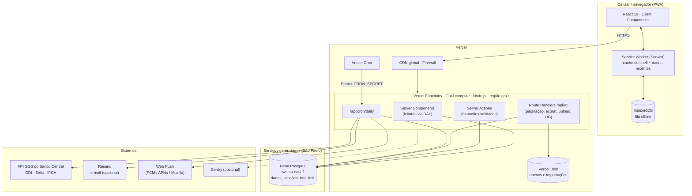
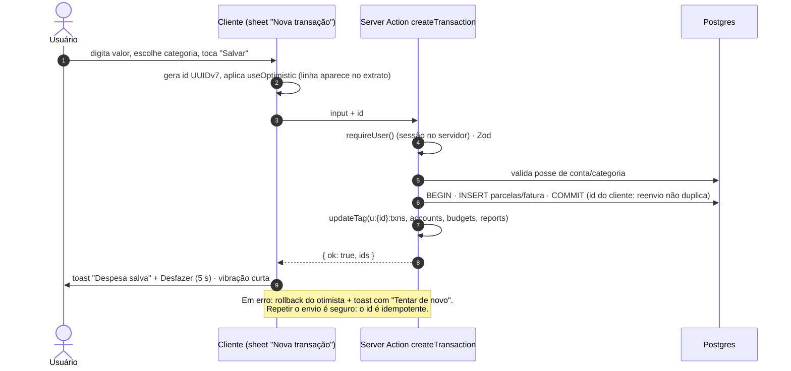
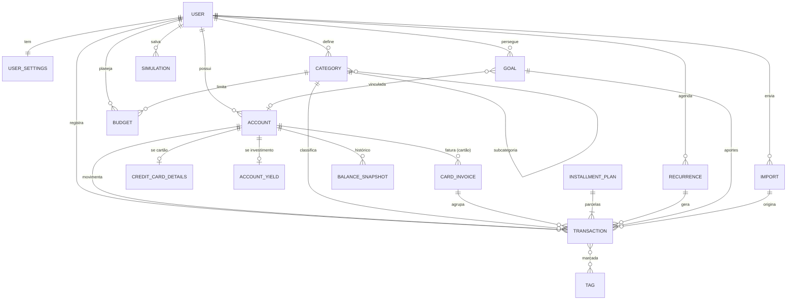

# 01 · System design — Meu Finan

> Controle financeiro pessoal, mobile-first, com projeção de juros compostos, orçamentos, metas e relatórios. Backend e frontend hospedados na Vercel. Uso pessoal: **um único usuário (o dono)**, com autenticação obrigatória.

**Sumário**

1. [Visão do produto](#1-visão-do-produto)
2. [Requisitos](#2-requisitos)
3. [Arquitetura](#3-arquitetura)
4. [Stack](#4-stack)
5. [Estrutura do projeto](#5-estrutura-do-projeto)
6. [Modelo de dados](#6-modelo-de-dados)
7. [Camada de aplicação e API](#7-camada-de-aplicação-e-api)
8. [Cache e invalidação](#8-cache-e-invalidação)
9. [Jobs agendados (Vercel Cron)](#9-jobs-agendados-vercel-cron)
10. [Integrações externas](#10-integrações-externas)
11. [Autenticação de usuário único](#11-autenticação-de-usuário-único)
12. [Performance](#12-performance)
13. [Observabilidade](#13-observabilidade)
14. [Ambientes, CI/CD e migrações](#14-ambientes-cicd-e-migrações)
15. [Custos](#15-custos)
16. [Roadmap](#16-roadmap)
17. [Decisões de arquitetura (ADRs)](#17-decisões-de-arquitetura-adrs)
18. [Riscos e mitigações](#18-riscos-e-mitigações)

---

## 1. Visão do produto

**Problema.** Planilhas são trabalhosas no celular e apps de banco mostram só um banco. A pessoa quer saber, em segundos, *quanto tem*, *para onde o dinheiro está indo*, *se vai fechar o mês no azul* e *quanto o dinheiro guardado pode render*.

**Promessa.** Registrar um gasto em menos de 5 segundos, ver o mês inteiro em uma tela e planejar o futuro com projeções honestas (com IR e inflação).

**Público.** Uma pessoa só: o dono do app, no Brasil (BRL, `pt-BR`, fuso `America/Sao_Paulo`), uso majoritário no celular, frequentemente com uma mão. Não há cadastro público: o acesso é criado uma única vez pelo próprio dono (§11.1).

**Objetivos mensuráveis**

| Objetivo | Métrica | Meta |
|---|---|---|
| Registro rápido | Tempo da abertura do "+" até salvar (p50) | ≤ 5 s |
| Hábito | Dias da semana com pelo menos um registro (medido no próprio banco) | ≥ 3 dias/semana |
| Proteção | Páginas, actions e rotas que devolvem dados sem sessão | nenhuma (teste de acesso no CI) |
| Clareza | Tarefas "quanto gastei com X?" resolvidas sem ajuda em teste de usabilidade | ≥ 90% |
| Velocidade | LCP p75 (4G, celular intermediário) | ≤ 2,0 s |
| Responsividade | INP p75 | ≤ 200 ms |

**Fora de escopo na v1**: conexão automática com bancos (Open Finance — fase 4), múltiplas moedas com conversão (o campo existe, só BRL é suportado), uso por mais de uma pessoa (contas compartilhadas só se um dia houver mais pessoas), app nativo (o PWA cobre instalação, push e atalhos).

---

## 2. Requisitos

### 2.1 Funcionais

| ID | Módulo | Requisito |
|---|---|---|
| RF-01 | Acesso do dono | Configuração única do acesso (`/primeiro-acesso`); login por passkey e por e-mail + senha forte; sessões revogáveis; recuperação de emergência (`/recuperar`); 2FA TOTP na F1. Sem cadastro público (§11) |
| RF-02 | Onboarding | Criar primeira conta com saldo atual, escolher categorias sugeridas, definir dia de início do mês financeiro |
| RF-03 | Contas | CRUD de contas (corrente, poupança, dinheiro, investimento, cartão de crédito, outra); arquivar; ajustar saldo (gera lançamento de ajuste); ordenar |
| RF-04 | Lançamentos | Receita, despesa e transferência; status pago/pendente; data; categoria/subcategoria; tags; notas; anexo (comprovante) |
| RF-05 | Parcelamento | Compra parcelada em 2–72x, com distribuição de centavos e alocação automática nas faturas |
| RF-06 | Recorrência | Lançamentos que se repetem (diário, semanal, mensal, anual, com intervalo); editar "só este", "este e próximos" ou "todos" |
| RF-07 | Cartão de crédito | Limite, dia de fechamento e vencimento, faturas por mês, status (aberta/fechada/paga/vencida), pagamento total/parcial, melhor dia de compra, limite comprometido com parcelas futuras |
| RF-08 | Extrato | Lista agrupada por dia, busca textual tolerante a acentos, filtros (período, conta, categoria, tipo, status, tag), seleção múltipla e ações em lote |
| RF-09 | Orçamentos | Valor mensal por categoria, ritmo de gasto (pace), "pode gastar por dia", copiar do mês anterior, rollover opcional |
| RF-10 | Metas | Valor-alvo, prazo, conta vinculada, aporte planejado, rentabilidade esperada; projeção de data de conclusão e aporte necessário |
| RF-11 | Simulador | Juros compostos com valor inicial, aporte mensal (com reajuste anual), taxa (a.m., a.a., % do CDI, IPCA+), prazo, IR regressivo, inflação; modos "quanto terei", "quanto investir", "em quanto tempo"; comparar até 3 cenários; salvar e compartilhar |
| RF-12 | Relatórios | Visão geral (receitas × despesas, taxa de poupança), por categoria (com drill-down), fluxo de caixa com projeção, patrimônio líquido, calendário de gastos; regime de competência ou caixa; exportar CSV/PDF |
| RF-13 | Importação | Upload de OFX/CSV, pré-visualização, deduplicação, categorização sugerida por regras aprendidas |
| RF-14 | Notificações | Contas a vencer, fatura fechando, orçamento a 80%/100%, meta atingida — via Web Push (resumo por e-mail opcional, em fase posterior) |
| RF-15 | Insights | Cartões de observação automáticos (ex.: gasto atípico em uma categoria) |
| RF-16 | Privacidade e dados | Modo discreto (oculta valores), exportar todos os dados (backup), apagar todos os dados (recomeçar do zero) |
| RF-17 | Ajustes | Categorias (criar, editar, mesclar, reordenar), tema, dia de início do mês, notificações, segurança (passkeys, senha, sessões) |

### 2.2 Não funcionais

| Atributo | Requisito |
|---|---|
| Plataforma | Web responsiva mobile-first; PWA instalável (Android/iOS/desktop) |
| Performance | LCP ≤ 2,0 s, INP ≤ 200 ms, CLS ≤ 0,05 (p75); JS inicial da rota `/inicio` ≤ 170 KB gz |
| Disponibilidade | Herdada da Vercel e da Neon; degradação graciosa (offline mostra últimos dados) |
| Consistência | Saldos e totais sempre derivados do ledger (fonte única da verdade); operações multi-linha atômicas, numa transação de banco (`db.transaction`) |
| Durabilidade | Dado apagado ou corrompido por engano tem volta: soft delete com Desfazer, restauração pontual da Neon e backup semanal criptografado fora da Neon (§11.7) |
| Precisão | Valores monetários em centavos inteiros; nenhum `float` persiste dinheiro |
| Segurança | OWASP ASVS nível 2 como referência; sessão verificada no servidor em toda página, action e rota; checagem de posse (`user_id`) em todas as consultas; rate limiting nas rotas de autenticação |
| Privacidade | Minimização (sem CPF), backup exportável, apagar todos os dados, logs sem PII (§11.8) |
| Acessibilidade | WCAG 2.2 AA |
| Localização | `pt-BR` primeiro; textos em catálogo para permitir outros idiomas |
| Custo | R$ 0/mês: tudo dentro dos planos gratuitos (§15) |

---

## 3. Arquitetura

### 3.1 Visão geral

Aplicação **monolítica modular** em Next.js: o mesmo deploy entrega páginas (React Server Components), mutações (Server Actions), endpoints HTTP (Route Handlers), imagens dinâmicas e jobs agendados. Dados em Postgres gerenciado, colocalizado na mesma região das funções.



### 3.2 Por que essa forma

- **Um deploy só**: front e back no mesmo projeto Vercel, tipos compartilhados de ponta a ponta, preview por PR com banco próprio (branch da Neon, sempre protegido — §11.6).
- **RSC para leitura**: as telas chegam renderizadas com dados, sem cascata de requisições no celular; menos JavaScript no cliente.
- **Server Actions para escrita**: validação (Zod) e autorização no servidor, sem API REST interna para manter.
- **Route Handlers só quando há motivo**: paginação incremental chamada pelo cliente, arquivos (CSV/PDF/upload), cron, webhooks, imagens OG.
- **Colocalização**: funções em `gru1` (São Paulo) + Postgres em `aws-sa-east-1` → latência de banco de ~1–3 ms por consulta. Para quem usa o app no Brasil, isso vale mais do que funções na borda.

### 3.3 Fluxo de leitura (ex.: abrir o Início)

1. `proxy.ts` (antigo `middleware.ts`) faz só uma checagem otimista do cookie de sessão e redireciona para `/entrar` se não houver.
2. A página `/inicio` é um Server Component; o **shell** (cabeçalho, navegação) é estático e sai imediatamente; cada card é um componente assíncrono dentro de `<Suspense>` com skeleton próprio — saldo, orçamento e próximas contas fazem streaming independente. Com Cache Components, ler a sessão fora de `<Suspense>` é erro de build, então nem o layout nem a página esperam a sessão no topo.
3. Cada card chama `requireUser()` do **DAL** (`server/dal`) — a checagem real da sessão, no servidor — e as queries com o `userId` no Postgres (com cache por tag, ver §8).

### 3.4 Fluxo de escrita (ex.: nova despesa)



---

## 4. Stack

| Camada | Escolha | Observações |
|---|---|---|
| Framework | **Next.js 16.4** (App Router, Turbopack, React 19.3) | `proxy.ts` no lugar de `middleware.ts`; **Cache Components ligado** (`cacheComponents: true`, como o `create-next-app` 16.4 gera) e `partialPrefetching`: sessão lida só dentro de `<Suspense>`, `'use cache'`, `'use cache: private'`, `cacheTag`, `updateTag`. Confirme as APIs nos guias de `node_modules/next/dist/docs/` |
| Linguagem | TypeScript `strict` | `noUncheckedIndexedAccess` ligado |
| Estilo | **Tailwind CSS v4** via `@tailwindcss/turbopack` (sem PostCSS) | tokens via `@theme` em CSS (ver doc 02) |
| Componentes | **shadcn/ui** (primitivas Radix) | código copiado para o repo e adaptado aos tokens |
| Sheets/drawers | Sheet próprio sobre o Dialog do Radix + Motion | arrastar para fechar no celular, diálogo centralizado a partir de `md`; o voltar do navegador fecha a folha do topo |
| Animação | **Motion** (`motion/react`) | sempre respeitando `prefers-reduced-motion` |
| Gráficos | SVG/HTML próprios (`src/components/charts`) | colunas, linha, área empilhada com scrub, sparkline e anéis; cada gráfico tem visão em tabela |
| Formulários | Estado local do React + **Zod 4** | o schema da Server Action valida no servidor; o cliente só dá retorno imediato |
| Server Actions | **next-safe-action** | middleware de auth (sessão verificada em toda action) e erros padronizados |
| Estado de URL | **nuqs** | filtros e mês ativo na URL (voltar do navegador funciona, links compartilháveis) |
| Dados no cliente | Server Components + Server Actions com `refresh()` | sem cache de dados no cliente; autocomplete por Server Action |
| Estado de UI | **Zustand** (com `persist`) | modo discreto, rascunho do lançamento, preferências locais |
| Datas | motor próprio (`src/lib/finance/dates`) + `@date-fns/tz` | datas locais sem hora; o fuso do usuário só entra para saber que dia é hoje |
| ORM | **Drizzle ORM** + drizzle-kit | dois drivers atrás da mesma API: **Neon WebSocket Pool** (`drizzle-orm/neon-serverless`, com `attachDatabasePool` da Vercel) quando há `DATABASE_URL`, e **PGlite** embutido (`drizzle-orm/pglite`) no desenvolvimento local e nos testes; ambos com transações interativas (`db.transaction`) |
| Banco | **Neon Postgres** (Vercel Marketplace) | `aws-sa-east-1`; extensões `pg_trgm`, `unaccent` |
| Auth | **Better Auth** | plugin de passkey (`@better-auth/passkey`), `twoFactor` na F1; adapter Drizzle; hooks que fecham o cadastro após o primeiro acesso |
| Rate limit | limitador embutido do **Better Auth** (`storage: 'database'`) | sem Redis; regras estritas em login, primeiro acesso e recuperação |
| Arquivos | **Vercel Blob** | upload direto do cliente (evita limite de 4,5 MB de corpo das funções) |
| E-mail | **Resend** + React Email — opcional, fase posterior | resumo semanal e alertas; o login não depende de e-mail |
| PWA | **Serwist** (`@serwist/next`) + `web-push` | manifest via `app/manifest.ts` |
| Imagens dinâmicas | `next/og` (`ImageResponse`) | cartão de compartilhamento da simulação |
| PDF | `@react-pdf/renderer` | relatórios exportados (runtime Node) |
| Parsers | papaparse (CSV) + parser OFX próprio (SGML 1.x e XML 2.x) | |
| Observabilidade | Vercel Observability, Speed Insights; **Sentry** opcional, em fase posterior | métricas de hábito saem do próprio banco (§13) |
| Qualidade | Biome (lint/format), **Vitest 5** + Testing Library, fast-check, **Playwright** | e2e em viewports de iPhone e Pixel |
| Pacotes | **npm** | Node.js 24 |

---

## 5. Estrutura do projeto

Organização **por feature** (cada domínio tem suas actions, queries, schemas e componentes) e um núcleo financeiro **puro** (sem I/O), testado à exaustão.

```
meu-finan/
├─ src/
│  ├─ app/
│  │  ├─ page.tsx                             # "/" → redireciona para /inicio (sem landing pública)
│  │  ├─ (auth)/                              # as únicas páginas sem sessão
│  │  │  ├─ entrar/page.tsx
│  │  │  ├─ primeiro-acesso/page.tsx          # configuração única do dono (SETUP_TOKEN)
│  │  │  └─ recuperar/page.tsx                # emergência, só com RECOVERY_TOKEN
│  │  ├─ (app)/
│  │  │  ├─ layout.tsx                        # AppShell: TopBar, BottomNav/Sidebar, QuickAdd
│  │  │  ├─ @modal/(.)extrato/[id]/page.tsx   # detalhe em sheet (intercepting route)
│  │  │  ├─ inicio/page.tsx
│  │  │  ├─ extrato/page.tsx
│  │  │  ├─ extrato/[id]/page.tsx
│  │  │  ├─ contas/page.tsx · contas/[id]/page.tsx
│  │  │  ├─ cartoes/[id]/page.tsx · cartoes/[id]/faturas/[mes]/page.tsx
│  │  │  ├─ planejar/orcamentos/page.tsx
│  │  │  ├─ planejar/metas/page.tsx · planejar/metas/[id]/page.tsx
│  │  │  ├─ planejar/simulador/page.tsx
│  │  │  ├─ relatorios/[visao]/page.tsx       # visao-geral | categorias | fluxo | patrimonio | calendario
│  │  │  ├─ importar/page.tsx
│  │  │  └─ ajustes/…
│  │  ├─ onboarding/page.tsx
│  │  ├─ api/
│  │  │  ├─ auth/[...all]/route.ts            # Better Auth
│  │  │  ├─ v1/transactions/route.ts          # GET paginado (keyset)
│  │  │  ├─ v1/transactions/suggest/route.ts  # autocomplete de descrição
│  │  │  ├─ v1/reports/[visao]/route.ts
│  │  │  ├─ v1/export/route.ts                # CSV | PDF
│  │  │  ├─ v1/blob/upload/route.ts           # token de upload do Vercel Blob
│  │  │  ├─ v1/attachments/[id]/route.ts      # download autorizado
│  │  │  ├─ og/simulacao/route.tsx            # ImageResponse 1200×630
│  │  │  └─ cron/daily/route.ts
│  │  ├─ manifest.ts · icon.tsx · apple-icon.tsx · sw.ts
│  │  └─ globals.css                          # tokens (doc 02)
│  ├─ components/
│  │  ├─ ui/            # shadcn adaptado (button, sheet, dialog, input, …)
│  │  ├─ app/           # AppShell, BottomNav, TopBar, MonthSwitcher, PrivacyToggle
│  │  ├─ money/         # Money, MoneyInput, Keypad
│  │  └─ charts/        # ChartCard, Sparkline, Ring, BarsIncomeExpense, RankedBars, …
│  ├─ features/
│  │  ├─ transactions/  { actions.ts, queries.ts, schema.ts, components/, hooks/ }
│  │  ├─ accounts/ · cards/ · categories/ · budgets/ · goals/
│  │  ├─ simulator/ · reports/ · imports/ · insights/ · notifications/ · settings/
│  ├─ server/
│  │  ├─ auth.ts        # instância Better Auth (passkey, hooks do primeiro acesso, rate limit em banco)
│  │  ├─ dal.ts         # getSession, requireUser (React cache)
│  │  ├─ safe-action.ts # cliente next-safe-action + middlewares
│  │  ├─ db/            { client.ts, schema/*.ts, seed-defaults.ts }
│  │  ├─ cache-tags.ts
│  │  └─ jobs/          # passos do cron diário (idempotentes)
│  ├─ lib/
│  │  ├─ finance/       # PURO: money, rates, compound, tax, solve, installments,
│  │  │                 #       invoices, recurrence, period, budget-pace, forecast, goals
│  │  ├─ format/        # moeda, datas, percentuais, compacto
│  │  ├─ auth-client.ts # cliente Better Auth (React) com plugin de passkey
│  │  └─ utils.ts
│  └─ proxy.ts
├─ drizzle/             # migrações SQL geradas
├─ scripts/seed.ts      # npm run db:seed
├─ tests/e2e/           # Playwright
├─ .github/workflows/   # CI e backup semanal (F1)
├─ vercel.json
└─ drizzle.config.ts
```

Regras de dependência: `app → features → server/lib`; `lib/finance` não importa nada do projeto (só funções puras); componentes de `features` não acessam o banco — só via actions/queries da própria feature.

---

## 6. Modelo de dados

### 6.1 Convenções

| Tema | Decisão |
|---|---|
| IDs | `uuid` v7 (ordenável no tempo → índices mais compactos); gerado na aplicação, inclusive no cliente para idempotência |
| Dinheiro | `bigint` em **centavos** (`amount_cents`). Nunca `numeric`/`float` para valores de lançamento |
| Sinal | **Ledger com sinal por conta**: entrada na conta `> 0`, saída `< 0`. Saldo = saldo inicial + Σ lançamentos efetivados |
| Transferência | Duas linhas (`kind = 'transfer'`) ligadas por `transfer_id`: saída na origem, entrada no destino. Não entram em relatórios de receitas/despesas |
| Cartão de crédito | É uma conta (`type = 'credit_card'`). Compras são despesas negativas na conta-cartão com `invoice_id`. Pagar a fatura = transferência da conta corrente para o cartão |
| Estorno | Despesa com valor positivo (reduz o total da categoria); `kind` continua `expense` |
| Datas | `occurred_on date` (data local do usuário, sem hora); `created_at/updated_at timestamptz` |
| Exclusão | Soft delete (`deleted_at`) para permitir "Desfazer"; expurgo definitivo após 30 dias pelo cron |
| Dono (`user_id`) | `user_id` em todas as tabelas de domínio, mesmo com um único usuário: consultas uniformes, checagem de posse barata e caminho aberto se um dia houver mais pessoas. Todo índice começa por `user_id` (ou por uma FK já escopada). Não há outra camada de isolamento entre pessoas |
| Taxas | `numeric` com escala explícita (índices, percentuais), nunca `float` no banco |

### 6.2 Diagrama entidade-relacionamento



### 6.3 DDL de referência (PostgreSQL 16+)

> As tabelas de autenticação seguem os modelos do Better Auth e ficam no schema Drizzle (`src/server/db/schema/auth.ts`): `user`, `session`, `account` (credencial de senha), `verification`, `passkey`, `rateLimit` (contadores do limitador, com storage em banco) e, na F1, a do 2FA (`twoFactor`). Para não colidir com a tabela `account` dele, as contas financeiras se chamam `fin_accounts`.

```sql
create extension if not exists pg_trgm;
create extension if not exists unaccent;

-- unaccent não é IMMUTABLE; wrapper para poder indexar
create or replace function f_unaccent(text) returns text
  language sql immutable parallel safe strict
  as $$ select public.unaccent('public.unaccent'::regdictionary, $1) $$;

create type fin_account_type as enum ('checking','savings','cash','investment','credit_card','other');
create type txn_kind        as enum ('income','expense','transfer','adjustment');
create type txn_status      as enum ('pending','paid');
create type category_kind   as enum ('income','expense');
create type rate_index      as enum ('fixed','cdi','selic','ipca');
create type recurrence_freq as enum ('daily','weekly','monthly','yearly');
create type import_status   as enum ('uploaded','parsed','review','done','failed');

-- Preferências -------------------------------------------------------------
create table user_settings (
  user_id              text primary key references "user"(id) on delete cascade,
  currency             char(3)  not null default 'BRL',
  locale               text     not null default 'pt-BR',
  timezone             text     not null default 'America/Sao_Paulo',
  month_start_day      smallint not null default 1 check (month_start_day between 1 and 28),
  theme                text     not null default 'dark' check (theme in ('system','light','dark')),  -- escuro por padrão; salvo ao trocar o tema
  privacy_mode_default boolean  not null default false,
  report_basis         text     not null default 'accrual' check (report_basis in ('accrual','cash')),
  onboarding_done_at   timestamptz,
  created_at           timestamptz not null default now(),
  updated_at           timestamptz not null default now()
);

-- Contas -------------------------------------------------------------------
create table fin_accounts (
  id                    uuid primary key,
  user_id               text not null references "user"(id) on delete cascade,
  name                  text not null check (char_length(name) between 1 and 60),
  type                  fin_account_type not null,
  color                 text not null,               -- token: 'cat-1'..'cat-8'
  icon                  text not null,               -- nome do ícone Lucide
  initial_balance_cents bigint not null default 0,
  include_in_net_worth  boolean not null default true,
  sort_order            int not null default 0,
  archived_at           timestamptz,
  created_at            timestamptz not null default now(),
  updated_at            timestamptz not null default now()
);
create index fin_accounts_user on fin_accounts (user_id, sort_order) where archived_at is null;

create table credit_card_details (
  account_id          uuid primary key references fin_accounts(id) on delete cascade,
  limit_cents         bigint   not null check (limit_cents >= 0),
  closing_day         smallint not null check (closing_day between 1 and 31),
  due_day             smallint not null check (due_day between 1 and 31),
  payment_account_id  uuid references fin_accounts(id) on delete set null
);

create table account_yield (                          -- para projeções de investimentos
  account_id      uuid primary key references fin_accounts(id) on delete cascade,
  index           rate_index not null,
  pct_of_index    numeric(7,4),                      -- 1.0200 = 102% do CDI
  spread_annual   numeric(7,6),                      -- 0.060000 = IPCA + 6%
  fixed_annual    numeric(7,6),                      -- prefixado
  tax_mode        text not null default 'regressive' check (tax_mode in ('regressive','exempt'))
);

create table card_invoices (
  id               uuid primary key,
  user_id          text not null references "user"(id) on delete cascade,
  account_id       uuid not null references fin_accounts(id) on delete cascade,
  reference_month  date not null check (extract(day from reference_month) = 1), -- mês do vencimento
  closing_date     date not null,
  due_date         date not null,
  unique (account_id, reference_month)
);
-- Total, pago e status da fatura são DERIVADOS dos lançamentos (ver doc 03 §9).

-- Categorias ---------------------------------------------------------------
create table categories (
  id          uuid primary key,
  user_id     text not null references "user"(id) on delete cascade,
  parent_id   uuid references categories(id) on delete cascade,
  kind        category_kind not null,
  name        text not null check (char_length(name) between 1 and 40),
  icon        text not null,
  color       text not null,
  sort_order  int not null default 0,
  archived_at timestamptz,
  unique nulls not distinct (user_id, parent_id, name)
);

create table tags (
  id       uuid primary key,
  user_id  text not null references "user"(id) on delete cascade,
  name     text not null,
  unique (user_id, name)
);

-- Planos de parcelamento e recorrências -------------------------------------
create table installment_plans (
  id           uuid primary key,
  user_id      text not null references "user"(id) on delete cascade,
  account_id   uuid not null references fin_accounts(id),
  description  text not null,
  total_cents  bigint not null check (total_cents > 0),
  count        smallint not null check (count between 2 and 72),
  first_date   date not null,
  created_at   timestamptz not null default now()
);

create table recurrences (
  id               uuid primary key,
  user_id          text not null references "user"(id) on delete cascade,
  account_id       uuid not null references fin_accounts(id),
  category_id      uuid references categories(id),
  kind             txn_kind not null check (kind in ('income','expense')),
  amount_cents     bigint not null check (amount_cents <> 0),
  description      text not null,
  freq             recurrence_freq not null,
  interval         smallint not null default 1 check (interval between 1 and 12),
  by_month_day     smallint check (by_month_day between 1 and 31),  -- 31 = último dia
  start_on         date not null,
  end_on           date,
  generated_until  date not null,          -- horizonte já materializado
  paused_at        timestamptz,
  created_at       timestamptz not null default now(),
  updated_at       timestamptz not null default now()
);

-- Metas, importações -------------------------------------------------------
create table goals (
  id                  uuid primary key,
  user_id             text not null references "user"(id) on delete cascade,
  name                text not null,
  icon                text not null,
  color               text not null,
  target_cents        bigint not null check (target_cents > 0),
  target_date         date,
  account_id          uuid references fin_accounts(id) on delete set null,
  initial_cents       bigint not null default 0,
  monthly_plan_cents  bigint,
  expected_rate       jsonb,               -- {"index":"cdi","pct":1.02} | {"index":"fixed","annual":0.1}
  achieved_at         timestamptz,
  archived_at         timestamptz,
  created_at          timestamptz not null default now(),
  updated_at          timestamptz not null default now()
);

create table imports (
  id            uuid primary key,
  user_id       text not null references "user"(id) on delete cascade,
  account_id    uuid not null references fin_accounts(id),
  blob_pathname text not null,
  format        text not null check (format in ('ofx','csv')),
  status        import_status not null default 'uploaded',
  stats         jsonb,                     -- {"rows":120,"duplicates":8,"imported":112}
  error         text,
  created_at    timestamptz not null default now()
);

-- Lançamentos (ledger) -----------------------------------------------------
create table transactions (
  id                   uuid primary key,
  user_id              text not null references "user"(id) on delete cascade,
  account_id           uuid not null references fin_accounts(id),
  category_id          uuid references categories(id),
  kind                 txn_kind not null,
  status               txn_status not null default 'paid',
  amount_cents         bigint not null check (amount_cents <> 0),
  description          text not null check (char_length(description) between 1 and 120),
  notes                text,
  occurred_on          date not null,
  paid_at              timestamptz,
  transfer_id          uuid,
  invoice_id           uuid references card_invoices(id),
  installment_plan_id  uuid references installment_plans(id) on delete cascade,
  installment_number   smallint,
  recurrence_id        uuid references recurrences(id) on delete set null,
  goal_id              uuid references goals(id) on delete set null,
  import_id            uuid references imports(id) on delete set null,
  external_id          text,                -- FITID do OFX / hash do CSV
  attachment_pathname  text,
  created_at           timestamptz not null default now(),
  updated_at           timestamptz not null default now(),
  deleted_at           timestamptz,
  constraint transfer_pair      check (kind <> 'transfer' or transfer_id is not null),
  constraint installment_fields check ((installment_plan_id is null) = (installment_number is null))
);

create index txn_user_date     on transactions (user_id, occurred_on desc, id desc) where deleted_at is null;
create index txn_account_date  on transactions (account_id, occurred_on desc)       where deleted_at is null;
create index txn_user_cat_date on transactions (user_id, category_id, occurred_on)  where deleted_at is null;
create index txn_pending       on transactions (user_id, occurred_on)              where status = 'pending' and deleted_at is null;
create index txn_invoice       on transactions (invoice_id)                         where invoice_id is not null;
create index txn_transfer      on transactions (transfer_id)                        where transfer_id is not null;
create unique index txn_external on transactions (account_id, external_id)          where external_id is not null;
-- inclui linhas excluídas de propósito: uma ocorrência apagada não é recriada pelo cron
create unique index txn_recurrence_occ on transactions (recurrence_id, occurred_on) where recurrence_id is not null;
create index txn_search        on transactions using gin (f_unaccent(lower(description)) gin_trgm_ops);

create table transaction_tags (
  transaction_id uuid not null references transactions(id) on delete cascade,
  tag_id         uuid not null references tags(id) on delete cascade,
  primary key (transaction_id, tag_id)
);

-- Orçamentos ---------------------------------------------------------------
create table budgets (
  id            uuid primary key,
  user_id       text not null references "user"(id) on delete cascade,
  category_id   uuid not null references categories(id) on delete cascade,
  month         date not null check (extract(day from month) = 1), -- mês financeiro
  amount_cents  bigint not null check (amount_cents > 0),
  rollover      boolean not null default false,
  unique (user_id, category_id, month)
);

-- Histórico, índices de mercado, simulações, regras, notificações -----------
create table balance_snapshots (
  account_id     uuid not null references fin_accounts(id) on delete cascade,
  on_date        date not null,
  balance_cents  bigint not null,
  source         text not null default 'auto' check (source in ('auto','manual')),
  primary key (account_id, on_date)
);

create table market_rates (            -- global (sem user_id), alimentada pelo cron
  index     rate_index not null,
  ref_date  date not null,
  value     numeric(12,8) not null,    -- CDI/Selic: % a.a.; IPCA: % no mês
  primary key (index, ref_date)
);

create table simulations (
  id         uuid primary key,
  user_id    text not null references "user"(id) on delete cascade,
  name       text not null,
  params     jsonb not null,           -- validado por Zod (SimulationInput)
  created_at timestamptz not null default now(),
  updated_at timestamptz not null default now()
);

create table categorization_rules (
  id           uuid primary key,
  user_id      text not null references "user"(id) on delete cascade,
  pattern      text not null,          -- descrição normalizada (sem acento, minúscula)
  category_id  uuid not null references categories(id) on delete cascade,
  account_id   uuid references fin_accounts(id) on delete cascade,
  hits         int not null default 0,
  updated_at   timestamptz not null default now(),
  unique (user_id, pattern)
);

create table push_subscriptions (
  id          uuid primary key,
  user_id     text not null references "user"(id) on delete cascade,
  endpoint    text not null unique,
  p256dh      text not null,
  auth        text not null,
  user_agent  text,
  created_at  timestamptz not null default now()
);

create table notifications (
  id          uuid primary key,
  user_id     text not null references "user"(id) on delete cascade,
  type        text not null,           -- bill_due | invoice_closing | budget_80 | budget_100 | goal_reached | insight
  dedupe_key  text not null,           -- ex.: 'bill_due:<txn_id>' (evita repetir)
  payload     jsonb not null,
  read_at     timestamptz,
  created_at  timestamptz not null default now(),
  unique (user_id, dedupe_key)
);

create table job_runs (
  id          uuid primary key,
  job         text not null,
  started_at  timestamptz not null default now(),
  finished_at timestamptz,
  status      text not null default 'running',
  report      jsonb
);
```

### 6.4 Exemplo de schema Drizzle (convenção)

```ts
// src/server/db/schema/transactions.ts
export const transactions = pgTable(
  'transactions',
  {
    id: uuid('id').primaryKey(),
    userId: text('user_id').notNull().references(() => user.id, { onDelete: 'cascade' }),
    accountId: uuid('account_id').notNull().references(() => finAccounts.id),
    categoryId: uuid('category_id').references(() => categories.id),
    kind: txnKind('kind').notNull(),
    status: txnStatus('status').notNull().default('paid'),
    amountCents: bigint('amount_cents', { mode: 'number' }).notNull(),
    description: text('description').notNull(),
    occurredOn: date('occurred_on').notNull(),
    // … demais colunas como na DDL
    deletedAt: timestamp('deleted_at', { withTimezone: true }),
  },
  (t) => [
    index('txn_user_date')
      .on(t.userId, t.occurredOn.desc(), t.id.desc())
      .where(sql`${t.deletedAt} is null`),
  ],
);
```

### 6.5 Consultas-chave

**Saldo por conta** (efetivados; pendentes ficam para a previsão):

```sql
select a.id,
       a.initial_balance_cents
         + coalesce(sum(t.amount_cents) filter (where t.status = 'paid'), 0) as balance_cents
from fin_accounts a
left join transactions t on t.account_id = a.id and t.deleted_at is null
where a.user_id = $1 and a.archived_at is null
group by a.id;
```

**Extrato paginado por keyset** (estável mesmo com inserções; nunca `OFFSET`):

```sql
select id, occurred_on, description, amount_cents, kind, status, category_id, account_id,
       installment_number, installment_plan_id
from transactions
where user_id = $1 and deleted_at is null
  and occurred_on between $from and $to
  and (occurred_on, id) < ($cursor_date, $cursor_id)   -- ausente na 1ª página
order by occurred_on desc, id desc
limit 51;                                               -- 50 + 1 para saber se há próxima
```

**Receitas × despesas por mês financeiro** (dia de início `d`): desloca a data em `d − 1` dias antes de truncar.

```sql
select date_trunc('month', occurred_on - ($d - 1))::date as period,
       sum(amount_cents)  filter (where kind = 'income')  as income_cents,
       -sum(amount_cents) filter (where kind = 'expense') as expense_cents
from transactions
where user_id = $1 and deleted_at is null and status = 'paid'
  and occurred_on >= $from and occurred_on < $to
group by 1
order by 1;
```

**Busca tolerante a acento e erro de digitação**:

```sql
select … from transactions
where user_id = $1 and deleted_at is null
  and f_unaccent(lower(description)) % f_unaccent(lower($q))      -- similaridade trigram
order by similarity(f_unaccent(lower(description)), f_unaccent(lower($q))) desc, occurred_on desc
limit 30;
```

### 6.6 Volume e crescimento

Uma pessoa gera ~1.500–5.000 lançamentos/ano. Com os índices acima, agregações de 12 meses leem alguns milhares de linhas — milissegundos. Não há tabelas de resumo na v1. Se um relatório ficar lento (p95 > 150 ms), criar `monthly_category_totals` mantida pela própria Server Action (na mesma transação) — não por trigger, para manter a lógica testável em TypeScript.

---

## 7. Camada de aplicação e API

### 7.1 Princípios

- **Leitura**: Server Components chamam a camada de domínio (`src/server/domain/*`), cujas funções recebem `userId`/`UserContext` explicitamente. Sem chamadas HTTP internas.
- **Escrita**: Server Actions (`src/server/actions/*`) criadas com `authAction` (next-safe-action). Toda action: autentica (sessão verificada no servidor) → valida com Zod → chama o domínio, que **verifica a posse de todo id referenciado** (conta, categoria, meta, fatura) e executa numa transação (`db.transaction`) → atualiza a tela com `refresh()` → retorna DTO.
- **Dentro de uma transação, só o `tx`**: o PGlite tem uma conexão só, então uma consulta pelo `db` global com uma transação aberta trava. Funções auxiliares recebem um `Executor` (`db` ou `tx`).
- **Rotas**: todo Route Handler começa verificando a sessão (`getSession()` do DAL; sem sessão → 401). Exceções: `/api/auth/*` (Better Auth), `/api/cron/daily` (`CRON_SECRET`) e o aviso de upload concluído do Vercel Blob (assinado, §7.3).
- **Nunca** aceitar `userId` vindo do cliente. **Nunca** retornar linhas cruas do banco — sempre DTOs com os campos que a tela usa.
- **Idempotência**: o cliente gera o `id` (UUIDv7) de lançamentos; o insert usa `on conflict (id) do nothing`. Reenvio por rede instável ou fila offline não duplica.

```ts
// src/server/safe-action.ts
export const actionClient = createSafeActionClient({
  handleServerError(e) {
    if (e instanceof AppError) return e.publicMessage;
    console.error(e); // logs da Vercel (e o Sentry, quando entrar)
    return 'Algo deu errado. Tente novamente.';
  },
});

// Toda action autenticada confere a sessão no servidor; o proxy nunca é a única checagem
export const authAction = actionClient.use(async ({ next }) => {
  const user = await requireUser();
  return next({ ctx: { user } });
});
```

```ts
// src/server/actions/transactions.ts (resumido)
export const createEntryAction = authAction
  .inputSchema(z.discriminatedUnion('kind', [entrySchema, transferSchema]))
  .action(async ({ parsedInput: input, ctx: { user } }) => {
    const ctx = await getUserContext(user.id);       // fuso, dia de início do mês, "hoje"
    const result = input.kind === 'transfer'
      ? await createTransfer(ctx, input)
      : await createTransaction(ctx, input);          // posse, parcelas, faturas, recorrência
    refresh();                                        // a tela atual busca os dados de novo
    return result;
  });

// src/server/domain/transactions.ts (resumido)
export async function createTransaction(ctx: UserContext, input: TransactionInput) {
  return db.transaction(async (tx) => {
    const account = await requireAccount(tx, ctx.userId, input.accountId);   // posse
    const category = input.categoryId ? await requireCategory(tx, ctx.userId, input.categoryId, input.kind) : null;
    const rows = buildRows(input, account, category);                          // via lib/finance
    await tx.insert(transactions).values(rows);
    return { ids: rows.map((row) => row.id) };
  });
}
```

```ts
// src/server/dal.ts
import 'server-only';
// Lê cookies/headers: com Cache Components, só é chamado dentro de <Suspense> (nunca no topo de um layout)
export const getSession = cache(async () => auth.api.getSession({ headers: await headers() }));
export const requireUser = cache(async () => {
  const session = await getSession();
  if (!session) redirect('/entrar');
  const { id, name, email } = session.user;
  return { id, name, email }; // DTO estreito, nunca a sessão inteira
});
```

### 7.2 Server Actions

| Domínio | Action | Observações |
|---|---|---|
| Lançamentos | `createTransaction` | despesa/receita; com `installments` cria plano + N linhas; com `recurrence` cria regra + materializa 60 dias |
| | `createTransfer` | duas pernas na mesma transação SQL |
| | `updateTransaction(id, patch, scope)` | `scope`: `this` \| `this_and_future` \| `all` (recorrência/parcelas) |
| | `deleteTransaction(id, scope)` / `restoreTransaction(id)` | soft delete + desfazer |
| | `bulkUpdateTransactions(ids, patch)` | categoria, status, tags |
| | `markAsPaid(id, paidOn?)` | |
| Contas | `createAccount`, `updateAccount`, `archiveAccount`, `reorderAccounts` | |
| | `adjustBalance(accountId, newBalanceCents)` | gera lançamento `adjustment` com a diferença |
| Cartões | `upsertCardDetails`, `payInvoice(invoiceId, fromAccountId, amountCents, date)` | pagamento parcial permitido |
| Categorias | `createCategory`, `updateCategory`, `mergeCategories(from, into)`, `reorderCategories` | mesclar move lançamentos, orçamentos e regras |
| Orçamentos | `upsertBudget`, `deleteBudget`, `copyBudgetsFromPreviousMonth(month)` | |
| Metas | `createGoal`, `updateGoal`, `contributeToGoal(goalId, amountCents, fromAccountId?)` | aporte com conta vinculada vira transferência |
| Simulador | `saveSimulation`, `deleteSimulation` | |
| Importação | `parseImport(importId)`, `confirmImport(importId, rows)` | |
| Ajustes | `updateSettings`, `subscribePush`, `unsubscribePush` | |
| Dados | `requestDataExport()`, `deleteAllData(confirmation)` | ambas exigem sessão recente; apagar remove dados financeiros e blobs, mantém o acesso (usuário, senha, passkeys) e volta ao onboarding (§11.8) |

### 7.3 Route Handlers (`/api/v1`)

| Método e rota | Uso | Resposta |
|---|---|---|
| `GET /api/v1/transactions?from&to&account&category&kind&status&tag&q&cursor&limit` | lista infinita do extrato | `{ items: TxnDTO[], nextCursor: string \| null, totals: { inCents, outCents } }` |
| `GET /api/v1/transactions/suggest?q=` | autocomplete da descrição com categoria/conta sugeridas | `{ items: [{ description, categoryId, accountId, lastAmountCents }] }` |
| `GET /api/v1/reports/{visao-geral\|categorias\|fluxo\|patrimonio\|calendario}?from&to&basis` | dados dos gráficos | séries já agregadas, em centavos |
| `GET /api/v1/export?format=csv\|pdf&from&to` | exportação | arquivo (`Content-Disposition: attachment`) |
| `POST /api/v1/blob/upload` | `handleUpload` do Vercel Blob (gera token, valida tipo/tamanho, registra no `onUploadCompleted`) | JSON do protocolo do Blob |
| `GET /api/v1/attachments/:transactionId` | baixa comprovante após checar posse | stream/redirect de curta duração |
| `GET /api/og/simulacao?s=<params base64url>` | imagem 1200×630 da simulação; exige sessão como as demais — o app compartilha o arquivo (Web Share API), não um link público | `image/png` |
| `GET /api/cron/daily` | job diário; protegido por `CRON_SECRET`, sem sessão | relatório do `job_runs` |

Todas as rotas de `/api/v1` e `/api/og` verificam a sessão no servidor antes de qualquer leitura (sem sessão → 401 `UNAUTHORIZED`). No upload, a sessão é exigida ao gerar o token (`onBeforeGenerateToken`); o aviso de upload concluído (`onUploadCompleted`) vem dos servidores do Vercel Blob, sem sessão, e é autenticado pela assinatura que o próprio `handleUpload` verifica.

Exemplo de `TxnDTO`:

```json
{
  "id": "0192f1a2-7c3e-7b1a-9d2e-5f6a7b8c9d0e",
  "occurredOn": "2026-10-14",
  "description": "Supermercado",
  "amountCents": -6450,
  "kind": "expense",
  "status": "paid",
  "category": { "id": "…", "name": "Mercado", "icon": "shopping-cart", "color": "cat-3" },
  "account": { "id": "…", "name": "Conta principal", "type": "checking" },
  "installment": null,
  "hasAttachment": false,
  "tags": []
}
```

### 7.4 Erros

Formato único em actions e handlers: `{ ok: false, error: { code, message, fieldErrors? } }`.

| Código | HTTP | Quando | Exibição no app |
|---|---|---|---|
| `UNAUTHORIZED` | 401 | sessão ausente/expirada | redireciona ao login preservando a rota |
| `NOT_FOUND` | 404 | id inexistente **ou fora do escopo do `user_id`** (não vazar existência) | toast + volta |
| `VALIDATION` | 422 | Zod | erro inline no campo |
| `CONFLICT` | 409 | ex.: categoria com mesmo nome | inline |
| `RATE_LIMITED` | 429 | muitas tentativas de login, primeiro acesso ou recuperação (limitador do Better Auth) | mensagem com tempo de espera |
| `INTERNAL` | 500 | inesperado (vai aos logs; ao Sentry, quando ativado) | toast genérico + "Tentar de novo" |

---

## 8. Cache e invalidação

Dados financeiros são **por usuário** e mudam a cada lançamento, então o cache serve para não recalcular agregações caras (relatórios de 12 meses, dashboard), não para servir dado velho.

- **Cache Components está ligado** (`cacheComponents: true` no `next.config.ts`). Ler a sessão (cookies/headers) é dado de requisição: só dentro de `<Suspense>` — fora dele é erro de build — e nunca com `await` no topo de um layout, que seguraria o segmento inteiro.
- O **usuário atual** pode usar `'use cache: private'`: o resultado fica só no navegador (nunca num cache do servidor) e as telas autenticadas continuam com prefetch.
- Funções de leitura agregada usam `'use cache'` + `cacheTag(...)`. O `userId` entra como **argumento** (faz parte da chave); cookies/headers não podem ser lidos dentro de `'use cache'` — a sessão é resolvida fora, pelo DAL, e só o id entra. Chaves e tags ficam em texto puro: usar o id, nunca e-mail ou valores.
- Mutações chamam `updateTag()` (leitura das próprias escritas na mesma navegação) para as tags afetadas.

| Tag | Invalidada por |
|---|---|
| `u:{id}:accounts` | qualquer lançamento, ajuste, transferência, pagamento de fatura |
| `u:{id}:txns` | qualquer lançamento |
| `u:{id}:budgets:{yyyy-mm}` | lançamento no mês, mudança de orçamento |
| `u:{id}:reports` | qualquer lançamento (relatórios recalculam sob demanda) |
| `u:{id}:cards` | lançamento em cartão, pagamento de fatura, cron de fechamento |
| `u:{id}:goals` | aportes, alteração de meta, saldo da conta vinculada |
| `rates` | cron diário (índices do BCB) |

O extrato paginado **não** é cacheado no servidor (muda demais); no cliente, TanStack Query mantém as páginas e é invalidado após mutações.

---

## 9. Jobs agendados (Vercel Cron)

O plano Hobby só permite cron **diário** (com precisão de até ~1 h). O design usa **um único job diário** que orquestra passos idempotentes — funciona igual em qualquer plano.

```json
// vercel.json
{
  "$schema": "https://openapi.vercel.sh/vercel.json",
  "regions": ["gru1"],
  "crons": [{ "path": "/api/cron/daily", "schedule": "0 9 * * *" }]
}
```

`0 9 * * *` UTC = 06:00 em Brasília (sem horário de verão desde 2019). Cron só roda no deployment de **produção**.

```ts
// src/app/api/cron/daily/route.ts
export const maxDuration = 300;

export async function GET(req: Request) {
  const secret = process.env.CRON_SECRET;
  // falha fechada: sem a variável, ninguém passa (nem quem enviar "Bearer undefined")
  if (!secret || req.headers.get('authorization') !== `Bearer ${secret}`) {
    return new Response('Unauthorized', { status: 401 });
  }
  const run = await startJobRun('daily');
  for (const step of dailySteps) await run.step(step.name, step.fn); // isola falhas por passo
  return Response.json(await run.finish());
}
```

| Passo | O que faz | Idempotência |
|---|---|---|
| 1. `materializeRecurrences` | gera lançamentos `pending` até hoje + 60 dias; avança `generated_until` | chave única (`recurrence_id`, `occurred_on`) |
| 2. `rollInvoices` | cria a fatura do próximo ciclo quando a atual fecha; marca fechadas | `unique (account_id, reference_month)` |
| 3. `syncMarketRates` | busca CDI, Selic e IPCA no SGS/BCB; `upsert` em `market_rates`; `updateTag('rates')` | PK (`index`, `ref_date`) |
| 4. `snapshotBalances` | no 1º dia do mês, grava saldo de fim de mês de cada conta | PK (`account_id`, `on_date`) |
| 5. `sendReminders` | contas que vencem em ≤ 3 dias, fatura fechando em 2 dias, orçamento ≥ 80%/100%, meta atingida → Web Push (e o resumo semanal por e-mail, quando entrar) | `notifications.dedupe_key` |
| 6. `purge` | apaga lançamentos com `deleted_at` > 30 dias, importações e blobs órfãos > 7 dias | naturalmente idempotente |

Cada passo processa em lotes com cursor e orçamento de tempo (para em ~240 s e retoma no dia seguinte, registrando no `job_runs`). Com um único usuário o volume é pequeno; o orçamento de tempo é só uma proteção.

---

## 10. Integrações externas

| Serviço | Uso | Detalhes |
|---|---|---|
| **BCB — SGS** | taxas para simulador, metas e rendimento de contas | `https://api.bcb.gov.br/dados/serie/bcdata.sgs.{codigo}/dados/ultimos/{n}?formato=json` — séries: **432** (meta Selic, % a.a.), **4389** (CDI anualizado base 252, % a.a.), **12** (CDI diário), **433** (IPCA mensal, %). Respostas com data `dd/MM/yyyy` e valor com ponto decimal em string. Cache no banco; o app nunca chama o BCB em tempo de requisição |
| BCB — Focus (opcional) | expectativa de IPCA/Selic para cenários default | API Olinda de expectativas de mercado |
| Resend (opcional, fase posterior) | resumo semanal e alertas por e-mail | domínio próprio com SPF/DKIM/DMARC; templates React Email. O login e a recuperação não dependem de e-mail |
| **Web Push** | lembretes | VAPID; no iOS funciona apenas com o PWA instalado na tela de início (iOS 16.4+) |
| **Vercel Blob** | comprovantes e arquivos de importação | upload direto do navegador com token de curta duração; caminho com sufixo aleatório; download só via rota autenticada |
| Open Finance (fase 4) | sincronização automática de contas | via agregador certificado (ex.: Pluggy, Belvo); webhooks em `/api/webhooks/*` |

---

## 11. Autenticação de usuário único

O app tem **um único usuário: o dono**. Ainda assim, a autenticação é obrigatória e de primeira classe — o app fica numa URL pública e guarda dados financeiros sensíveis ("apesar de ser para um único usuário, é necessário autenticação para preservar os dados"). Princípios:

- **Sem cadastro público**, nem agora nem depois: o acesso é criado uma única vez (§11.1) e, a partir daí, nenhum outro usuário pode ser criado.
- **Só três páginas sem sessão**: `/entrar`, `/primeiro-acesso` e `/recuperar` (mais os arquivos públicos: manifest, ícones, service worker). Todo o resto exige sessão.
- **Verificação no servidor em toda camada**: cada página, Server Action e Route Handler confere a sessão pelo DAL (§11.5). Exceções: `/api/auth/*` (o próprio Better Auth), `/api/cron/daily` (segredo próprio) e o aviso de upload concluído do Vercel Blob (assinado, §7.3). O `proxy.ts` só redireciona — nunca é a única checagem.
- **Falha fechada**: se faltar uma variável (`SETUP_TOKEN`, `OWNER_EMAIL`, `RECOVERY_TOKEN`, `CRON_SECRET`), a funcionalidade que depende dela fica desligada, nunca aberta.

### 11.1 Primeiro acesso (`/primeiro-acesso`)

Configuração única do dono, disponível **só enquanto não existe nenhum usuário** no banco.

1. A tela pede o código de configuração (`SETUP_TOKEN`), nome, e-mail e senha. O e-mail precisa ser o `OWNER_EMAIL` e o token é comparado em tempo constante. Sem uma das duas variáveis, ou com um usuário já criado, a rota responde 404.
2. A regra vale também **dentro do Better Auth**, não só na página: um hook antes do endpoint de cadastro (`hooks.before` em `/sign-up/email`) exige token e e-mail do dono, e um hook de banco (`databaseHooks.user.create.before`) recusa criar usuário quando já existe um. Uma chamada direta a `/api/auth/*` também não cria um segundo usuário.
3. Com o acesso criado, a sessão começa, o app oferece criar uma passkey neste aparelho e `ensureOwnerDefaults` cria as preferências e as categorias padrão; em seguida vem o onboarding.
4. Depois do primeiro acesso, remova o `SETUP_TOKEN` da Vercel — a rota já está fechada, mas é um segredo a menos para vazar.

### 11.2 Login (`/entrar`)

- **Passkey primeiro**: o campo de e-mail usa `autocomplete="username webauthn"` e a página inicia a autenticação condicional (conditional UI; `autoFill` no cliente do plugin de passkey) — o sistema oferece a passkey já no foco do campo. Há também o botão "Entrar com passkey". Passkeys resistem a phishing e não deixam segredo compartilhado no servidor.
- **E-mail + senha como alternativa**: senha forte, com **no mínimo 12 caracteres** (`minPasswordLength: 12`), hash scrypt (padrão do Better Auth). Erro sempre genérico ("E-mail ou senha incorretos").
- **Sem login social e sem link mágico**: cada método a mais é mais uma porta, e um provedor social poderia criar usuários. Endpoints do Better Auth que o app não usa ficam desligados (`disabledPaths`).
- **Retorno seguro**: `?voltar=` só aceita caminho interno (começa com `/` e não com `//`), para não virar redirecionamento aberto.
- **2FA TOTP** (plugin `twoFactor`, com códigos de backup) é o próximo passo de endurecimento, na F1.

### 11.3 Sessões

- Sessão em banco (Better Auth), cookie `HttpOnly`, `Secure`, `SameSite=Lax`.
- **30 dias, deslizante**: `expiresIn` de 30 dias, renovada com o uso (`updateAge`); sem uso por 30 dias, expira.
- **Revogável**: Ajustes › Segurança lista as sessões (aparelho, último uso) e encerra uma, as outras ou todas; sair encerra a sessão no servidor, não só no navegador. Se o cookie cache for usado, fica curto (minutos): é o atraso máximo para uma revogação valer.
- **Sessão recente para operações sensíveis**: trocar a senha, criar ou remover passkey, encerrar sessões, exportar ou apagar todos os dados exigem uma sessão criada há pouco (`session.freshAge`); se não for, o app pede para entrar de novo (com passkey, um toque).

### 11.4 Recuperação de emergência (`/recuperar`)

Para quando o dono perde o acesso (sem passkey e sem senha). Não há recuperação por e-mail: a prova de identidade é ter acesso ao projeto na Vercel.

1. Definir `RECOVERY_TOKEN` (aleatório e longo) nas variáveis de ambiente de produção da Vercel e fazer redeploy — variáveis novas só valem para deploys novos. Sem a variável, `/recuperar` responde 404.
2. Em `/recuperar`, informar o e-mail do dono, o token e uma nova senha (≥ 12 caracteres); opcionalmente, marcar "remover passkeys" (aparelho perdido).
3. O servidor redefine a senha, **revoga todas as sessões** e, se marcado, apaga as passkeys. Limitador estrito, token comparado em tempo constante, cada uso registrado no log.
4. Remover `RECOVERY_TOKEN` e fazer redeploy. Entrar com a nova senha e criar uma passkey de novo.

### 11.5 Verificação em cada camada

| Camada | O que faz | Fronteira de segurança? |
|---|---|---|
| `proxy.ts` | sem cookie de sessão → redireciona para `/entrar?voltar=…` | não: só olha a presença do cookie |
| Páginas e layouts (RSC) | `requireUser()` do DAL, dentro de `<Suspense>` (Cache Components) | sim |
| Server Actions | `authAction` chama `requireUser()` antes de validar a entrada | sim |
| Route Handlers | `getSession()` no início; sem sessão → 401 `UNAUTHORIZED` | sim |
| Cron | `Authorization: Bearer ${CRON_SECRET}`; sem a variável, 401 | sim |
| CI | testes de acesso: sem sessão, toda página redireciona e toda action/rota recusa | rede de segurança |

```ts
// src/proxy.ts — redirecionamento otimista; quem decide é o DAL
import { getSessionCookie } from 'better-auth/cookies';
import { type NextRequest, NextResponse } from 'next/server';

const PUBLIC_PAGES = ['/entrar', '/primeiro-acesso', '/recuperar'];

export function proxy(request: NextRequest) {
  const { pathname } = request.nextUrl;
  if (PUBLIC_PAGES.includes(pathname) || getSessionCookie(request)) return NextResponse.next();
  const url = new URL('/entrar', request.url);
  url.searchParams.set('voltar', pathname);
  return NextResponse.redirect(url);
}

export const config = {
  // tudo, menos /api (cada rota confere a própria sessão) e os arquivos públicos
  matcher: ['/((?!api|_next/static|_next/image|icon|apple-icon|.*\\.(?:ico|png|svg|webp|webmanifest|js)$).*)'],
};
```

O matcher protege por padrão: uma página nova já nasce atrás do redirecionamento. Mesmo assim, ele não substitui o DAL — Server Actions são POSTs para a rota onde são usadas, e uma mudança no matcher pode tirar uma rota do proxy sem ninguém perceber.

### 11.6 Proteções

| Ameaça | Mitigação |
|---|---|
| Força bruta / credential stuffing | limitador embutido do Better Auth com storage no Postgres (`rateLimit.storage: 'database'`, sem Redis) e regras mais estritas que o padrão (`customRules`) para login, primeiro acesso e recuperação; passkey como método principal; senha ≥ 12 caracteres |
| Usuário criado por terceiros | sem cadastro público; primeiro acesso só com `SETUP_TOKEN` + `OWNER_EMAIL`, enquanto não há usuário, aplicado na página e nos hooks do Better Auth |
| Sessão roubada | cookie `HttpOnly`/`Secure`/`SameSite=Lax`; sessões listáveis e revogáveis; sessão recente para operações sensíveis; a recuperação revoga todas |
| Acesso sem sessão | DAL em toda página, action e rota; o proxy só redireciona; testes de acesso no CI |
| Preview exposto | Deployment Protection com **Vercel Authentication** em todos os previews. Cada preview usa um branch da Neon com **cópia dos dados de produção** — um preview aberto vazaria dados reais |
| CSRF | Server Actions verificam `Origin`; Route Handlers mutáveis exigem sessão + `Origin`; o Better Auth confere a origem das requisições (`trustedOrigins`) |
| XSS | React escapa por padrão; CSP base (abaixo); sem `dangerouslySetInnerHTML` com dado do usuário |
| Clickjacking | `frame-ancestors 'none'` |
| Redirecionamento aberto | `voltar` só aceita caminho interno |
| Upload malicioso | allowlist de MIME (`image/jpeg`, `image/png`, `image/webp`, `application/pdf`, OFX, CSV), limite de 10 MB, nome aleatório |
| Vazamento em logs | logs estruturados sem PII (sem valores, descrições ou e-mails); o Sentry, se entrar, com `beforeSend` removendo esses campos |
| Segredos | só nas variáveis de ambiente da Vercel, por ambiente (§14); nunca no repositório nem com prefixo `NEXT_PUBLIC_`; `SETUP_TOKEN` e `RECOVERY_TOKEN` só enquanto estão em uso. Única exceção: a credencial só de leitura do backup, como segredo do GitHub Actions (§11.7) |

**Atenção ao limitador**: ele só atua nas requisições que passam pelo handler do Better Auth (`/api/auth/*`); uma chamada direta a `auth.api` dentro de uma Server Action não é contada. Por isso o primeiro acesso e a recuperação passam pelo handler (o cadastro com hook; a recuperação como endpoint de um plugin próprio) ou aplicam a mesma contagem por conta própria.

Cabeçalhos: `Strict-Transport-Security`, `Content-Security-Policy`, `Referrer-Policy: strict-origin-when-cross-origin`, `X-Content-Type-Options: nosniff`, `Permissions-Policy: camera=(self), geolocation=()` (câmera para foto do comprovante).

**CSP base**, definida em `headers()` no `next.config.ts` e sem nonce — com nonce, toda página teria de ser renderizada por requisição, o que é incompatível com o shell estático do Cache Components (guia de CSP do Next.js):

```text
default-src 'self'; script-src 'self' 'unsafe-inline'; style-src 'self' 'unsafe-inline';
img-src 'self' blob: data:; font-src 'self'; connect-src 'self'; worker-src 'self';
manifest-src 'self'; object-src 'none'; base-uri 'self'; form-action 'self';
frame-ancestors 'none'; upgrade-insecure-requests
```

Em desenvolvimento, `script-src` ganha `'unsafe-eval'` (o React só usa `eval` em dev). Os domínios do Vercel Blob entram em `img-src`/`connect-src` quando os anexos forem implementados. Para tirar o `'unsafe-inline'` de `script-src` sem perder o shell estático, avaliar o SRI experimental do Next.js (`experimental.sri`).

### 11.7 Backups

Preservar os dados também é não perdê-los.

| Camada | Como | Desde |
|---|---|---|
| Lixeira | soft delete com Desfazer; expurgo definitivo após 30 dias (§6.1) | F1 |
| Restauração pontual da Neon | a Neon guarda o histórico do banco e restaura para um instante anterior (ou abre um branch nele) dentro da janela de retenção do plano. **A janela depende do plano — confira no plano atual da Neon** se ela cobre o tempo que você levaria para notar um problema | F0 |
| Export semanal criptografado | workflow agendado no GitHub Actions roda `pg_dump` pela conexão direta (`DATABASE_URL_UNPOOLED`) com um papel só de leitura, criptografa o arquivo com uma chave pública (ex.: `age`; a chave privada fica fora do GitHub) e guarda o resultado fora da Neon, com retenção definida | F1 |
| Exportar meus dados | ZIP sob demanda pelo app (§11.8) — backup manual | F3 |

- O `pg_dump` precisa ser da mesma versão major do Postgres da Neon, ou mais nova.
- Backup só vale se restaura: de tempos em tempos, restaurar o último export num branch descartável da Neon e conferir contagens e saldos.

### 11.8 Privacidade e dados

- O app é de uso exclusivamente pessoal: a LGPD não se aplica ao tratamento feito por pessoa natural para fins exclusivamente particulares e não econômicos (art. 4º, I). As práticas abaixo continuam porque protegem o próprio dono.
- **Minimização**: só o necessário (nome, e-mail de login, dados financeiros digitados). **Sem CPF**.
- **Exportar meus dados** (backup sob demanda): ZIP com JSON completo + CSV de lançamentos, gerado na hora, link que expira em 24 h; exige sessão recente.
- **Apagar todos os dados** (conveniência para recomeçar do zero): confirmação forte (digitar "apagar") + sessão recente; apaga dados financeiros e anexos, mantém o acesso (usuário, senha, passkeys) e volta ao onboarding. O que foi apagado continua nos backups (§11.7) até sair da janela de retenção.
- Criptografia em trânsito (TLS) e em repouso (Neon). Sem analytics de produto: as métricas de hábito saem do próprio banco (§13); o Speed Insights mede só desempenho.

---

## 12. Performance

| Técnica | Detalhe |
|---|---|
| Colocalização | Funções em `gru1` + Neon `aws-sa-east-1` |
| Streaming | Cada card do dashboard em `<Suspense>` próprio; shell estático pré-renderizado |
| Pouco JS | Server Components por padrão; Client Components só onde há interação |
| Code splitting | Recharts, teclado numérico, calendário e importador via `next/dynamic` |
| Fonte | `next/font` (Manrope variável, subset latin, `display: swap`) — zero CLS |
| Ícones | `lucide-react` com imports por ícone (`optimizePackageImports`) |
| Banco | Keyset pagination, índices parciais, agregação em SQL (nunca no JS), uma consulta por card |
| Cold start da Neon | O plano gratuito suspende o compute ocioso — a 1ª consulta após inatividade pode levar algumas centenas de ms. Em plano pago, ajustar/desligar o scale-to-zero |
| Percepção | UI otimista, skeletons com a forma do conteúdo, prefetch de rotas da tab bar |

Orçamento por rota (p75, 4G): `/inicio` LCP ≤ 2,0 s; `/extrato` primeira página ≤ 1,8 s; abrir "Nova transação" ≤ 100 ms (componente pré-carregado no idle).

---

## 13. Observabilidade

| Sinal | Ferramenta | Uso |
|---|---|---|
| Erros (cliente e servidor) | logs da Vercel; **Sentry** opcional, em fase posterior | com Sentry: alerta em pico de erros e release tracking por deploy |
| Logs de funções | Vercel Observability | JSON estruturado com `requestId`, rota, duração, `userId` com hash |
| Acesso | log de eventos de autenticação | logins, falhas, bloqueios do limitador, uso do primeiro acesso e da recuperação |
| Core Web Vitals | Vercel Speed Insights | p75 por rota; alerta se LCP > 2,5 s |
| Hábito pessoal | consultas no próprio banco (sem analytics de produto) | dias com registro por semana, origem dos lançamentos, simulações salvas |
| Jobs | tabela `job_runs` + log | painel simples em `/ajustes/sistema` |
| Uso dos planos gratuitos | painéis de uso da Vercel e da Neon | conferir de tempos em tempos se o consumo segue dentro dos planos gratuitos |

Métricas de hábito (calculadas no banco, sem valores monetários): dias com pelo menos um lançamento por semana, origem dos lançamentos (manual, importação, recorrência), parcelados criados, simulações salvas e orçamentos criados.

---

## 14. Ambientes, CI/CD e migrações

| Ambiente | Banco | Como |
|---|---|---|
| Desenvolvimento | **PGlite embutido** em `.data/pglite` (padrão, sem conta nenhuma) ou branch `dev` da Neon via `DATABASE_URL` | `npm run demo` (dados de exemplo) + `npm run dev`; o `predev` aplica as migrações no banco local |
| Preview (cada PR) | **branch da Neon criado automaticamente** pela integração da Vercel — **cópia dos dados de produção** | URL própria por PR, protegida por Vercel Authentication (§11.6) |
| Produção | branch `main` da Neon | merge na `main` → deploy |

Pipeline:

1. **GitHub Actions** em cada PR: `npm run lint` (Biome), `npm run typecheck` (`next typegen && tsc --noEmit`), `npm run test:coverage` (Vitest, cobertura ≥ 95% em `lib/finance`) e testes de acesso (sem sessão, toda página redireciona e toda action/rota recusa).
2. **Vercel** cria o preview; o comando de build do projeto é `npm run build:vercel` (`drizzle-kit migrate && next build`), contra o branch do banco do preview.
3. Evento `deployment_status` dispara **Playwright** contra a URL do preview (iPhone 15 e Pixel 8 emulados; bypass de Deployment Protection via segredo).
4. Merge → produção. Migrações seguem **expand/contract**: só mudanças compatíveis com a versão anterior do código (permite Instant Rollback da Vercel sem quebrar o banco). Remoções de coluna vão num deploy posterior.

Variáveis de ambiente:

| Variável | Origem |
|---|---|
| `DATABASE_URL`, `DATABASE_URL_UNPOOLED` | integração Neon |
| `BETTER_AUTH_SECRET`, `BETTER_AUTH_URL` | manual |
| `OWNER_EMAIL` | manual — o único e-mail aceito no primeiro acesso (§11.1) |
| `SETUP_TOKEN` | manual, aleatório e longo; só até o primeiro acesso — depois, remover |
| `RECOVERY_TOKEN` | manual, aleatório e longo; **ausente por padrão** — definido só durante uma recuperação de emergência (§11.4) |
| `BLOB_READ_WRITE_TOKEN` | Vercel Blob |
| `CRON_SECRET` | manual (a Vercel envia como `Authorization: Bearer`) |
| `VAPID_PRIVATE_KEY`, `NEXT_PUBLIC_VAPID_PUBLIC_KEY` | gerado com `web-push generate-vapid-keys` |
| `RESEND_API_KEY` | Resend — opcional, fase posterior |
| `SENTRY_DSN`, `SENTRY_AUTH_TOKEN` | Sentry — opcional, fase posterior |

Mudanças de variáveis na Vercel só valem para deploys novos: depois de criar ou remover `SETUP_TOKEN` e `RECOVERY_TOKEN`, faça redeploy.

---

## 15. Custos

Uso pessoal de um único usuário: **R$ 0/mês**, tudo dentro dos planos gratuitos.

| Serviço | Plano | Custo | Observação |
|---|---|---|---|
| Vercel | Hobby | R$ 0 | gratuito e **somente para uso pessoal, não comercial** — é o caso deste app |
| Neon | Free | R$ 0 | suspende o compute ocioso (cold start, §12); a janela de restauração depende do plano (§11.7) |
| GitHub Actions | gratuito | R$ 0 | CI e backup semanal, dentro da cota gratuita da conta |
| Resend, Sentry | gratuitos (opcionais) | R$ 0 | só se entrarem numa fase posterior |

Pontos de atenção: os limites dos planos gratuitos mudam — conferir as tabelas atuais de vez em quando; invocações de funções (o cron é 1/dia), transferência de dados do Blob, horas de compute da Neon (scale-to-zero ajuda), envio de push (gratuito). Se algum limite apertar (por exemplo, a janela de restauração da Neon), o upgrade é por serviço.

---

## 16. Roadmap

| Fase | Entregas | Critério de pronto |
|---|---|---|
| **F0 — Fundação** | repo, CI, Vercel + Neon, Better Auth (primeiro acesso, passkey, senha, recuperação de emergência, rate limit em banco), proxy + DAL, cabeçalhos de segurança, design tokens, AppShell, PWA básico | o primeiro acesso cria o dono e se fecha; login por passkey funciona no iPhone e Android; sem sessão, nenhuma página, action ou rota devolve dados; PWA instalável |
| **F1 — MVP** | onboarding, contas, categorias, lançamentos (quick-add), extrato com busca/filtros, Início, simulador de juros compostos, relatórios Visão geral e Categorias; 2FA TOTP; backup semanal criptografado | o dono registra e entende o mês sem planilha; um backup semanal restaurado com sucesso num branch de teste |
| **F2 — Planejamento** | cartão de crédito e faturas, parcelamento, recorrências, orçamentos com pace, metas com projeção, previsão de saldo | fecha o ciclo do cartão de crédito sem ajuste manual |
| **F3 — Hábito e dados** | importação OFX/CSV com regras, notificações push (e-mail opcional), insights, fluxo de caixa, patrimônio, calendário, exportação CSV/PDF e "Exportar meus dados", fila offline | o registro em 3+ dias por semana virou hábito (métrica no próprio banco, §13) |
| **F4 — Expansão** | Open Finance, categorização assistida por IA, metas com investimento real; contas compartilhadas só se um dia houver mais pessoas | — |

---

## 17. Decisões de arquitetura (ADRs)

**ADR-01 — Next.js full-stack em vez de API separada.** Um projeto, um deploy, tipos compartilhados, Server Actions eliminam a camada REST interna. *Trade-off*: acoplamento ao modelo do Next.js; mitigado mantendo regras de negócio em `lib/finance` (puro) e `features/*/queries.ts` (SQL), portáveis.

**ADR-02 — Neon Postgres (decidido).** Integração nativa no Marketplace da Vercel (cobrança única, variáveis injetadas), **branch de banco por preview**, região em São Paulo, driver serverless, restauração pontual do histórico (§11.7). *Alternativa considerada*: Supabase (Postgres + Auth + Storage num só lugar) — não adotada: Better Auth e Vercel Blob já cobrem autenticação e arquivos. *Trade-off*: o driver HTTP (`neon-http`) não tem transação interativa; escritas multi-linha atômicas usam `db.batch([...])`, que roda numa transação só.

**ADR-03 — Centavos em `bigint`.** Elimina erro de ponto flutuante em somas; `number` do JS representa inteiros exatos até 2⁵³ (≈ R$ 90 trilhões em centavos). Projeções (juros compostos) rodam em `number` e só arredondam na exibição — o erro relativo (~10⁻¹⁵) é irrelevante para simulação e o resultado não é persistido como lançamento.

**ADR-04 — Ledger com sinal por conta.** Saldo é uma soma simples; transferências e pagamento de fatura são duas pernas balanceadas; cartão de crédito vira "uma conta com saldo negativo", o que torna patrimônio líquido = Σ saldos.

**ADR-05 — PWA em vez de app nativo.** Instalação, push (inclusive iOS 16.4+), atalhos e offline cobrem o caso de uso; um código só; deploy instantâneo. *Trade-off*: sem widgets nativos e sem leitura de notificações do banco. Reavaliar na F4 (Expo/React Native compartilhando `lib/finance`).

**ADR-06 — Better Auth em vez de Clerk/Auth.js.** Dados de acesso no próprio Postgres (nenhum serviço externo guardando credenciais), passkeys por plugin (`@better-auth/passkey`), 2FA TOTP por plugin (F1), hooks para fechar o cadastro depois do primeiro acesso, adapter Drizzle e **rate limiting embutido com storage em banco** — dispensa Redis. O Auth.js passou a ser mantido pela equipe do Better Auth, o que reforça a escolha.

**ADR-07 — Motor financeiro compartilhado cliente/servidor.** O simulador recalcula a cada toque no slider sem rede (600 meses ≈ microssegundos); o servidor usa as mesmas funções para metas e relatórios — um resultado só, testado uma vez.

**ADR-08 — Um cron diário orquestrador.** Compatível com o plano Hobby, simples de observar, passos idempotentes. Com um único usuário, o volume cabe com folga num job diário.

**ADR-09 — Usuário único com autenticação obrigatória.** O app é usado só pelo dono, mas fica numa URL pública e guarda dados sensíveis; por isso a autenticação continua obrigatória e de primeira classe. *Decisão*: sem cadastro público; primeiro acesso único com `SETUP_TOKEN` + `OWNER_EMAIL` (falha fechada, reforçado por hooks do Better Auth); passkey primeiro e senha forte como alternativa; rate limit do Better Auth com storage em banco; sessões de 30 dias, deslizantes e revogáveis; sessão recente para operações sensíveis; recuperação de emergência via `RECOVERY_TOKEN`; sessão verificada no servidor em toda página, action e rota; `user_id` mantido nas tabelas de domínio. *Consequências*: o plano Hobby da Vercel serve (uso pessoal, não comercial); nada de Redis, de testes de isolamento entre usuários ou de políticas de banco por usuário; custo de R$ 0 nos planos gratuitos. Se um dia houver mais pessoas, revisar cadastro, isolamento e modelo de acesso antes de abrir o app a elas.

**ADR-10 — Postgres embutido (PGlite) no desenvolvimento local e nos testes.** O mesmo SQL das migrações roda num Postgres compilado para WebAssembly, dentro do próprio processo do Node: `npm run dev` funciona sem Docker nem conta na Neon, `npm run demo` gera dados de exemplo e os testes de integração usam um banco em memória com as mesmas restrições, índices e extensões (pg_trgm, unaccent) da produção. Em produção, o driver WebSocket Pool da Neon (com `attachDatabasePool` da Vercel) dá transações interativas iguais às do PGlite, então o código de escrita é um só (`db.transaction`). *Trade-off*: o PGlite tem uma conexão só — consultas pelo `db` global com uma transação aberta travam, daí a regra de usar sempre o `tx`; e o pacote do PGlite vai junto no bundle das funções (alguns MB, carregado só quando usado).

---

## 18. Riscos e mitigações

| Risco | Impacto | Mitigação |
|---|---|---|
| Lógica de fatura/parcelas incorreta em casos de borda (dia 31, fevereiro) | alto (confiança) | funções puras com testes de tabela e property-based (doc 03 §13) |
| O dono desiste de registrar gastos | alto | quick-add em < 5 s, sugestões, recorrências, importação, lembrete diário opcional |
| Dono perde o acesso (aparelho com a passkey perdido, senha esquecida) | alto | senha como alternativa, passkeys em mais de um aparelho, recuperação de emergência com `RECOVERY_TOKEN` (§11.4) |
| Perda de dados (exclusão por engano, bug, migração ruim) | alto | soft delete com Desfazer, restauração pontual da Neon, backup semanal criptografado, migrações expand/contract (§11.7, §14) |
| Preview expõe dados reais | alto | Vercel Authentication em todo preview; lembrar que o branch do preview copia a produção (§11.6) |
| Cold start do banco no plano gratuito | médio | skeletons, streaming; plano pago ajusta scale-to-zero |
| Mudanças de API nas versões novas do Next.js | médio | fixar versões, ler os guias em `node_modules/next/dist/docs/`, atualizar com codemods oficiais, testes e2e no preview |
| iOS limita PWAs (push só instalado, sem vibração) | médio | instruções de instalação, e-mail como alternativa (quando entrar), recursos progressivos |
| Projeções interpretadas como promessa de rendimento | médio | aviso "simulação, não é recomendação", mostrar premissas (taxa, IR, inflação) sempre visíveis |
| Dados sensíveis expostos em tela em público | médio | modo discreto com um toque, lembrado por dispositivo |
